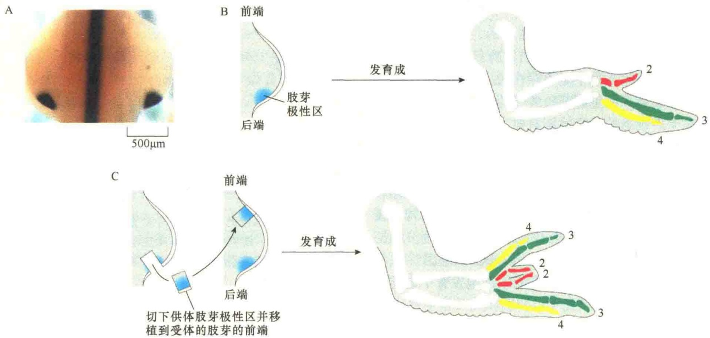
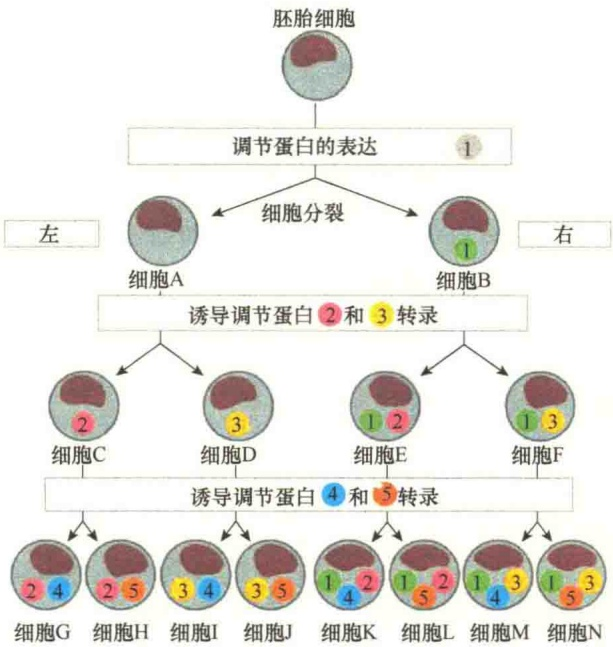
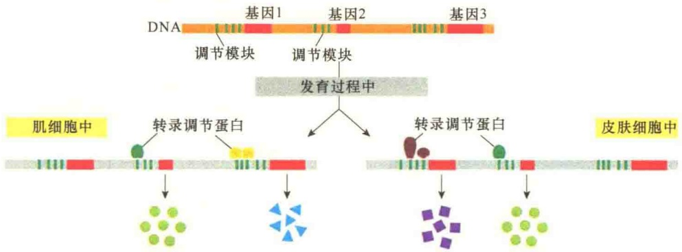
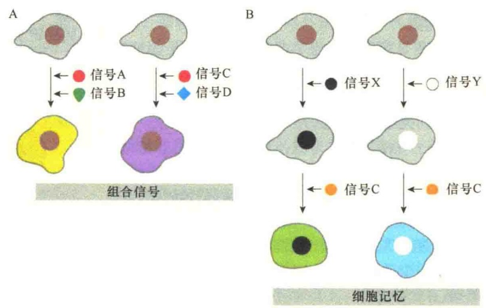
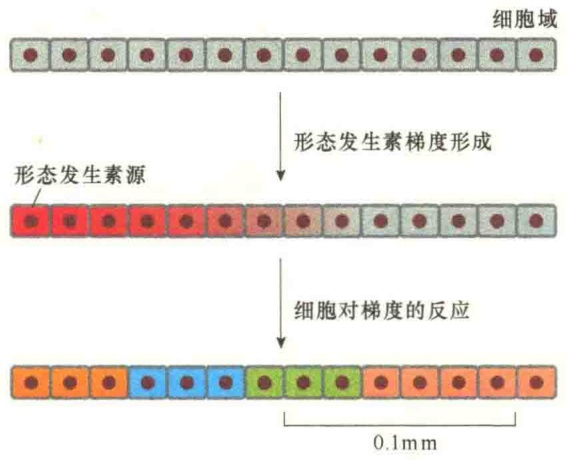
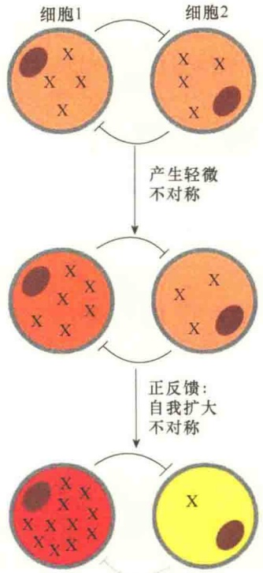
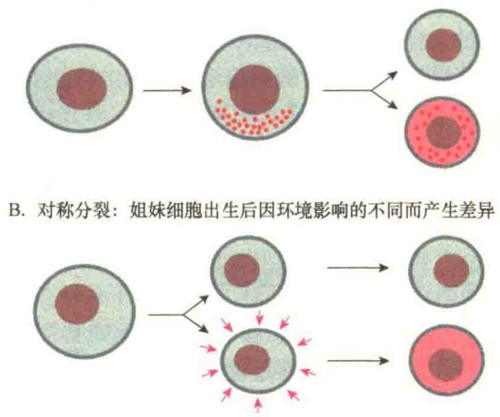

已经迁至适当位置并应该开始参与形成不同的组织和器官？

为了解决这个问题，细胞必须能够检测到自己在胚胎的哪个部位，并根据位置信息指导它们自身的分化和行为。有人提出形态发生素（morphogen）假说来解释处于胚胎不同部位的细胞在发育过程中的形态发生行为:形态发生素在胚胎的特定部位合成和分泌，然后扩散到周围组织，指导形态的发生。实际上，形态发生素假说强调的是位置信息（positional information）对形态发生的影响。科学家通过对鸡的肢芽（limb bud）发育研究，肯定了形态发生素在形态发生中的作用。

鸡胚胎的腿和翅开始是由一小团中胚层发育形成肢芽，肢芽早期为舌形突起，内部为中胚层来源的间叶组织，表面覆盖着外胚层表皮。当肢芽逐渐长长时，就会发育成适当的骨组织，并在肢芽的末端形成指。指导肢形成的形态发生素是由中胚层组织的一小块区域细胞分泌的 Shh 蛋白（Sonic hedgehog protein），该区域位于肢芽的后端附近。如果将此处的组织移植到另一个肢芽的前端，其结果会发育成正常个体的 2 倍数量的趾（图 14-10），这显然是形态发生素对发育影响的结果。

图 14-10 在鸡胚翅形成过程中后中胚层位置信息的作用（引自 Alberts et al., 2008）。A. 培育 4 天的鸡胚后端两侧的肢芽形态。B. 在正常的发育过程中，鸡翅形成 3 个趾，编号为 2、3、4，它们对应于 5 指中的 3 个。C. 如果将肢芽极性区的一片后中胚层移到另一个肢芽的前侧，则会形成两个 3 趾，且互为镜像。后来发现极性区中形态发生素是由 Sonic hedgehog 基因表达的 Shh 蛋白。

## 4.3 细胞分化的机制

前面讨论了细胞分化的一些基本规律及影响细胞分化的一些因素，但是细胞分化的本质是什么？人类基因组中起作用的基因总数有2万～2.5万个，这些基因在分化的细胞中是否都表达？如果表达有差异，那么这些差异是如何表现的？

## 14.3.1 基因表达及调控

在细胞发育过程中，细胞分化的命运受卵细胞卵裂后所获得的细胞质因子的控制，并受相邻细胞的诱导。一旦细胞发育的命运被决定，细胞如何按照决定的程序进行精确的分化？从分子水平看，分化细胞间的主要差别是合成的蛋白质种类不同，如红细胞合成血红蛋白、胰岛细胞合成胰岛素等。而蛋白质是由基因编码的，所以合成的蛋白质不同，主要是表达的基因不同。不难理解，细胞分化的分子基础在于基因表达及调控。

## 14.3.1.1 持家基因与组织特异性基因

在胚胎发生过程中，细胞分化与基因表达存在何种具体的关系还不清楚。事实上，细胞的基因并非都是与细胞分化有直接关系。根据基因与细胞分化的关系，可以将基因分为两大类。一类是持家基因（house-keeping gene），是维持细胞最低限度功能必不可少的基因，如编码组蛋白的基因、核糖体蛋白的基因、线粒体蛋白的基因、糖酵解酶的基因等。这类基因在所有类型的细胞中都进行表达，因为这些基因的产物对于维持细胞的基本结构和代谢功能是必不可少的。

另一类是组织特异性基因（tissue-specific gene），或称奢侈基因（luxury gene）。这类基因与各类细胞的特殊性有直接的关系，是在各种组织中进行不同的选择性表达的基因，如表皮的角蛋白基因、肌细胞的肌动蛋白基因和肌球蛋白基因、红细胞的血红蛋白基因等。

## 14.3.1.2 三类基因对动物细胞分化的影响

哪些基因在动物中是共享的，但与其他种属生物不共享？有些属于动物发育所需的特异性基因，在单细胞生物中是不存在的。比较动物的基因组与单细胞真核生物芽殖酵母的基因组，有三类基因对于多细胞的动物特别重要。第一类包括编码细胞-细胞黏着与通讯的基因。人有几百个编码信号蛋白、细胞表面受体、细胞黏着蛋白、离子通道蛋白的基因。第二类包括编码调节转录、染色质结构蛋白的基因。人类含有1000多个编码转录调节蛋白的基因，而酵母大约只有25个该类基因。第三类是非编码RNA，包括编码miRNA基因，人类含有500多个该类基因，它们在细胞发育中起重要作用。

## 14.3.1.3 基因差异表达

早在 1897 年，澳大利亚的科学家 Weismann 就推测:在细胞分化过程中，特化细胞只保留了与自身特定功能相关的遗传信息，其他的遗传信息被逐步破坏了。后来对这一推测进行了修改，提出分化的细胞虽然保留了全套的遗传信息，但只有某些基因得到表达。现在知道细胞分化主要是组织特异性基因中某种（或某些）特定基因选择性表达的结果，这些选择性表达的蛋白质和分化细胞的特异性状密切相关，但不是细胞基本生命活动必不可少的。研究表明，细胞分化是组织特异性基因按一定顺序表达的结果，表达的基因数占基因总数的 5%～10%。也就是说，某些特异性基因表达的结果生成一种类型的分化细胞，另一组特异性基因表达的结果导致出现另一类型的分化细胞。因此细胞分化的关键是细胞按照一定程序发生差别基因表达（differential gene expression），开放某些基因，关闭某些基因。另外，分化细胞间的差异往往是一群基因表达的差异，而不仅仅是一个基因表达的差异。在基因的差异表达中，包括结构基因和调节基因的差异表达，差异表达的结构基因受组织特异性表达的调控基因的调节（图 14-11）。

图 14-11 多基因的差别表达对发育的控制（引自 Alberts et al., 2008）。图中高度概括性显示了几个调节基因合成的调节蛋白如何调控多种类型细胞的发育，主要是通过基因的差异表达。

## 14.3.1.4 不同组织细胞内基因表达调控

在多细胞的生物中，每一个基因都含有几千个非编码的核苷酸序列，在这些序列中含有一些调节元件。这些调节元件根据其所在的细胞组织中转录调节子及基因组的结构，决定着何时、何地进行该基因的表达，以及该基因表达的强度（图 14-12）。其结果是，即使编码 DNA 没有发生变化，由于调节 DNA 发生了改变，也会改变“基因-调节”网络的逻辑关系，从而改变了发育的结果。

## 14.3.2 信号诱导作用

前面已经讨论的细胞位置效应、诱导作用都是细胞信号分子的传导作用。发育中的动物构建空间结构需要细胞按照相邻细胞发出的信号进行移动，这种信号称为诱导信号。当然，这种诱导信号受限于特定的时间与空间。有些信号依赖于细胞与细胞的接触，有些则通过扩散的信号分子进行较远距离的传导。动物发育中大多数诱导事件都是通过一套高度保守的信号途径控制的，包括转化生长因子  $\beta$ （TGF $\beta$ ）、Wnt、Hedgehog、Notch，以及受体酪氨酸激酶（RTK）途径等。

图 14-12 在发育中调节 DNA 决定了基因表达模式（引自 Alberts et al., 2015）。在肌细胞与皮肤细胞中基因组是相同的，但是这些基因的作用不同，这是因为不同组织的细胞中表达的转录调节蛋白不同，与相同基因上游不同的调节元件结合所致。例如，在皮肤细胞中两个转录调节蛋白识别基因 1 的一个转录元件，从而将其激活。然而在肌细胞中有一套不同调节蛋白与基因 3 结合并将其激活。而激活基因 2 的调节蛋白在两类细胞中都存在。

## 14.3.2.1 信号结合与细胞记忆

小分子的信号转导途径如何产生如此巨大的多样性的细胞与组织模式？有三种机制。第一，通过基因扩增（gene duplication）。一个途径中的基本成员通常由密切相关的同源基因编码，这样就产生了多样性。例如，Notch 信号途径，在一个组织中由 Notch 1 介导；而在另一个组织中，由它的同源蛋白 Notch 4 介导。第二，细胞对于一个特定信号蛋白的应答取决于细胞同时接受的另

一个信号（图 14-13A），结果是，不同信号组合产生极为不同的应答。第三，最为基础的，激活信号途径的效果依赖于应答细胞以前的经历:以前的影响留下了印记，并记录在染色质、转录调节蛋白的选择，以及细胞含有的 RNA 分子中。这种细胞记忆能够使具有不同历史的细胞对相同的信号产生不同的应答（图 14-13B）。因此，相同的几个信号途径在不同的时间里重复使用并与不同结果放在一起能够产生无限复杂的模式。

## 14.3.2.2 形态发生素浓度梯度效应

单个的分子通常只是管控“是”与“否”的选择，也就是说，它们的浓度高时是一种结果，浓度低时是另一种结果。但是，在很多情况下，应答是通过精细的梯度:当一种信号分子处于高浓度时，可以指导细胞进入一种发育途径；若是浓度处于中间值时，细胞则进入另一种途径；若是低浓度时，细胞则进入第三种发育途径。

一种信号分子产生不同浓度的一般方式是从信号源向外逐渐扩散，产生浓度梯度。离信号源不同位置的细胞按照它们各自对信号分子浓度的经历不同，具有各种不同发育行为（图 14-14）。具有这种效应的信号分子就是形态发生素。最简单的情况是一种特化的细胞群以一种稳定的速率产生一种形态发生素，然后，该形态发生素向外扩散形成梯度。形态发生素扩散的速度与半衰期决定着形态发生素扩散的范围与梯度。

图 14-13 对于相同的诱导信号产生不同应答的两种机制（引自 Alberts et al., 2015）。A. 在组合信号诱导中，一种信号的效应依赖于同时接收到的另一信号。B. 通过细胞记忆，以前的信号（或其他事件）能够留下持续的印记，这些痕迹能够对当下的信号产生影响。图中用不同颜色的细胞核表示以前的印记。

图 14-14 形态发生素的梯度形成与作用（引自 Alberts et al., 2015）。由局部细胞产生形态发生素，并扩散形成梯度。形态发生素的浓度不同诱导沿途不同细胞中不同基因的表达，导致命运的不同。通过扩散运输产生浓度梯度的距离很短，整个距离为 0.1mm 或更短。

形态发生素的梯度与半衰期可受一些因素的影响而改变，如沿途中的细胞表面受体与之扩散的形态发生素结合，并通过内吞将其降解，从而缩短了形态发生素的半衰期；或者，形态发生素与细胞外基质中的分子（如硫酸乙酰肝素蛋白聚糖）结合，也会降低其扩散速度。

## 14.3.2.3 侧抑制导致不同细胞类型的产生

形态发生素以及其他类型的诱导信号的作用使胚胎中细胞不对称性变得更加不对称与不同。问题是，如果在开始时并没有明显不对称的细胞群体中，情况又会如何？能否调节应答产生不对称性发育？

答案是肯定的。最常见的一种机制是侧抑制（lateral inhibition），它是细胞间相互作用的一种形式，这种作用迫使相邻细胞变得不同，以至于最终形成不同类型的细胞。

以一对相邻细胞为例:开始它们的形态相似，都能产生信号分子X，而且对其有一定程度的应答，并遵从一种规律，即细胞接收的信号越强，产生该信号的能力就越弱（图14-15）。如果一个细胞产生较多的X，另一个细胞则产生较少的X，这就产生了一个正反馈的环，使相邻两个细胞开始有了差别。

## 14.3.2.4 不对称分裂能够产生多样性

细胞的多样性并非总是依赖细胞环境中的信号诱导。在某些情况下，由于两个子细胞的不对称分裂从而导致差异。这种不对称分裂导致某些重要的分子或一些分布不均匀的分子不能均匀分配到两个子细胞。不对称遗传保证了两个子细胞进行差异化发育（图 14-16）。不对称分裂是早期发育的共同特点，受精卵有内部的发育模式，大细胞的卵裂将不同决定子分离到不同的母细胞。

图 14-15 通过侧抑制与正反馈产生不对称性（引自Alberts et al., 2015）。图中所示两个细胞相互作用，每个细胞都能产生作用于另一个细胞的物质 X，抑制另一个细胞产生物质 X。一个细胞提高 X 就会导致正反馈，使该细胞的 X 进一步提高，而与之相邻细胞的 X 就会下降。最终导致两个细胞发育的差异，一个被保留，另一个被淘汰。

A. 不对称分裂:姐妹细胞因不对称分裂而产生差异

图 14-16 产生姐妹细胞差异的两种方式（引自 Alberts et al., 2015）。