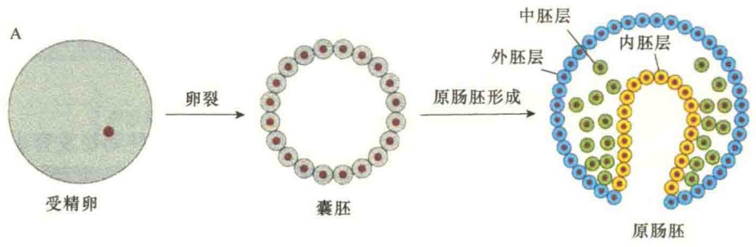
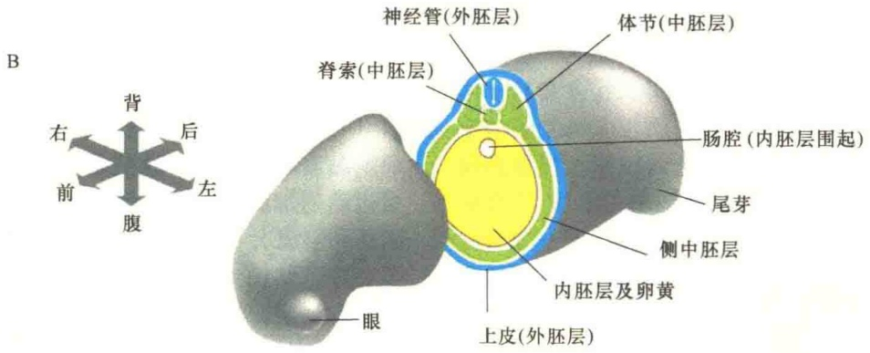
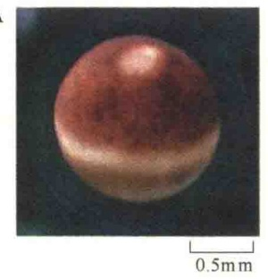
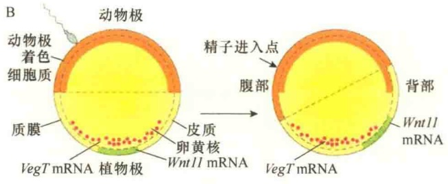
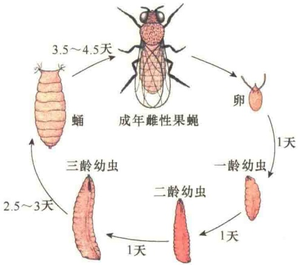
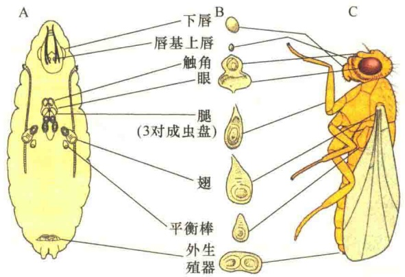
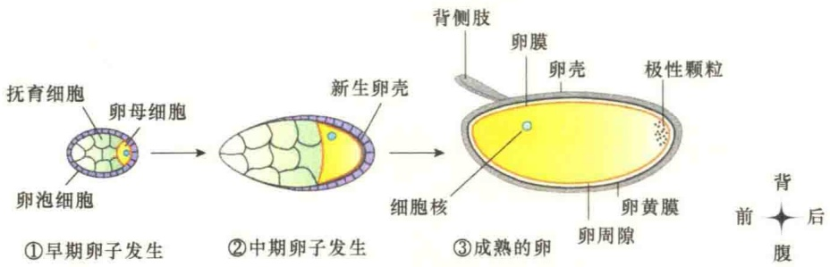
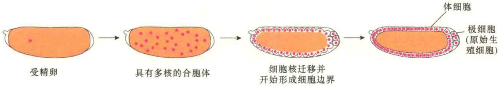

## 14.4 模式形成的机制

动物是通过食用其他的生物而生存的。因此，尽管动物是多种多样的，但在解剖学上具有生命的共同特征。上皮细胞在外面形成一个保护层，消化道从食物中吸收营养，肌细胞负责运动，神经元与感官细胞控制着动物的行为。这些不同类型的细胞组成组织与器官，形成一层皮肤覆盖在身体的外部，形成的口用于吞食食物，体内的肠道用于消化食物，在皮肤与肠道之间的空间中布满了肌肉、神经及其他的组织。很多动物具有清晰可见的轴:口与脑在前端，肛门在后端；背腹轴，即背部与腹部；还有一个左右轴。也就是说多细胞的动物在发育之初具有一个模式（pattern），相当于一个“蓝图”，然后按“蓝图”构建身体的“大厦”。

发育中多细胞的生物必须创建各种组织模式，在这些组织模式中，有些仅有少量的细胞，有些以前根本就没有细胞，需要重新转移与构建。

个体发育是一个从简单到复杂、各部分的功能逐渐限制与特化的过程。要理解个体空间模式如何形成，以及在此过程中细胞是如何做决定的，必须关注受精卵及早期胚胎的发育演变。

虽然不同种属动物在长期的进化中，为了生存的需要，形态、大小、生活习性具有极大的差别，但是，通过对一些模式生物的深入研究，从分子机制及大分子的作用模式，发现它们又是非常保守的，有着极大的相似性。对于动物发育生物学而言，非洲爪蟾（Xenopus laevis）、黑腹果蝇（Drosophila melanogaster）、秀丽隐杆线虫（Caenorhabditis elegans）、小鼠（Mus musculus）及斑马鱼（Danio rerio）都是极好的模式生物，本节讨论的内容主要来自这几种模式生物的研究。

## 14.4.1 三胚层形成与极性初级轴

令人惊奇的是，即使是属于同一个门的动物，发育的早期起始步骤也是非常不同的，如蛙、鸡及哺乳动物，即使它们后期的发育非常类似，但是它们的受精卵在大小与结构上都是完全不同的。所有的动物胚胎都会有原肠胚形成，但是在原肠胚形成过程中，时间节点、细胞移动的相关模式、胚胎的形态与大小都是非常不同的。而且，在原肠胚形成之前就能发现胚胎有了明显的极性(polarization)，极性的出现是空间模式形成的第一步。

## 14.4.1.1 三胚层形成

三胚层形成是各种动物发育中构建形体构型（body plan）的保守机制。受精后，受精卵通常要快速分裂，即卵裂，形成很多小细胞。在卵裂过程中，胚胎还没有营养，故此不能生长。在此阶段，完全由卵细胞提供预先储存的营养支持，即母体信息，包括蛋白质及一些mRNA。在母体的mRNA和蛋白质完全耗尽或降解之前，胚胎的基因组一直处于非活性状态。胚胎基因组被激活后，细胞黏着形成囊胚，囊胚是固体或是中空的、充满流动的细胞球。囊胚经过复杂的细胞重排（即原肠胚形成），然后将囊胚转化为含有内消化道的多层细胞结构（图14-17）。囊胚的某些细胞仍然保留在外层，构成了外胚层，它将产生上皮与神经系统。其他的细胞向内侵入，形成内胚层，该部分将发育成肠管以及它的附属器官，如肺、胰腺和肝。另一些细胞则转移到外胚层与内胚层之间的空间，形成中胚层，这部分细胞将发育成肌组织、结缔组织、血、肾和各种其他组织。细胞通过进一步的移动和分化，创造和界定了精细的细胞结构。

## 14.4.1.2 极性初级轴的建立

发育之初必须建立三种初级轴。第一种是动物-植物轴（animal-vegetal axis，A-V轴）。在大多数物种中，动物极通过原肠胚的移动成为内部组织，而植物极则保留在外部。第二种是前后轴（anterior-posterior axis，A-P轴），是进一步发展成头与尾的部位。第三种是背腹轴（dorsal-ventral axis，D-V轴），该部位进一步发展成背部与腹部。

一种极端的情况是，卵是球形对称的，轴仅是在胚胎发生时才出现。鼠是最为接近这种极端情况的例子。在卵中，极性的信号很模糊，相应的，经过最初几步的细胞分裂形成的卵裂球都很相像。如果早期的鼠胚分裂成两个，就会产生一对双胞胎。与此相类似的是，如果在2细胞的鼠胚中有一个细胞遭到破坏，然后将剩下的一个细胞植入代孕鼠的子宫中进行发育，在多数情况下，都能够发育成一个正常的鼠。

与此相反的另一极端情况是，卵的结构限定了未来身体的轴，多数物种都属于这种情况，包括果蝇。例如，非洲爪蟾的卵在受精之前就有了A-V轴，核靠近顶部，此处为动物极，而卵黄则位于植物极。有几种类型的 mRNA 分子位于卵植物极的细胞质中，发育过程中也在该区域翻译合成蛋白质。受精后，这些 mRNA 和蛋白质对细胞的发育就有重要影响。这些 mRNA 和蛋白质属于母体信息，在卵子发生时就保存在植物极，以备受精后激活胚胎发育之用。如编码转录调节蛋白 VegT 的 mRNA 就是一例。受精后，该 mRNA 进行翻译，合成的 VegT 蛋白激活一套编码信号蛋白的基因，这些蛋白质诱导中胚层与内胚层。

图 14-17 蛙卵发育的早期阶段（引自 Alberts et al., 2015）。A. 受精卵分裂形成三个胚层。B. 三胚层发育模式。图中显示发育模式的前后轴、背腹轴、左右轴，并标示了三个胚层未来的发育走向。

与此相反的是，非洲爪蟾胚胎的 D-V 轴是通过受精作用确定的。随着精子的进入，卵细胞质的外皮层（out cortex）向卵的中央区旋转移动，动物极向一侧稍微迁移（图 14-18）。如果人为地阻断旋转，虽然可进行正常地分裂，生成具有中部肠道的胚胎，但是没有背部结构或没有 D-V 轴。因此，皮质旋转是形成 D-V 轴所必需。

图 14-18 蛙卵及其不对称性（引自 Alberts et al., 2015）。A. 受精前的卵细胞。B. 卵细胞中分子的不对称分布，以及受精后产生的变化，包括背腹、动物-植物极的不对称性的变化。受精作用，通过微管骨架的重新识别，触发了卵皮质围绕卵的中心点旋转了约  $30^{\circ}$ ，旋转的方向取决于精子进入的位点。某些物质随着后期的运输作用沿微管被运送到背部区域。汇集于背部的 Wnt11 mRNA 在背部翻译成 Wnt11 信号蛋白，进一步确定了背-腹部的极性。位于腹部的 VegT 蛋白可作为腹部的信号源诱导内胚层与中胚层的形成。

精子的进入改变了非洲爪蟾受精卵皮层旋转的方向，原因可能与精子带入的中心粒有关，旋转涉及卵细胞质中的中心体产生的微管的重新组织。微管重新组织导致基于微管的一些物质运输，包括编码 Wnt11 蛋白的 mRNA，它是信号蛋白 Wnt 家族的一个成员，通过皮质旋转移动到背部一侧。编码

Wnt11 蛋白的 mRNA 很快进行翻译合成相应的蛋白质，合成的 Wnt11 蛋白从该区域的合成细胞中分泌出来，并激活 Wnt 信号途径。该信号转导途径的激活是触发其后的级联反应的基础，这种信号转导促进身体的前后轴的组织。

虽然不同种属的动物有不同的机制产生特异的轴，但是进化的结果是相当保守的:头与尾、背部与腹部、肠与皮肤都是明显可分的。

## 14.4.2 果蝇的发育模式

果蝇只有4对染色体，生命周期短，是细胞分化研究的重要模式动物，从黑腹果蝇（D. melanogaster）发育研究中获得的许多分子事件已经被证实普遍适用于高等动物和人类。

## 14.4.2.1 果蝇的生活史及卵母细胞的发育

果蝇的生活史（life cycle）中包括从胚胎到成体的程序化完全变态（metamorphosis）过程，整个生活周期只需要9～10天（图 14-19）。

图 14-19 黑腹果蝇的生活史（引自 Hartl，1991）。

果蝇为双翅目昆虫，躯体分节。果蝇卵的大小约为  $0.2mm \times 0.45mm$ ，由卵发育为成虫果蝇大体经过 4 个阶段:卵、幼虫、蛹和成虫。果蝇在胚胎阶段有两个最重要的特征:极性（polarity）和分节（metamerism）。果蝇的卵从卵巢中排出时，它的细胞质物质就有了明确的空间分布定位和有秩序的卵质结构，就如同动物极和植物极一样，它的前端和后端明显可分。在胚胎的后期可见到分节，每一个分节都具有不同的特征。

所谓完全变态是指昆虫发育成成虫时的形态完全不同于幼虫。在果蝇的生活史中，有两种完全不同的形态，中间被变态过程隔开。一种是类似蚯蚓状的幼虫（larva），另一种就是成虫果蝇。变态期又称为化蛹（pupation）。果蝇的受精卵在1天之内就发育成幼虫，然后经过连续的3个幼虫发育阶段（称为龄期），此过程持续4天以上。在早期胚胎建成过程中，幼虫体内会形成几十种尚未分化的细胞团，称为成虫盘（imaginal disc），变态期后不同的成虫盘可以逐渐发育为果蝇的腿、翅、触角和躯体的其他部分的结构（图14-20）。

图 14-20 果蝇成虫盘的定位和发育的命运（引自 Hartl, 1991）。A. 9 对成虫盘和一个生殖成虫盘在幼虫中的相应部位。B. 成虫盘在幼虫发育后的形态。C. 发育成熟后成虫盘的结构。

果蝇卵母细胞的发育成熟分三个阶段(图14-21)。第一阶段是卵子发生的早期，此时卵母细胞的体积与其相邻的抚育细胞的大小相似。第二阶段，抚育细胞开始合成卵母细胞成熟所必需的mRNA，卵泡细胞开始形成卵鞘（egg shell），期间，卵母细胞的体积逐渐增大。第三阶段，成熟的卵细胞被卵黄被和绒毛膜（chorion）包围，卵黄被和绒毛膜构成卵鞘。抚育细胞和卵泡细胞消失，但它们合成的mRNA分散分布在卵母细胞中。极性的颗粒结构定位于卵的后部，此区将发育成生殖细胞。成熟的卵细胞有明显的极性，即前后轴（A-P轴）、背腹轴（D-V轴）。

## 14.4.2.2 果蝇早期发育模式

通过对果蝇的研究，获得了很多关于基因对发育调控的认识。近一二十年的研究重点主要是围绕早期胚胎发育进行，通过大规模的遗传筛选、寻找影响发育模式的突变，研究结果揭示了一些与发育相关的关键基因。通过对果蝇发育的遗传学研究发现，某些发育机制在果蝇与脊椎动物之间都是保守的，有些则不同。获得的果蝇发育遗传控制的知识，有助于我们进行多细胞生物发育的理解。

果蝇早期发育的启动比较特别（图 14-22）。如同其他昆虫的卵一样（但与大多数脊椎动物不同），果蝇的卵似黄瓜状，卵裂的速度异常快，生成的子核也进行同步分裂，但不会形成核膜。在合胞体（syncytium，即卵裂的细胞），生成大量的细胞核。细胞核向皮层迁移，形成一个合胞体囊胚（syncytium blastoderm）。大约产生6000个核以后（在进行第8轮和第11轮核分裂之间），细胞质膜开始内折，将细胞核包裹成独立的细胞，同时将合胞体囊胚转变成细胞囊胚（cellular blastoderm）。此时，不同种类的细胞分裂不再同步，它们发育的命运由所分割的细胞质中的信息决定。

图 14-21 果蝇的卵子发生（引自 Lodish et al., 2008）。①早期卵子发生:初期的卵细胞的大小与其相邻的抚育细胞相似，外面被一层卵泡细胞包围着，抚育细胞开始合成卵细胞成熟必需的 mRNA 与蛋白质，卵泡细胞开始形成卵鞘。②中期卵子发生:卵细胞体积持续增大。③成熟的卵:完全被卵鞘包裹，虽然抚育细胞已经消失，但由抚育细胞合成的 mRNA 等早已转运到卵细胞质。极性颗粒位于卵细胞后端，细胞质物质呈现不对称分布。

图 14-22 果蝇卵从受精到细胞囊胚阶段的发育（引自 Alberts et al., 2015）。受精卵中有一个细胞核；核分裂形成多核的合胞体；一些核移向四周，在后端，与生殖相关的极细胞（pole cell）已经浮现；合胞体囊胚中继续进行核分裂；质膜内陷包围单个细胞核，生成细胞囊胚。

果蝇合胞体阶段的发育模式依赖于分散在细胞中的信号，这些信号激活了使细胞核快速分离的基因，使细胞核被分配到单个的细胞前快速分裂。起始阶段的信号通讯不同于通常的细胞-细胞间的信号通讯，而是合胞体囊胚内相邻区域间通过转录调节蛋白的快速移动进行的通讯。

## 14.4.2.3 卵-极性基因对果蝇早期胚胎轴的调控

与大多数昆虫一样，果蝇发育的体轴在受精前就已经确定了。通过对影响果蝇早期发育突变的系统分析发现了卵-极性基因（egg-polarity gene），它们调节体轴的决定。根据它们的作用，将卵-极性基因分为4群，每一群在胚胎发育过程中控制不同区域的分化:①前部基因群（anterior-group gene），它们控制头和胸的发育；②后部基因群（posterior-group gene），控制腹节（abdominal segment）的发育；③端部基因群（terminal-group gene），调节最前部和最尾部区的发育；④背部基因群（dorsoventral-group gene），调控背部轴的发育。

在成熟的未受精的卵细胞中，卵-极性基因转录的 mRNA 和蛋白质通过建立不同的浓度梯度，帮助卵细胞建立前后轴和背腹轴，即卵-极性基因的产物沿着体轴呈浓度梯度分布。某些卵-极性基因合成的蛋白质通过扩散在细胞质中形成不对称分布，使得囊胚中的不同细胞带有不同量的卵-极性基因的蛋白质，造成分化的差异。母体 mRNA 的产物包括转录激活子（transcriptional activator）、转录抑制子（transcriptional repressor）及翻译抑制子（translational repressor），它们调节不同发育模式，构建不同的组织。

通过突变，研究了这些基因在胚胎发育模式形成中的作用。有一类突变破坏了胚胎的前后轴，此种突变与卵-极性基因有关。响应组织胚胎前端信号的卵-极性基因称为bicoid（bcd）。在受精之前，bicoid mRNA分子已经预先储存在卵的前端区域，一经受精，bicoid mRNA很快翻译成Bicoid蛋白。Bicoid蛋白是主要的前部形态发生素（anterior morphogen），并且在合胞体囊胚中扩散呈梯度分布，头部的浓度最高（图14-23）。沿A-P轴产生的不同浓度的Bicoid蛋白通过调节合胞体囊胚细