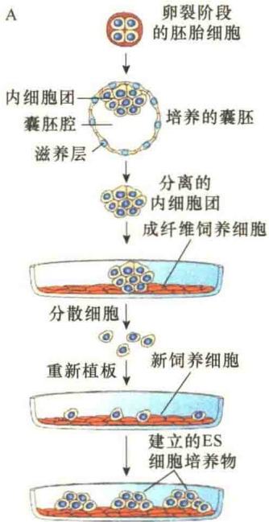
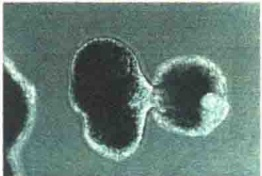
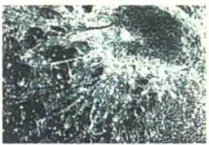
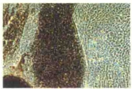
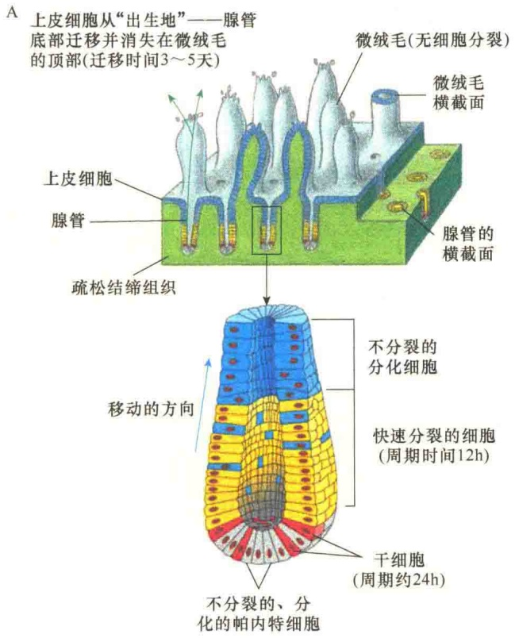
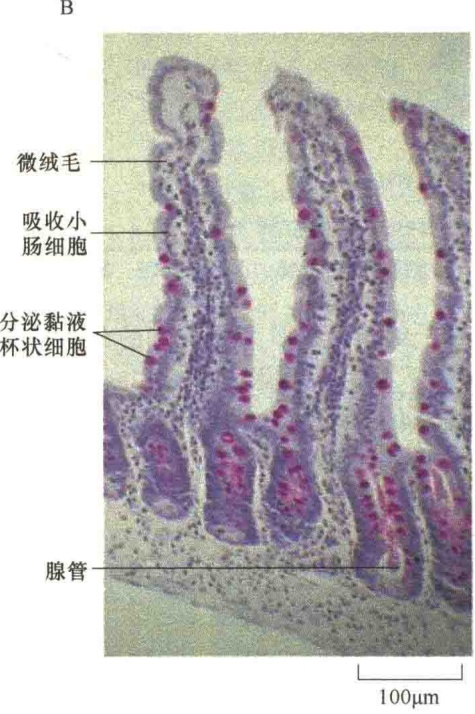
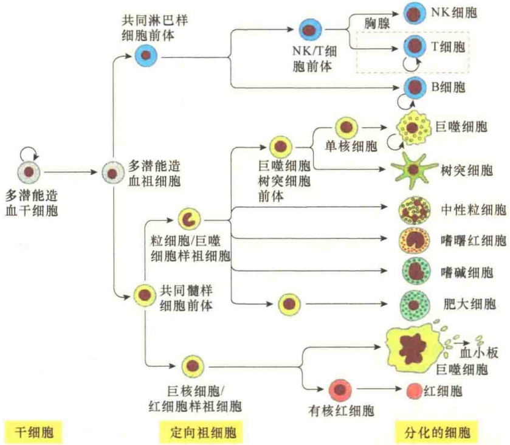

和单能干细胞（unipotent stem cell）。

胚胎干细胞是全能的，是分化和增殖构成动物发育的基础，即由单个受精卵发育成为具有各种组织器官的个体。成体干细胞的进一步分化则是成年动物体内组织和器官修复再生的基础:因为在细胞分化的过程中，细胞逐渐失去可塑性而发育成为高度分化的细胞，此时不仅丧失了其继续分化的能力，而且也失去再分裂的能力，最终衰老死亡；此外，机体内的许多细胞的寿命很短，需要不断被相应的新细胞替换。成体产生新的分化细胞有两种方式:①已分化细胞的分裂产生新细胞；②由未分化的干细胞产生新的分化细胞。

成体干细胞是一类成熟较慢但能自我维持增殖的未彻底分化的细胞，这种细胞存在于各种组织的特定位置上，一旦需要，这些细胞便可按发育途径，先进行细胞分裂，然后经过分化产生出另外一群具有有限分裂能力的细胞群。

多能干细胞具有分化出多种组织细胞的潜能，但失去了发育成完整个体的能力，发育潜能受到一定的限制。骨髓多能造血干细胞是典型的例子，它可分化出至少12种血细胞，但不能分化出造血系统以外的其他细胞。

单能干细胞也称专能、偏能干细胞，这类干细胞只能向一种类型或密切相关的两种类型的细胞分化，如上皮组织基底层的干细胞、肌肉中的成肌细胞等。

因此，从分化潜能来看，不同层级的干细胞发育的潜能是不同的，胚胎干细胞是最高层级的干细胞；潜能最大，单能干细胞潜能最低。

## 14.5.1.3 干细胞的特点

干细胞具有几个显著的特点:①干细胞本身不是终末分化细胞（即干细胞不是处于分化途径的终端）；②干细胞能无限地分裂；③干细胞分裂产生的子细胞只能在两种途径中选择其一，或保持亲代特征，仍作为干细胞，或不可逆地向终末分化。从功能上来讲，干细胞不是执行已分化细胞的功能，而是产生具有分化功能的细胞。

干细胞有时可以根据其形态学特征和存在位置来辨认。例如，在果蝇的性腺和外周神经系统，干细胞与其外周的分化细胞有固定的组织方式，形成增殖结构单元。但对许多组织而言，干细胞的存在部位目前仍未确定，也没有与分化细胞截然不同的形态学特征。不同的干细胞具有各自特异的生化标志，这对于确定干细胞位置、寻找和分离干细胞有重要意义。例如，角蛋白15是确定毛囊中表皮干细胞的分子标志，巢蛋白为神经干细胞（neural stem cell, NSC）的标记分子，等等。然而，干细胞生存的微环境可以影响其形态和生化特征，因此不能仅根据细胞的形态和生化特征来寻找干细胞。具有增殖和自我更新能力、在适当条件下表现出一定的分化潜能是干细胞最基本的特点。

## 14.5.2 胚胎干细胞

胚胎干细胞（ES 细胞）是一种经人工操作能够发育成一个新个体的全能性二倍体细胞。它是从早期胚胎内细胞团（inner cell mass，ICM）或原始胚胎生殖细胞（embryonic germ cell，EG cell）经体外分化抑制培养分离克隆的，二者的形态、标志、体内分化潜能及种系传递功能都相似。

## 14.5.2.1 胚胎干细胞的主要特性

ES 细胞有两个主要特性。第一，ES 细胞在不同条件下具有不同的功能状态，它是饲养层（feeder layer）细胞依赖的。在有抑制因子存在的限制培养基中，它呈未分化状态生长；在无抑制因子存在的培养基中，分化成各种细胞；在悬浮培养时，可形成胚状体（embryoid body，EB）。

第二，ES 细胞具有发育分化成各种类型细胞的多潜能性，此种特性既可在体内发育，也可在体外诱导。体外与体内分化途径和机制在分子水平上有许多相似之处，而且体外研究更具有优越性:①避免各种内源性因素干扰；②ES 细胞始终保持存活、增殖和分化潜能，而在体内研究则存在胎死宫内、可能流产等风险，使研究半途而废；③可制备成各种模型更直观明了，而且可研究分化过程中一些重要的细胞生物学问题。

图 14-31 是人的 ES 细胞的体外培养基诱导分化成不同类型细胞的基本过程。

## 14.5.2.2 胚胎干细胞的应用

ES 细胞一经问世，就因其区别于其他培养细胞的生物学特征，而引起生物工程领域研究人员的关注，在开展 ES 细胞建系和定向分化研究的同时，以 ES 细胞为材料进行广泛应用的尝试。

1）作为生产克隆动物的高效材料 ES 细胞可以无限传代和增殖而不失去其基因型和表现型，以其作为核供体进行核移植后在短期内可获得大量基因型和表现型完全相同的个体。胚胎干细胞与胚胎嵌合生产克隆动物可解决哺乳动物远缘杂交的困难。另外，由于体细胞克隆动物存在成功率低、早衰、易缺陷、易突变等问题，使 ES 细胞的克隆研究显得十分重要。

B

图 14-31 ES 细胞的培养与分化（引自 Lodish et al., 2008）。A. 将从通过体外受精获得的、处于卵裂阶段人囊胚的胚胎干细胞置于饲养细胞（feeder cell）——成纤维细胞上培养，建立 ES 细胞培养物，饲养细胞起看护作用。B. 将建立的 ES 细胞培养物悬浮培养在培养液中，人的 ES 细胞能够分化成多细胞的胚状体；将胚状体转移到固体培养基培养，可进一步分化成含有多种类型细胞（包括神经元、上皮细胞）的培养物，布满在固体培养基的表面。

2）发育生物学研究的理想体外模型 通过比较 ES 细胞不同发育阶段基因转录和表达，可确定胚胎发育及细胞分化的分子机制，并发现新基因。

3）新型药物的发现与筛选 利用 ES 细胞体外分化的细胞组织检验筛选新药，可大大减少实验动物及人群数量。

4）加快组织工程发展 组织工程（histological engineering）是生物学和工程学相结合的一项技术，人工培育供移植用的人类或动物细胞、组织或器官，即将种子细胞人工培养生长在支架（生物降解聚合物）上，培育出一定的组织或器官，这些组织或器官可移植给患者，达到临床治疗的目的（克隆治疗）。用ES细胞定向分化作为种子细胞，较以往用人或动物的组织细胞作种子细胞优越，具有数量大，生长快，取材容易等优点。

虽然 ES 细胞的应用前景很大，但由于胚胎干细胞的分化潜能也很大，存在伦理问题，因此各国对胚胎干细胞的使用都有严格的限制。

## 14.5.3 成体干细胞与组织更新

在成体组织或器官中，许多细胞仍具有自我更新及分化产生不同组织细胞的能力，如血细胞和皮肤细胞；此外在损伤情况下，肝等组织也表现出明显的补充损伤死亡细胞的能力，因此推测在成体中干细胞的存在主要是参与机体的组织更新，维持正常功能。例如，上皮组织、血细胞等都是需要持续不断更新的。

当然，也有某些组织缺少干细胞，这些组织是不会更新的。例如，在哺乳动物中，至少听觉上皮、视网膜上皮缺少干细胞。这些组织的感受器细胞——耳中的感觉毛细胞、视网膜的光受体等是不可以被替换的，因此，当这些细胞受剧烈噪声、激光照射，或随着年龄因素受到破坏，则是永久性的功能丧失。

## 14.5.3.1 干细胞与上皮组织的更新

在动物的所有组织中，肠皮层细胞的更新速度是最快的。小肠的上皮是单层的，其厚度仅有一层细胞。上皮覆盖在微绒毛的表面，而微绒毛伸向肠管的腔。上皮是腺管的皮层，而腺管向下插入到结缔组织（图 14-32）。腺管中的干细胞具有分裂能力，而分化的细胞是不能分裂的，不过腺管中的细胞是流动的，微绒毛顶端分化的细胞不断死亡，通过干细胞的分裂维持着细胞数量的恒定。

在腺管中主要有 4 种不分裂的终端分化细胞:1 种是吸收细胞，3 种是分泌细胞。

（1）吸收细胞（absorptive cell）。吸收细胞又称刷状缘细胞或内吞细胞。此类细胞密集包裹在微绒毛的表面，它们的作用是从消化腔中吸收营养，其顶端也能产生一些消化酶对细胞外基质中的一些物质进行消化。吸收细胞是上皮中主要类型的细胞。

（2）杯状细胞（goblet cell）。该细胞主要是分泌黏液到消化腔中，在上皮形成一个保护层。

（3）帕内特细胞（Paneth cell）。具有天然免疫作用。

（4）肠内分泌细胞（enteroendocrine cell）。此类细胞大约有15种不同的亚型，分泌血清素（serotonin）与肽激素，这些激素作用于肠壁中的神经元及其他类型的细胞，调节肠及其他组织细胞的生长、增殖与消化活性。

吸收细胞、杯状细胞、肠内分泌细胞三类不分裂的分化细胞位于同一条传送带上，同时从它们在腺管诞生的位置沿微绒毛上皮向前滑动。经过3～5天（如小鼠），这些细胞出现在腺管之后，很快到达微绒毛的顶端，在那里它们经过程序性死亡，并最终被“扔进”消化道。

腺管中的帕内特细胞的数量较少，并且有不同的迁移模式。它们生活在腺管的底部（图 14-32A），也会被持续地替换，只不过被替换的速度较慢，大约要经过几周（小鼠），最后经过程序性死亡，并被相邻的吞噬细胞所吞噬。

由于上述的 4 类细胞都是终端分化的、不分裂的细胞，它们数量的消减需要腺管底部干细胞的分裂与分化进行补充。

图 14-32 小肠皮层细胞的更新（引自 Alberts et al., 2015）。

## 14.5.3.2 造血干细胞

血液含有多种类型的细胞，功能也十分广泛，包括氧的输送到产生抗体。有些血细胞的工作场所就在血管内，而有些血细胞则借助于血管的运输作用到其他部位行使功能。但是，所有类型的血细胞在其生活史中都有一定的相似性。它们的生命跨度都有限，都是由共同的干细胞所产生，并且都是定位于骨髓中（人类）。造血干细胞（hematopoietic stem cell，HSC）是多潜能的，能够产生所有类型的终端分化的血细胞，以及某些其他类型的细胞，如骨中的破骨细胞。造血干细胞是哺乳动物体内最为复杂的干细胞系统，在医疗上具有极其重要的作用。

血细胞可以分成红细胞或白细胞。红细胞（red blood cell, erythrocyte）在血管中负责  $O_{2}$  及与血红蛋白结合在一起的  $CO_{2}$  的运输。白细胞（white blood cell, leukocyte）主要功能是抗感染，或是在某些情况下，能够吞噬及消化一些碎片。与红细胞不同的是，白细胞能够穿过血管的壁，到达其执行任务的场所履行任务。

白细胞分成三大类:粒细胞（granulocyte）、单核细胞（monocyte）、淋巴细胞（lymphocyte）。表 14-2 列出了各类血细胞及其相应的功能。

骨髓中含有多潜能的造血干细胞，能够产生所有类型的血细胞（图 14-33）。

## 14.5.3.3 其他组织的干细胞

肌干细胞可发育分化为成肌细胞（myoblast），后者可互相融合成为多核的肌纤维，形成骨骼肌最基本的结构。

表 14-2 血细胞的类型及其功能

| 细胞类型 | 主要功能 | 人血液中的浓度/(个/L) |
| --- | --- | --- |
| 红细胞 | 运输$O_{2}$及$CO_{2}$ | $5 \times 10^{12}$ |
| 白细胞 |  |  |
| 粒细胞 |  |  |
| 中性粒细胞 | 吞噬与消化入侵的细菌 | $5 \times 10^{9}$ |
| 嗜酸性粒细胞 | 破坏大的寄生虫,炎性反应 | $2 \times 10^{8}$ |
| 嗜碱性粒细胞 | 在某些免疫反应中释放组胺(有时释放血清紧张素) | $4 \times 10^{7}$ |
| 单核细胞 | 发育成巨噬细胞,能够吞噬、消化入侵的微生物及外源体,以及损伤衰老细胞 | $4 \times 10^{8}$ |
| 淋巴细胞 |  |  |
| B 细胞 | 制造抗体 | $2 \times 10^{9}$ |
| T 细胞 | 杀死病毒感染的细胞,调节其他白细胞的活性 | $1 \times 10^{8}$ |
| 中性杀手细胞 | 杀死病毒感染的细胞及某些癌细胞 | $1 \times 10^{8}$ |
| 血小板(骨髓中由巨噬细胞产生的细胞碎片) | 起始血凝集 | $3 \times 10^{11}$ |

注:人体大约含有5L的血，占体重的7%。其中红细胞占45%，白细胞占1%，其余是液态的血浆。

成骨干细胞似乎具有更良好的分化潜能，它不仅可发育为成骨细胞（osteoblast）和成软骨细胞（chondroblast），也能分化为成脂肪细胞（lipoblast）、成肌细胞和成纤维细胞（fibroblast）等。从理论上讲，成骨干细胞可再生骨、软骨、肌肉、肌腱、韧带和脂肪等多种组织，因而在生物材料学和整形外科学等领域占有重要的位置。

## 14.5.3.4 分生组织是植物干细胞的生态位

植物如同多细胞的动物，所有的组织与器官都是依赖于一小群干细胞分化而来。如同动物干细胞，植物干细胞同样具有自我更新，以及通过产生的子细胞分化成组织的能力。与动物干细胞一样，植物干细胞存在于一个特别的微环境——干细胞生态位（niche），生态位中的干细胞由细胞外产生的信号使其保持多潜能的状态。植物干细胞的生态位所在的组织叫分生组织（meristem），分生组织在长寿物种中可持续几千年。植物的体轴在胚胎建成期间形成两个初级分生组织:芽顶端分生组织与根顶端分生组织。与动物细胞发育不同，在植物胚胎发育中很少会形成特异性的组织与器官，代之的是植物器官（如花、叶，包括生殖细胞）随植物的生长与发育持续产生。植物的地上部分来自芽

图 14-33 造血干细胞的潜能（引自 Alberts et al., 2015）。多潜能的造血干细胞分裂时能够自我更新，保留一个干细胞，另一个成为有多潜能的祖细胞（progenitor cell），祖细胞分裂产生具有一定特异性的祖细胞，并进一步分化成特异的血细胞。在成年的哺乳动物中，除了 T 淋巴细胞外，都是在骨髓中发育成熟的。T 淋巴细胞在胸腺、破骨细胞、巨噬细胞中发育成熟。某些树突细胞也来自单核细胞。