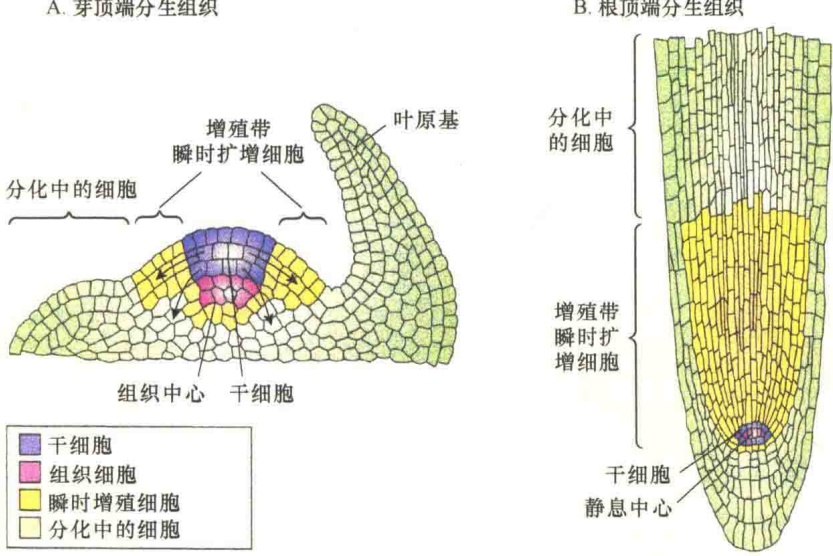
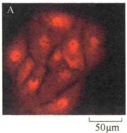
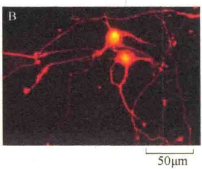
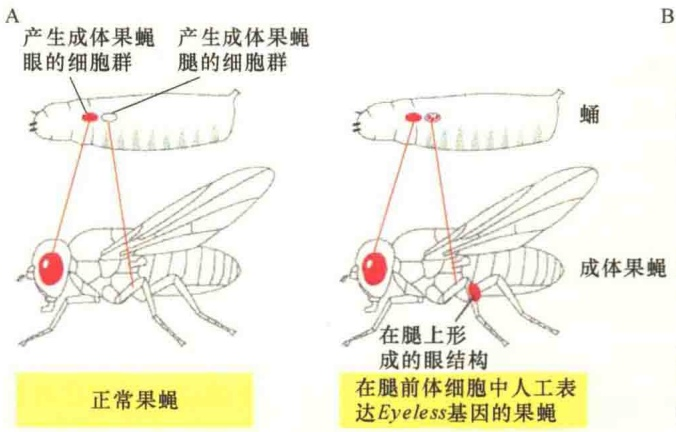
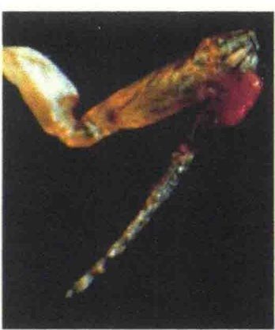
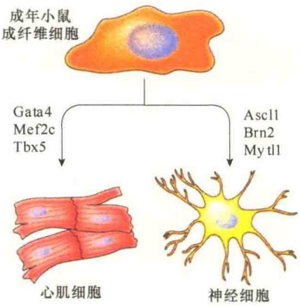
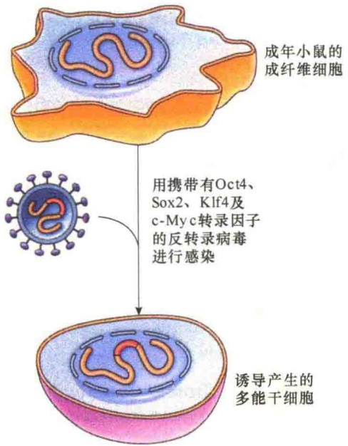
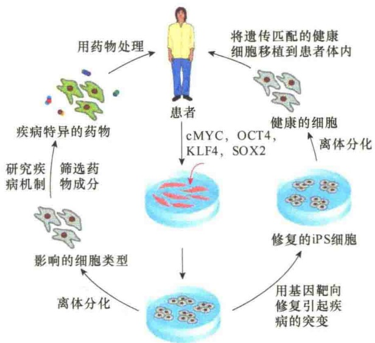

A. 芽顶端分生组织

B. 根顶端分生组织

图 14-34 拟南芥芽与根分生组织结构（引自 Lodish et al., 2015）。A. 芽顶端分生组织横切面。B. 根顶端分生组织横切面。

## 14.5.4.1 iPS产生的原理

细胞发育调控的关键因素是基因表达的调控。组织特异性是由不同的基因组合表达的调控结果，如在肝组织中，与肝细胞的生存相关的功能基因进行表达，而其他无关的基因则被关闭。不过，有一点是非常重要的，尽管细胞经过分化成特异组织功能的细胞，但其从原始受精细胞带来的基因组仍是全套的，所以细胞发育，仅是将不相干的基因沉默了，但并没有丢失，这就为细胞“返老还童”保留了机会。

从基因调控机制来说是多层次的，既有转录前调控又有转

顶端分生组织，地下部分来自根顶端分生组织。

与后生动物成体干细胞不同，植物成体干细胞能够生成完整的器官而不是特异的组织或谱系。缓慢分裂的多能干细胞位于芽分生组织的顶部，而快速分裂的多能性瞬时扩增的子细胞位于外周。芽干细胞的子代分散在分生组织的外周，并聚集形成新器官（包括叶与茎）的原基。当细胞需要分化成特异的细胞类型时，这些细胞将停止分裂。大多数器官都是通过细胞的膨大及伸长进行生长（图14-34A）。在叶原基的轴中会形成新的芽干细胞生态位，然后长成侧枝。花的分生组织产生4个花器官:萼片、雄蕊、心皮及花瓣。与芽顶端分生组织不同，花分生组织随着花器官的形成逐渐消失。

## 14.5.4 体细胞的重编程与诱导多能干细胞

从上面的讨论中看出，胚胎干细胞具有全能的发育潜能，在临床中具有很好的应用前景，但是涉及诸多伦理问题无法解决。研究者想通过用成年体细胞的核进行移植来获得胚胎干细胞衍生物，并具有发育成组织与器官的潜能，不仅技术难度大，同样有伦理问题。

将体细胞重编程为多潜能的干细胞终于在2006年有了突破。日本科学家Kazutoshi Takahashi和中山伸弥（Shinya Yamanaka）发现小鼠的成纤维细胞能够重编程为与胚胎干细胞类似的细胞，这种细胞被称为诱导多能干细胞（induced pluripotent stem cell, iPS）。

录后调控。很早以前研究人员就发现转录调节子（transcriptional regulator）对基因的表达至关重要。虽然不同基因组合表达决定细胞发育的特异性，但进一步研究发现，不同的转录调节子的组合同样影响细胞发育类型的特异性（图 14-35）。

图 14-35 一套转录调节因子组合对分化细胞类型的改变（引自 Alberts et al., 2015）。在本实验中，培养的肝细胞（A）在人工表达三种神经特异性转录调节因子的作用下转化为神经细胞（B）。这两种细胞都表达一种人工的红色荧光蛋白，这种蛋白质可以用来对它们进行可视化观察。这种细胞类型的转换涉及多种神经特异性基因的激活，以及多种肝特异性基因的抑制。

更为特殊的例子是在果蝇发育的早期，人为地将转录调节蛋白Eyeless基因导入正常发育成腿的细胞群中，其结果是，由于这种转录调节蛋白基因的不正常表达，使得果蝇的腿部长出了眼样（eye-like）的结构（图14-36）。

以上的例子都说明，在细胞发育与分化的过程中，转录调节蛋白及其不同组合可以改变细胞分化的特异性。

图 14-36 果蝇 Eyeless 基因在腿的前体细胞中的表达（引自 Alberts et al., 2015）。果蝇 Eyeless 基因在腿的前体细胞中的表达，触发了果蝇的腿部发育了一个眼样结构。A. 实验及结果示意图。B. 长有眼样结构的果蝇腿部照片。

## 14.5.4.2 体细胞通过重编程进行转分化

通过离体实验，转录调节蛋白能够诱导分化的体细胞通过重编程转变成其他类型的细胞，也就是让终端分化的细胞进行转分化（transdifferentiation）生成其他类型的细胞。

转分化的概念最早是在 1987 年提出并被实验所证实。Harold Weintraub 和他的同事将编码转录调节蛋白 MyoD 的基因人工导入培养的皮肤结缔组织的成纤维细胞中，成纤维细胞成功地转变成肌样（muscle-like）细胞。

根据单个转录调节子及3～4个不同转录因子组合都能成功诱导分化细胞重编程，科学家研究了通过转录因子的不同组合诱导成纤维细胞转分化成其他各种类型细胞的技术方法，取得了一系列的成功。特别是通过3个不同转录因子的组合，成功诱导小鼠的成纤维细胞转分化成心肌细胞与神经细胞（图14-37）。

## 14.5.4.3 诱导多能干细胞的制备

既然将编码转录调节蛋白 MyoD 的基因人工导入成纤维细胞中能够将成纤维细胞转变成肌样细胞，同样的技术能否将成年的体细胞转变成 ES 细胞？为了解决这一问题，研究人员挑选了 24 个候选的 ES 关键基因，将这些基因以不同的组合方式，通过反转录病毒载体转入成纤维细胞，几经挫折，在 2006 年取得了突破（图 14-38）。

实验结果表明，仅是 Oct4、Sox2、Klf4、c-Myc 这 4 个关键转录因子就足以启动小鼠的体细胞重编程生成 iPS 干细胞。后续的研究表明 iPS 干细胞像 ES 干细胞一样，能够分化成所有类型的细胞。更重要的是，后续研究也证明，成年人的成纤维细胞也能通过相同的技术重编程生成iPS。

图 14-37 小鼠成纤维细胞转分化成心肌细胞与神经细胞（引自 Cooper and Hausman，2013）。小鼠成纤维细胞在转录因子 Gata4/Mef2c/Tbx5 的诱导下转分化成心肌细胞；而在转录因子 Acs11/Brn2/Mytl1 的诱导下转分化成神经细胞。

## 14.5.4.4 ES与iPS在临床上的应用

利用 ES 与 iPS 细胞，以及通过细胞转分化技术获得的人工细胞在药物开发和临床组织修复中有广阔的应用前景。看起来，似乎任何组织都可以通过转分化的细胞进行替换。此方面的研究广泛而迅速，但是仍有不少难题需要解决。

随着 iPS 及直接转分化细胞的出现，有一个障碍至少在原理上被跨越了，即免疫排斥。由于 ES 细胞是早期胚胎产生的，并且是由没有任何关系的供体产生的，所以在遗传上与接受移植的患者的细胞是不同的，因此移植的细胞及其产生的子代易于被免疫系统所排斥。与此不同的是，iPS 及转分化细胞是从患者自身组织产生的，所以，移植回相同的个体后就会避免免疫系统的攻击。

图14-38 诱导多能干细胞的生成（引自Cooper and Hausman, 2013）。用携带有4个转录因子（Oct4、Sox2、Klf4、c-Myc）的反转录载体的病毒感染培养的成年小鼠成纤维细胞，成功地将成纤维细胞转变成具有多潜能的干细胞。

ES、iPS、转分化细胞除了通过移植进行组织修复外，还有其他一些重要用途，特别是可将任何类型的细胞培养形成大的、同源特化的细胞群。这些细胞群可用来研究疾病的机制，以及研究开发作用于特殊细胞类型的药物（图 14-39）。

举例来说，1989年美国犹他州大学Timothy教授首先报道一例患儿有心电图QT延长，心律失常，并有并指/趾等先天性遗传性异常，随后归为长QT综合征8型，属于一种遗传性L型 $\mathrm{Ca^{2+}}$ 通道病，命名为Timothy综合征。

为了研究该病的病理，研究者从患有该病的患者身上获取了皮肤成纤维细胞，并诱导成纤维细胞产生了iPS，最后将iPS诱导分化成心肌细胞。在此过程中，同时从正常人身上获取皮肤成纤维细胞并将iPS诱导成心肌细胞。比较两类心肌细胞发现，患者肌收缩没有规律，并且 $Ca^{2+}$ 的流入及电活性异常，获得了较为详细的数据，这种简便准确的分析，为开发治疗心律不齐的药物提供了可靠的依据。

## 细胞发育研究的科学进展

“单细胞发育”（development cell by cell）的研究技术是2018年Science杂志评出的十大科学突破之首的创新性技术。具体而言，这一技术可分为“三部曲”:首先，从生物体中分离出数千图 14-39 iPS 用于药物开发及遗传病的分析与治疗（引自 Alberts et al., 2015）。图的左侧显示的是如何从遗传病患者的细胞获得 iPS 分化的细胞用于遗传病发病机制分析及药物开发。右侧显示的是遗传缺陷在 iPS 中是如何修复的，然后用适当的方法诱导 iPS 分化健康的细胞，再将分化的细胞移植到遗传病患者的体内，这种移植不会被免疫排斥。

患者特异的iPS细胞

个完整的细胞；其次，对每个细胞的遗传物质进行有效的测序；最后，利用计算机或细胞标记工具，重建这些细胞的时间与空间关系。通过这一系列技术，科学家描绘出胚胎发育的惊人细节，以前所未有的清晰度，观察到单个细胞的发育过程。这项技术开创了新的细胞革命。

虽然我们根据已有的知识对细胞的发育与分化进行了介绍与讨论，但是一个受精卵究竟是如何产生构成完整身体的多种细胞类型、组织和器官的，仍然有许多不解之谜。

2018年4月26日，Science杂志同时发表了来自哈佛大学、Broad研究所等机构的三篇研究论文，报道了研究人员用单细胞测序技术分别在斑马鱼和蛙早期胚胎发育过程中建立了基因表达动态图谱，将相关数据以几分钟到几小时的时间间隔组合在一起，对细胞进行逐个描述，并观察胚胎最终形成的过程，从而建立起完整的路线图，揭示了单个细胞构建整个生物体的完整过程。

在斑马鱼的研究中，哈佛医学院系统生物学系的 Klein 和 Megason 分析了约 92 000 个斑马鱼细胞，收集了来自 7 个不同胚胎阶段的 mRNA 数据。研究小组从发育了 4h 的胚胎开始调查，在受精后 24h（这是基本器官开始出现的时间点）结束。每个细胞的基因活动模式表明了它的发展方向，并最终揭示了它的身份。

在另一项由 Kirschner 和 Klein 带领的关于非洲爪蟾的研究中，研究人员对受精后 5～22h 的 10 个胚胎期中 136 977 个细胞进行了单细胞 RNA 测序。基因表达数据显示，即使蛙胚胎看起来是未分化的一团，其细胞也开始呈现其最终特征，如尾巴。

而当 Klein、Kirschner 和 Megason 一同比较蛙和斑马鱼的结果时，惊奇地发现了一些差异。例如，某些细胞类型的发育途径因物种而异。尽管关键转录因子基因的活性在普通细胞类型中是相似的，但是在某些细胞类型中，其他基因的表达活性在两个物种之间的差异超出了研究人员的预期。

在第3篇论文中，哈佛大学的发育生物学家Alexander Schier开发了自己的计算方法，以追踪成熟斑马鱼中的细胞。在研究小组对胚胎早期生长阶段的细胞进行取样（在胚胎发育最初的9h中，每45min取一次样），以及对这些细胞的 mRNA 进行测序后，软件能够通过提取完全分化的细胞的基因活性并分析在次老胚胎（next-oldest embryo）中哪些细胞具有最相似的基因活动特征谱来重建每个细胞的发育史。最终，Schier 等证实，最初的单细胞胚胎（initial one-celled embryo）能够产生 25 种主要的细胞类型。他们的研究结果有了一些意外的发现。例如，发育生物学家曾经认为，一旦一个细胞开始沿着一个方向发展（如发育成一个肌肉细胞），那它就不会“偏离”这个方向。然而，他们的新研究发现，一些斑马鱼细胞会在“半路”转向另一个发展方向（即发育成不同的细胞类型）。

美国华盛顿大学的发育生物学家 David Kimelman 评价说，这些最新的研究结果称得上是“力作”，是“理解发育生物学基本问题的重大成果”。

## 本章小结

动物和植物的雌配子通常称为卵子，而将雄配子称为精子。配子形成的过程称为配子发生。在配子发生过程中，二倍体的原始生殖细胞要通过减数分裂和分化才能转化成单倍体的卵子或精子。

在大多数动物中，卵子形成（即卵子发生）发生在卵巢，并且有一个增殖期。雄性的精子发生与卵子发生过程有很大的不同，它是在睾丸中通过精子发生过程产生的。

精子与卵子的融合，即受精作用。受精作用涉及的反应包括:顶体反应、皮质反应、原核融合等。

从受精卵形成胚胎，再由胚胎生长发育成个体的过程称为个体发育。从形态上看，个体发育过程经历生长、分化和形态发生。在个体发育中，细胞的后代在形态、结构和功能上发生差异的过程称为细胞分化。发育分化先后涉及4种不同的细胞运动:细胞增殖、细胞间的相互作用、细胞分化、细胞运动。

细胞分化是胚胎细胞分裂后未定形的细胞在形态和生化组成上向专一性或特异性方向发展，或由原来较简单且具有可塑性的状态向异样化稳定状态发展的过程。细胞分化时的主要特征是细胞出现不同的形态结构和合成组织特异性蛋白质，演变成特定表型的细胞类型。其结果是:在空间上细胞之间出现差异；在时间上同一细胞和它以前的状态有所不同，从本质上说，细胞分化是从化学分化到形态、功能分化的过程。

从分子水平看，分化细胞间的主要差别是合成蛋白质种类的不同，即表达的基因不同，细胞分化的分子基础在于基因表达的控制。

果蝇只有 4 对染色体, 生命周期短, 是细胞分化研究的重要模式动物。通过对果蝇的研究, 获得了很多关于基因对发育调控的认知。

干细胞是一类具有自我复制能力的多潜能细胞，在一定条件下，它可以分化成多种功能细胞。胚胎干细胞的分化和增殖构成动物发育的基础，成体干细胞的进一步分化则是成年动物体内组织和器官修复再生的基础。

在人工条件，体外诱导体细胞重编程为多潜能的干细胞，而成为诱导多能干细胞（iPS），诱导多能干细胞如同胚胎干细胞一样，能够分化成所有类型的细胞。诱导多能干细胞在临床上有广阔的应用前景。

## 思考题

（1）简述海胆受精的基本过程。

（2）原肠胚的三个胚层的命运如何？

（3）什么是形态发生素？如何起作用？

（4）果蝇有几类卵-极性基因？如何调控早期果蝇胚胎轴的发育？

（5）何谓胚胎干细胞与成体干细胞？各有何潜能？

(6) 植物中的干细胞位于植物的什么部位？成年动物的干细胞存在的部位在哪里？动物与植物系统的干细胞有何不同？