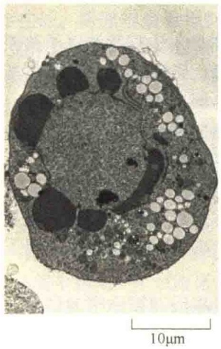
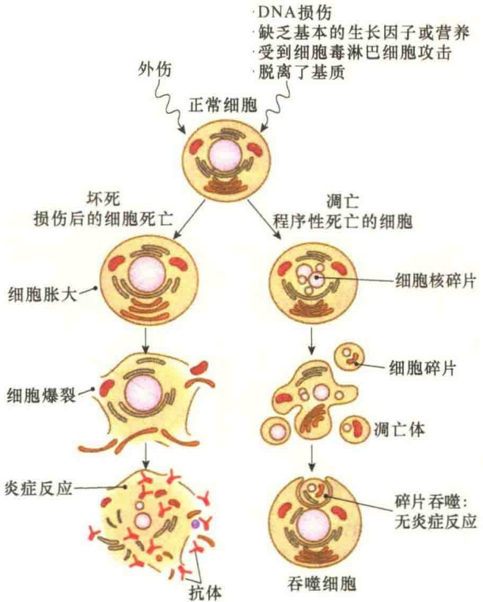
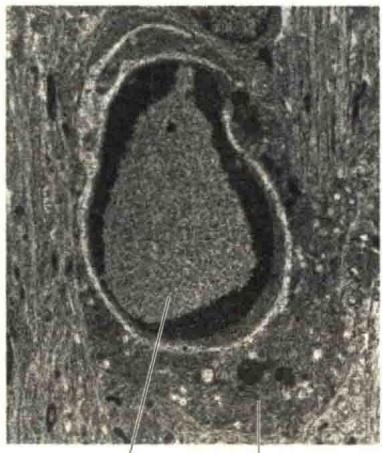
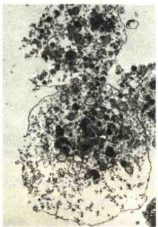
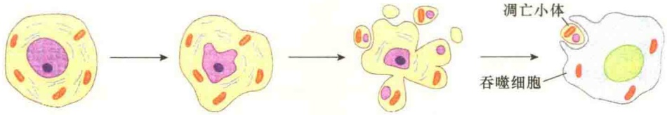
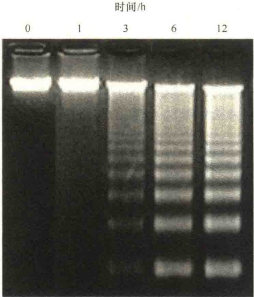
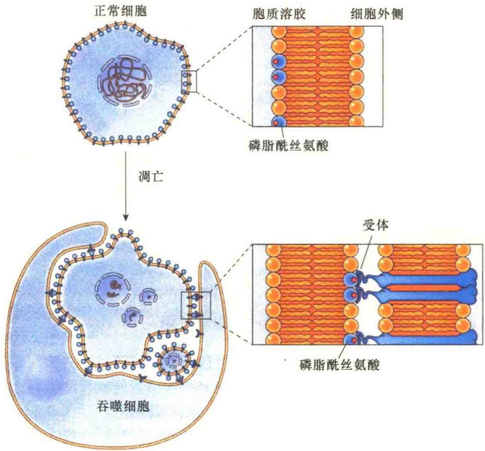
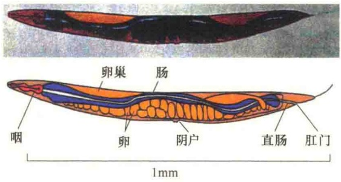
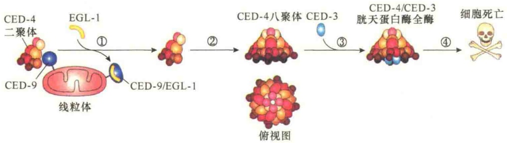

亡；而细胞凋亡的原因较多，如因 DNA 损伤而又无法修复等则进入凋亡途径，因而是细胞接受指令后的主动死亡。细胞凋亡是由它的生存环境、自身的代谢状况、发育史及基因组等因素触发的，并且是受高度程序性控制的。

细胞坏死与细胞凋亡有三个根本的区别。第一，引起死亡的原因不同:如物理性或化学性的损害因子、缺氧与营养不良等均可导致细胞坏死；而细胞凋亡则是由基因控制的。第二，死亡的过程不同:坏死细胞的质膜通透性增高，致使细胞肿胀，细胞器变形或肿大，早期核无明显形态学变化，最后细胞破裂；细胞凋亡的细胞不会膨胀、破裂，而是收缩并被割裂成膜性小泡后被吞噬。第三，坏死的细胞裂解要释放出内含物，并常引起炎症反应，在愈合过程中常伴随组织器官的纤维化，形成疤痕；细胞凋亡的细胞没有被完全裂解，不会释放内含物，所以不会引起炎症。图 15-6 是两种死亡的过程比较。

近年来发现细胞在受到炎症感染或病理性损伤后也会启动一种基因控制的死亡程序，将这种死亡称为细胞焦亡（pyroptosis），由Gasdermin家族蛋白介导，并常常伴有炎性因子的活化。

近年的研究已明确焦亡通路的关键分子:巨噬细胞在发生炎症时可经典和非经典的炎症小体通路完成对炎症性胱天蛋白酶（胱天蛋白酶-1/4/5/11）的活化，炎症性胱天蛋白酶和部分凋亡性胱天蛋白酶可以通过水解GSDMD等Gasdermin家族蛋白释放其N端活性结构域，进而形成寡聚体在质膜打孔，引起细胞膜破裂。

焦亡的命名起源于希腊语，将 “pyro-”（意为

图 15-6 细胞的两种死亡过程的比较（引自 Plopper et al., 2015）。正常细胞受到外伤后经过坏死而清除，坏死的细胞经过胀大、爆裂，最后引起炎症。正常细胞受到 DNA 损伤等通过凋亡进行清除，凋亡的细胞经过细胞断裂成碎片被吞噬细胞所吞噬，不会有炎症发生。

fire）结合-ptosis 词根组合，命名为 “pyroptosis”。

## 15.2.2.2 细胞凋亡的形态特征

细胞凋亡具有明显的形态学特征，包括:细胞变圆，染色质凝缩、分块，胞质皱缩（图 15-7）。

被吞的 吞噬细胞
死亡细胞

图 15-7 细胞凋亡与细胞坏死的形态比较（引自 Alberts et al., 2015）。A 和 B 是凋亡的细胞、C 是坏死细胞的电镜照片。A 与 C 是培养皿培养中死亡的细胞，而 B 是发育组织中凋亡的细胞，已经被巨噬细胞所吞噬。照片中可见到 A 与 B 中死亡的细胞形态比较完整，而 C 中坏死的细胞形态已经崩溃。

凋亡细胞的核 DNA 在核小体连接处断裂成核小体片段，并向核膜下或中央异染色质区凝缩形成浓缩的染色质块，在电镜下呈高电子密度。随着染色质不断凝缩，核纤层断裂消失，核膜在核孔处断裂形成核碎片。同时在细胞凋亡过程中，由于不断脱水，细胞质不断凝缩，细胞体积减小。凋亡细胞的核经核碎裂形成染色质块（核碎片），然后整个细胞通过出芽、起泡等方式形成一些球形的突起，并在其基部绞断而脱落产生大小不等的内含胞质、细胞器及核碎片的凋亡小体（apoptotic body）；或通过分隔机制，在凋亡细胞内由内质网分隔成大小不等的分隔区，靠近细胞膜端的分隔膜与细胞核融合并脱落形成凋亡小体；最后，凋亡小体被周围细胞或单核细胞吞噬（图 15-8）。

图 15-8 细胞凋亡的结构变化（引自 Karp，1996）。

细胞凋亡最突出的生化特征是染色质 DNA 有控制的裂解，并且是由于内源性内切核酸酶基因的活化和表达而造成的结果。这种由内源性内切核酸酶切割的染色质 DNA 片段大小是有规律的，即均为 200bp 的倍数。因此，抽提其中的 DNA 进行琼脂糖凝胶电泳，或进行氯化铯-溴化乙锭超速离心时，呈现出梯状（ladder）谱型（图 15-9），可作为鉴别是否发生细胞凋亡的一个重要的生化标志。

图15-9 凋亡的细胞的DNA梯状谱型

(引自 Alberts et al., 2015)。

由上述可见，细胞凋亡与细胞坏死在形态学、生化反应的改变、分子机制、细胞结局等方面都有本质的区别（表 15-3）。

表 15-3 细胞凋亡与细胞坏死的比较

| 比较内容 | 细胞凋亡 | 细胞坏死 |
| --- | --- | --- |
| 质膜 | 不破裂 | 发生破裂 |
| 细胞核 | 固缩,DNA片段化 | 弥漫性降解 |
| 细胞质 | 由质膜包围形成凋亡小体 | 溢出,细胞破裂成碎片 |
| 细胞质生化改变 | 溶酶体的酶增多 | 溶酶体解体 |
| 蛋白质合成 | 有 | 无 |
| 基因活动 | 有基因调控 | 无基因调控 |
| 自吞噬 | 常见 | 缺少 |
| 线粒体 | 自身吞噬 | 肿胀 |
| 诱发因素 | 生理性信号 | 强烈刺激信号 |
| 对个体影响 | 生长、发育、生存所必需 | 引起炎症 |

## 15.2.3 细胞凋亡的基因调控机制

2002 年的诺贝尔生理学和医学奖授予了在器官发育和细胞凋亡研究领域中做出奠基性贡献的 3 位科学家:英国的 Brenner、Sulston 和美国的 Horvitz。他们创造性地用线虫作为实验模型，实现了对器官发育过程中细胞分裂、分化的原位观察，完成了细胞图谱的绘制，在此基础上发现并研究了调控器官发育细胞凋亡的关键基因及其功能，并进一步在高等哺乳动物中发现了相关功能基因。

细胞凋亡是基因调控作用的结果。有很多基因参与调控细胞凋亡过程，调控环节包括信号转导、基因表达、蛋白质生物合成和代谢过程等。这些基因也叫细胞凋亡相关基因，大致可分两类:一类叫细胞凋亡遗传学相关基因，主要从线虫中获得，与线虫中131个细胞的程序性死亡的遗传控制有关，包括ced-1～ced-9、nuc-1、ces-1、ces-2和egl-1；另一类主要针对哺乳类细胞，包括原癌基因、肿瘤抑制基因和病毒癌基因，如bcl-2家族、c-myc、p53、Ela和Elb等。也可将上述相关基因分为另外两种类型，即其表达可促进程序性细胞死亡者和可抑制程序性细胞死亡者，前者包括ces-2、ced-3、ced-4、p53、c-myc、Ela、ICE、TNF-a、APO-1/fos等，后者包括egl-1、ces-1、ced-9、bcl-2、Elb、EBV-LMP-1、BHRF-1、crmA、A-20等。

## 15.2.3.1 细胞凋亡的两个阶段

健康细胞进入细胞凋亡是由信号决定的，这种信号有可能是细胞外的，也有可能是细胞内的。细胞凋亡分为两个阶段:一是死亡激活期（activation phase），此阶段主要是接受来自内部或外部的死亡信号（death图 15-10 凋亡细胞被巨噬细胞吞噬（引自 Cooper and Hausman，2013）。凋亡细胞及细胞碎片被吞噬细胞所识别并被吞噬。凋亡细胞表面的磷脂酰丝氨酸作为识别信号被吞噬细胞识别。磷脂酰丝氨酸通常存在于正常细胞质膜的内叶，发生凋亡时位于凋亡细胞质膜的外叶。

signal）并做出反应，即接受指令并决定死亡；二是死亡执行期（execution phase），即执行一套死亡程序，包括发生染色质凝缩，并逐步分布在核膜周围；接着发生细胞质浓缩，此时桥粒和中间纤维的连接被破坏，膜泡形成凋亡小体，最后被吞噬细胞吞噬和降解等。凋亡的细胞之所以能够被吞噬细胞识别和吞噬，是因为这些细胞的表面具有“将我吃掉”的信号，这种信号在正常细胞的表面是不存在的。研究得最清楚的被吞噬信号是存在于凋亡细胞的质膜脂双层外叶的磷脂酰丝氨酸（phosphatidylserine）分子，它一般存在于正常细胞质膜脂双层的内叶（图15-10）。

## 15.2.3.2 秀丽隐杆线虫细胞凋亡的调控基因

关于细胞凋亡的分子基础研究最初是在秀丽隐杆线虫（Caenorhabditis elegans）中获得突破。在胚胎发育期间，秀丽隐杆线虫有1090个体细胞，但在发育过程中有131个细胞死亡。因此，一个成熟的秀丽隐杆线虫有959个体细胞和1000～2000个性细胞。线虫的成虫分雌雄同体和雄性两种性别，雌雄同体相当于雌性（图15-11）；虫体透明，有6对染色体，约3000个基因。

秀丽隐杆线虫的细胞死亡是一种典型的程序性细胞死亡，15个基因分别在不同程度上与线虫的程序性细胞死亡有关。

图 15-11 雌雄同体的秀丽隐杆线虫（引自 Hartl，1991）。

ced-3、ced-4、ced-9 和 egl-1 4 个基因构成了线虫执行死亡的“死亡机器”（death machinery）。遗传学研究发现 ced-3 和 ced-4 是细胞杀手，在 ced-3 或 ced-4 突变体中，雌雄同体发育中应该死去的 131 个细胞都活下来了；ced-9 可抵消 ced-3 和 ced-4 的作用，防止细胞被杀死，因此是存活因子，在 ced-3 和 ced-4 的杀死细胞作用中起负调控。进一步的研究发现真正的细胞杀手是 ced-3 而不是 ced-4。ced-4 的作用是衔接子（adapter），对 ced-3 引起的程序性细胞死亡起促进作用（图 15-12）。

图 15-12 线虫中 CED-3 蛋白的激活（引自 Lodish et al., 2013）。① EGL-1 蛋白作为触发细胞死亡的应答信号，激活后与线粒体上的 CED-9 不对称结合，导致与线粒体上另一个 CED-9 结合的 CED-4 二聚体与 CED-4 脱离；② CED-4 形成八聚体；③ CED-4 八聚体与 2 分子的 CED-3 酶原结合，并将 CED-3 激活；④ 启动细胞凋亡。

## 15.2.3.3 胱天蛋白酶介导蛋白酶解级联反应

细胞凋亡是由细胞内一个特异性的蛋白酶家族成员触发的，它们在细胞内能够切割多种蛋白质的特殊序列，引起巨大变化，并导致细胞死亡及被吞噬。这些蛋白酶在其活性位点都有一个半胱氨酸，并在靶蛋白特异的天冬氨酸位点进行切割，因此将之称之为胱天蛋白酶（caspase），又称凋亡蛋白酶，其中c代表半胱氨酸，asp代表天冬氨酸。胱天蛋白酶在细胞内合成时是没有活性的前体，仅仅是在细胞凋亡期间被激活。胱天蛋白酶分为两大类:一类是起始者（initiator）胱天蛋白酶，另一类是执行者（executioner）胱天蛋白酶。图15-13显示的是起始者胱天蛋白酶与执行者胱天蛋白酶在细胞凋

图 15-13 细胞凋亡期间胱天蛋白酶的激活（引自 Alberts et al., 2015）。起始者胱天蛋白酶在 C 端有一个蛋白酶结构域，在 N 端有一个较小的衔接蛋白结合结构域，并且是无活性的单体，有时将它称为胱天蛋白酶原（procaspase）。凋亡信号触发了衔接蛋白与胱天蛋白酶的氨基端结合，由于衔接蛋白的结合引起胱天蛋白酶二聚化并被激活。胱天蛋白酶被激活后，相互从蛋白酶结构域的切割位点进行切割，被切开的两部分经过重排形成由大、小两个亚基组成的二聚体，再装配成含有两个胱天蛋白酶与两个衔接蛋白组成的具有活性的复合物。执行者胱天蛋白酶合成时是无活性的二聚体，经起始者胱天蛋白酶切割重排后形成有活性的四聚体，执行降解作用。