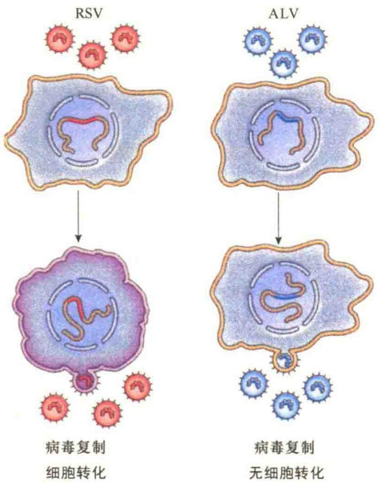

如同动植物发育，肿瘤也会进化成不同的亚克隆细胞，亚克隆之间在遗传上具有多样性。这些亚克隆可以独立转移到不同环境，并在适合的环境中生存。此外，每个亚克隆可以发生不同的突变获得新的特性，因此增加了肿瘤遗传的多样性。

## 15.3.1.4 癌细胞转移

恶性肿瘤的一个显著特点是能够侵入（invade）相邻的组织，并转移（metastasis）到其他的组织。如果在转移过程中，细胞继续增殖的话，就会沿途留下肿瘤的“种子”，大多数肿瘤细胞最终都会获得转移能力。

正常细胞通常因细胞-细胞间的黏着以及基膜等物理障碍被限制在原有的器官及组织，但是，癌细胞具有穿过基膜的能力并转移到身体的其他组织与器官（图 15-30）。

## 15.3.2 癌的遗传学基础

癌是一种基因性疾病，因为所有的癌都与基因的改变有关；但癌与先天性遗传疾病不同，后者系缺陷基因通过性细胞传递到子代而发病，而癌主

要是体细胞后天获得性 DNA 的改变导致细胞无节制地增殖，这种增殖不断侵袭周围正常组织，导致疾病。所以，在大多数情况下，癌症是不遗传的。从细胞水平上看，癌的发育又是极偶然的事件。从遗传上看，癌都是由一个细胞发展而来，由一个失去了增殖控制的细胞发展而来，因此将癌看成是单克隆的。究其根源是基因突变及表达了错误的蛋白质，导致细胞生理生化表型的改变。将突变后导致细胞癌变的基因统称为癌基因。

## 15.3.2.1 癌发生的生化起因

癌的发生源于表达了突变的蛋白质，突变的蛋白质结构发生了变化，影响了细胞的正常生长。突变后可诱发癌变的蛋白质大约分为7类（图15-31）:①某些细胞外信号分子，如生长因子（growth factor）；②信号受体（signal receptor）；③信号转导蛋白（signal transduction protein）；④转录因子（transcription factor）；⑤细胞周期控制蛋白（cell-cycle control protein）；⑥DNA修复蛋白（DNA-repair protein）；⑦抗凋亡蛋白（antiapoptosis protein），包括促进凋亡的肿瘤抑制蛋白，以及促进细胞生存的癌蛋白。

图 15-30 癌细胞转移（引自 Lodish et al., 2013）。A. 以乳腺癌细胞为例，转移的第一步，某些乳腺癌细胞离开肿瘤，附着到基膜；通过细胞外基质纤维到达血管，癌细胞通过诸如表皮生长因子（EGF）之类的信号，附着到血管上，EGF 是由巨噬细胞分泌的；癌细胞进一步穿过血管的上皮细胞的壁进入血流。B. 癌细胞伸展的侵润性伪足（invadopodium）能够产生金属蛋白酶（metalloprotease）及其他的一些蛋白酶来开辟通路。

图 15-31 参与细胞生长于增殖控制的 7 类蛋白质（引自 Lodish et al., 2013）。

## 15.3.2.2 病毒癌基因与细胞癌基因

病毒中有几个家族被称为肿瘤病毒（tumor virus），能够直接诱发实验动物与人发生癌变。其中包括引起肝癌的乙型与丙型肝炎病毒、引起颈部癌及生殖器癌的乳头瘤病毒（papilloma virus）、梅克尔细胞多瘤病毒（Merkel cell polyomavirus）、疱疹病毒（herpesvirus），以及反转录病毒（retrovirus），如人的T细胞淋巴瘤病毒（成年T细胞白血病）。另外，HIV可在HIV患者体内诱发癌变并发生免疫缺陷。

除了 RNA 病毒引起细胞癌变外，有些 DNA 病毒也能引起细胞癌变。表 15-4 列出了部分与肿瘤有关的 DNA 病毒和 RNA 病毒。

表 15-4 部分 DNA、RNA 病毒

<table><tr><td>病毒家族</td><td>诱导人的肿瘤</td><td>基因组大小/kb</td></tr><tr><td colspan="3">DNA 病毒</td></tr><tr><td>乙型肝炎病毒</td><td>肝癌</td><td>3</td></tr><tr><td>多瘤病毒及 SV40</td><td>梅克尔细胞瘤</td><td>5</td></tr><tr><td>乳头瘤病毒</td><td>颈部癌及生殖器癌</td><td>8</td></tr><tr><td>疱疹病毒</td><td>伯基特淋巴瘤、鼻咽癌、卡波西肉瘤</td><td>100~200</td></tr><tr><td colspan="3">RNA 病毒</td></tr><tr><td>丙型肝炎病毒</td><td>肝癌</td><td>10</td></tr><tr><td>反转录病毒</td><td>成人 T-细胞白血病</td><td>9~10</td></tr></table>

对肿瘤病毒的研究揭示一些特异的基因能够诱导细胞转化为癌，将此类基因称之为癌基因（oncogene）。癌基因的发现，揭示了癌变的分子基础。但是，大约有80%在人身上发生的癌不是由病毒引起的，而是由其他因素引起，如射线、化学致癌剂等。这些理化因素的致癌作用是通过对细胞癌基因突变引起的。因此，从癌的分子基础来看，癌基因是根本的原因，可分为病毒癌基因（viral oncogene, v-oncogene）和细胞癌基因（cellular oncogene, c-oncogene）。

通过对 v-癌基因的研究发现了 c-癌基因。而将 v-癌基因与 c-癌基因联系起来的关键实验是对致癌反转录病毒（oncogenic retrovirus）的研究。

劳氏肉瘤病毒（Rous sarcoma virus，RSV）是一种RNA病毒，可使鸡产生肉瘤。第一个病毒癌基因就是在RSV中发现并鉴定的，即src基因。实验表明，RSV感染培养的鸡胚成纤维细胞，可使鸡胚成纤维细胞发生转化；将转化的鸡成纤维细胞导入小鸡体内，可诱导小鸡在1\~2周内长出一个大的肿瘤。但是，用与 RSV 亲缘关系密切的禽白血病病毒（avian leukosis virus，ALV）做对照，不会发生小鸡胚成纤维细胞的转化（图 15-32）。

已经从不同的动物，包括鸡、火鸡、小鼠、大鼠、猫与猴子等分离了40多种高度致癌的反转录病毒。所有这些病毒，都像RSV一样，至少含有一个（有些含两个）与病毒复制无关，但可以引起细胞转化的癌基因。在某些情况下，不同的病毒含有相同的癌基因。这些癌基因中，有很多基因编码的蛋白质都是促进细胞增殖信号途径中的重要成分（如Ras、Raf蛋白）。

图15-32 RSV与ALV转化实验（引自Cooper and Hausman, 2016）。RSV与ALV病毒基因组都能在鸡胚成纤维细胞中复制，但是只有RSV能引起细胞转化。

## 15.3.2.3 致癌基因

致癌基因（carcinogenic gene）又称致癌关键基因（cancer critical gene），意指所有因突变可促进癌的发生或生成的基因。根据突变基因的产物活性高低及对癌形成的影响，将致癌基因分为三类。第一类是原癌基因（proto-oncogene）。此类基因未突变时，基因产物具有正常的细胞功能，一旦突变，导致该基因过表达或表达产物的活性过高从而导致细胞癌变。将原癌基因突变致癌的突变称为功能获得突变（gain-of-function mutation），因此类突变获得了诱发细胞癌变的功能。功能获得突变致使原癌基因转变成了癌基因。第二类是肿瘤抑制基因(tumor suppressor gene)，此类基因突变丧失了对肿瘤的抑制作用。将肿瘤抑制基因的突变称为功能失去突变（loss-of-function mutation），它们因突变失去了功能之后导致细胞癌变。第三类是基因组维护基因(genome maintenance gene), 因为它们的突变导致基因组不稳定。例如, $p53$ 基因, 它的突变会失去对细胞基因组 DNA 维护的能力, 此类基因也是功能会失去突变。表 15-5 总结了三类致癌基因的一些基本特性。

表 15-5 三类致癌基因的比较

| 基因类型 | 基因的正常功能 | 基因产物举例 | 突变效应 | 突变基因的遗传特性 | 基因突变的原因 |
| --- | --- | --- | --- | --- | --- |
| 原癌基因 | 促进细胞的生存或增殖 | 抗凋亡蛋白;促进细胞增殖信号传导及信号转导途径中的成分;转录因子 | 功能获得突变,允许细胞的增殖与生存不受调节 | 遗传显性突变 | 点突变;染色体转位;基因扩增 |
| 肿瘤抑制基因 | 抑制细胞的增殖与生存 | 促凋亡蛋白质;细胞周期进程的抑制蛋白;DNA/染色体损伤的关卡监控蛋白;阻止细胞增殖信号途径中的成分 | 功能失去突变,允许细胞的增殖与生存不受调节 | 遗传隐性突变 | 基因缺失;点突变;甲基化作用 |
| 基因组维护基因 | DNA损伤修复及防止DNA损伤 | DNA修复酶 | 功能失去突变,允许突变累积 | 遗传隐性突变 | 基因缺失;点突变;甲基化作用 |

原癌基因只要一个拷贝突变就会转变成癌基因，因此原癌基因的突变是显性的；而肿瘤抑制基因与基因组维护基因则需要两个拷贝都突变了才能诱发癌变，所以肿瘤抑制基因与基因组维护基因突变是隐性的（图 15-33）。

图 15-33 两类致癌基因突变（引自 Alberts et al., 2015）。

A. 功能获得突变只需发生一次突变，就能够促进细胞癌变。由于此类突变仅涉及一对等位基因中的一个，所以是显性突变。

B. 功能失去突变需要发生两次突变，使得一对等位基因的两个拷贝都发生了突变才会促进细胞癌变，因此是隐性突变。

## 15.3.2.4 原癌基因与功能获得突变

原癌基因是正常细胞中来自反转录病毒的致癌基因。在正常的细胞中，它们是细胞内重要的调节基因。在很多情况下，这些基因编码的蛋白质在正常细胞中通常参与增殖的信号调控（如 ras、raf）。癌基因是相应的原癌基因不正常的表达，或原癌基因突变的形式，从突变的角度来说，这种突变是功能获得突变。

原癌基因突变成癌基因，称为原癌基因的激活（activation）或转变（conversion），涉及功能获得突变，至少有4种可能的机制。①点突变（point mutation）:在原癌基因中发生了单个碱基对的变化导致产生了具有超活性（hyperactive）或持续活性的蛋白质。②染色体易位（chromosomal translocation）导致两个基因融合成一个杂合基因，编码一个嵌合的蛋白质，这种蛋白质的功能与亲代蛋白质不同，常常是组成型表达。③染色体转位，这种转位与前面的易位不同，这种转位将一种生长调控基因置于不同的启动子的控制之下，导致该基因不合时宜地表达。④扩增（amplification），如不正常的DNA复制。一段含有原癌基因的DNA扩增，拷贝数增加，导致编码蛋白的超量合成。例如，Raf原癌基因蛋白含有两个结构域:一个是氨基端的调节结构域，另一个是羧基端的蛋白激酶结构域。在病毒Raf原癌基因蛋白中，其氨基端的调节结构域已经缺失，并被部分缺失的病毒Cag序列（$\Delta$Cag）所替代（图15-34），结果是蛋白激酶不受调节地持续合成，引起细胞转化。

Ras 蛋白基因的点突变是原癌基因功能获得突变的典型例子。在人体正常的细胞中，原癌基因 ras 编码的 Ras 蛋白在生长因子类信号分子的信号通路中具有重要作用，但是在关键位置发生点突变后，会导致癌变。第一个发现的突变是第 12 位的甘氨酸被缬氨酸取代，ras 原癌基因突变成癌基因，导致细胞癌变（图 15-35）。其后又发现，第 12、13、61 位氨基酸被其他的氨基酸取代也会导致 ras 原癌基因突变成癌基因。

图 15-34 Raf 原癌蛋白（引自 Cooper and Hausman，2016）。

表 15-6 列出了人体常见的癌基因与诱发的肿瘤。

## 15.3.2.5 肿瘤抑制基因与功能失去突变

一般情况下，肿瘤抑制基因编码的蛋白质以不同的方式抑制细胞增殖。这类基因突变，失去了其

图 15-35 ras 原癌基因的点突变（引自 Cooper and Hausman，2016）。

对肿瘤发育的“抑制”功能。涉及功能失去突变导致细胞癌变的抑癌基因编码的蛋白质可分为以下5类:①调节或抑制细胞进入细胞周期的蛋白质（如p16及Rb蛋白）；②作为分泌激素或抑制细胞增殖的发育信号受体及转导蛋白（如TGF-β）；③细胞关卡控制蛋白，如监控DNA复制正确与否及DNA是否有损伤的p53蛋白；④促进凋亡的蛋白质；⑤参与DNA修复的酶类。

表 15-6 人体常见的癌基因与肿瘤

| 癌基因 | 激活机制 | 肿瘤 |
| --- | --- | --- |
| abl | 易位 | 慢性髓样白血病,急性淋巴细胞白血病 |
| bcl-2 | 易位 | 卵泡B细胞淋巴瘤 |
| CCND1 | 易位 | 甲状腺腺瘤,B细胞淋巴瘤 |
| CCND1 | 扩增 | 鳞状细胞、膀胱、乳腺、食管、肝及肺癌 |
| Cdk4 | 点突变 | 黑素瘤 |
| CTNNB1 | 点突变 | 结肠癌 |
| eRbB | 扩增 | 星形细胞瘤,多种其他类型瘤 |
| eRbB | 点突变 | 肺癌 |
| eRb-2 | 扩增 | 乳腺癌、卵巢癌 |
| c-myc | 易位 | 伯基特淋巴瘤 |
| L-myc | 扩增 | 肺癌 |
| N-myc | 扩增 | 成神经细胞瘤、肺癌 |
| PDGFR | 易位 | 慢性骨髓单核白血病 |
| PDGFR | 点突变 | 胃肠基质瘤 |
| PI3K | 点突变 | 乳腺癌、卵巢癌、胃癌、肺癌 |
| B-raf | 点突变 | 黑素瘤、结肠癌 |
| rasH | 点突变 | 甲状腺腺瘤 |

续表

| 癌基因 | 激活机制 | 肿瘤 |
| --- | --- | --- |
| rasK | 点突变 | 结肠、肺、胰腺及甲状腺癌 |
| rasN | 点突变 | 急性髓样淋巴细胞白血病、甲状腺腺瘤 |

目前推测人的基因组织中大约有 20 多种肿瘤抑制基因。表 15-7 列出了部分肿瘤抑制基因及突变后引发的肿瘤。

表 15-7 肿瘤抑制基因的功能及突变后引起的肿瘤

| 基因 | 突变后引发的癌变 |
| --- | --- |
| APC | 结肠/直肠癌 |
| BRCA1 | 乳腺癌与卵巢癌 |
| BRCA2 | 乳腺癌 |
| INK4 | 黑素瘤、肺癌、脑瘤、白血病、淋巴癌 |
| p53 | 脑瘤;乳腺癌、结肠/直肠癌、食道癌、肝癌、肺癌;肉瘤、淋巴瘤 |
| PTCH | 基底细胞瘤 |
| PTEN | 脑瘤,黑素瘤,前列腺癌、内皮癌、肾癌及肺癌 |
| Rb | 成视网膜细胞瘤,肉瘤,膀胱、乳腺与肺癌 |
| Smad2 | 结肠/直肠瘤 |
| Smad4 | 结肠/直肠瘤,胰腺瘤 |

1）Rb 基因 Rb 基因是世界上第一个被克隆和完成全序列测定的肿瘤抑制基因，为成视网膜细胞瘤易感基因。Rb 基因转录产物约 4.7kb，表达产物为 928 个氨基酸组成的蛋白质，分子质量约 105kDa，称为 P105-Rb。Rb 蛋白分布于核内，是一类 DNA 结合蛋白。