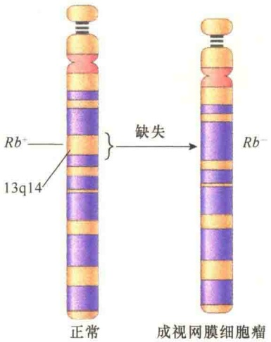
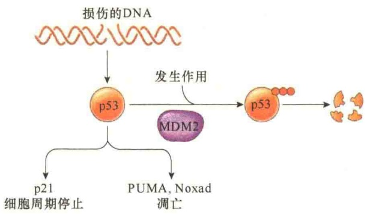
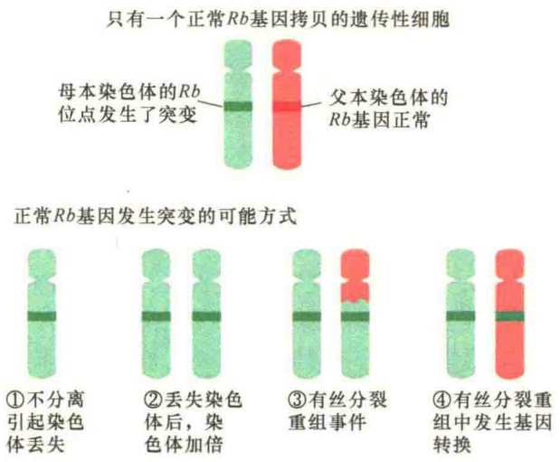
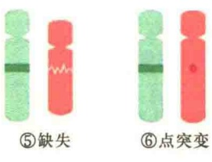

Rb 基因与癌的关系有两种情况:一种是遗传性的（hereditary），或称家族性（familial），即某些家族的儿童中高频率发生成视网膜细胞瘤；另一种是散发（sporadic）性的，即在无家族关系人群的较年长者中零散发生。成视网膜细胞瘤发生的家族性表明该病是可遗传的。从成视网膜细胞瘤儿童的细胞中进行的遗传分析，发现患者 13 号染色体有一小段缺失（图 15-36），并且这种缺失不仅是肿瘤细胞，而且在身体其他所有组织中都是缺失的，这表明该缺失是遗传下来的。

图 15-36 在成视网膜细胞瘤中 Rb 基因的缺失（引自 Cooper and Hausman, 2016）。

遗传性视网膜瘤儿童的 $Rb$ 基因的两个拷贝中有一个是正常的，一个 $Rb$ 基因拷贝有缺失突变，这种儿童会在生命的早期患视网膜瘤，而且是两只眼睛都会发生。携带有遗传性 $Rb$ 突变的儿童发生视网膜细胞病变必须在另一个 $Rb$ 基因拷贝也发生突变导致功能丧失之后（图15-37A），因为只有$Rb$ 基因的两个拷贝都失活，才会引起病变。对于非遗传的视网膜瘤患者而言，由于遗传的一对 $Rb$ 基因是正常的，所以需要经过两次独立的自发突变（图15-37B），才会发生视网膜细胞癌变，这种概率要小得多，即使发生，也是在年龄很大以后，并且通常只会影响一只眼睛。

2）p53 基因 p53 基因是迄今发现与人类肿瘤相关性最高的基因，该基因编码一种分子质量为 53kDa 的蛋白质，命名为 p53。

p53 蛋白有两类功能，一是调节细胞周期的进程，其目的是维护基因组的稳定；二是调节细胞凋亡，目的是防止细胞癌变。因此，p53 基因既是基因组维护基因，也是肿瘤抑制基因。

p53 蛋白主要集中于核仁区，能与 DNA 特异结合，其活性亦受磷酸化调控。p53 蛋白在 S 期磷酸化，其抑制细胞分裂的活性消失。正常 p53 蛋白的生物功能好似“基因组卫士”（guardian of the genome），在  $G_{1}$  期检查 DNA 损伤点，监测细胞基因组的完整性。如有损伤，p53 蛋白阻止 DNA 复制，以提供足够的时间使损伤 DNA 修复；如果修复失败，p53 蛋白则引发细胞程序性死亡阻止具有基因损伤、可能诱发癌变的细胞产生；如果 p53 基因的两个拷贝都发生了突变，对细胞的增殖失去控制，导致细胞癌变（图 15-38）。

B. 随机性成视网膜细胞瘤

图 15-37 自发的体细胞突变对成视网膜细胞瘤的作用（引自 Lodish et al., 2013）。成视网膜细胞瘤是由一对等位基因 Rb 决定的。A. 在家族性成视网膜细胞瘤患者中，他们出生时就携带了一个突变的 Rb 基因拷贝，后经自发突变，使两个 Rb 基因都成为突变的形式，这样很快发展为成视网膜细胞瘤。B. 非遗传的视网膜瘤需要经过两次独立的自发突变，才会发生视网膜细胞癌变，这种概率很小。

图 15-38 p53 蛋白的作用（引自 Cooper and Hausman, 2016）。p53 蛋白既能调控 DNA 损伤的细胞进入细胞周期，又能在 DNA 损伤的诱导下，启动凋亡蛋白 Bcl2 家族成员 PUMA 及 Noxad 表达诱导细胞凋亡。MDM2 是癌基因蛋白，是一种泛素连接酶，能够将 p53 蛋白泛素化后降解。

在健康的  $G_{1}$  细胞中，p53 蛋白的浓度很低，如果  $G_{1}$  细胞受到遗传损伤（如受到紫外光照射或化学致癌物的作用），p53 蛋白的浓度会快速上升。将含有断裂链的 DNA 注入细胞，可检测到 p53 蛋白浓度的这种变化。研究表明，p53 蛋白的浓度变化不是由于 p53 基因表达的提高，而是由于 p53 蛋白降解速度的下降（即稳定性提高）。p53 蛋白的降解受 MDM2 蛋白的调控，该蛋白质与 p53 蛋白结合，并将 p53 蛋白由细胞核输出到细胞质，并经泛素化途径被降解。在 DNA 损伤关卡途径中，p53 蛋白要被磷酸化，p53 蛋白被磷酸化之后不再与 MDM2 蛋白结合，也就不会被运送到细胞质中被降解，因此 DNA 损伤后细胞核中 p53 的浓度升高，从而激活 p21 基因和 BAX 基因的表达，使细胞停止分裂或使细胞进入程序性死亡。如果 p53 基因突变，等于失去了分子警察，DNA 损伤引起的突变失去监控，就会导致细胞癌变。

表观遗传学的改变是导致肿瘤抑制基因永久失活的另一类重要方式。可以通过 DNA 甲基化，以及改变组蛋白修饰酶（histone modifying enzyme）或染色质重塑复合物的活性等将肿瘤抑制基因沉默。这些表观遗传学的改变导致肿瘤抑制基因不可逆的失活。

DNA 甲基化发生在 CpG 岛的胞嘧啶中，它们主要存在于基因的启动子中。这些胞嘧啶的甲基化会导致启动子的抑制。大部分结直肠癌的特征是 DNA 超甲基化（hypermethylation）。DNA 低甲基化（hypormethylation）也是癌症的标志。许多与癌症有关的基因的启动子被低甲基化，引起它们所控制基因的表达增加。例如，25% 的急性髓样细胞白血病的特征是 DNA 低甲基化，这是由于催化 CpG 二核苷酸甲基化的酶失活突变所致。最近发现的与 DNA 甲基化有关的 DNA 修饰包括在 CpG 岛上 5-甲基胞嘧啶转化为羟基化的变体（5-羟基甲基胞嘧啶）。这种 DNA 修饰也与癌症有关。催化这些转化的酶是 DNA 羟化酶家族的成员。这些酶需要 α-酮戊二酸作为辅

犹他大学的研究者发现大象身上细胞数量是人类的100倍，但大象的癌症致死率低于5%，而人类的癌症致死率则为25%。通过对大象的DNA分析，发现一些大象身上至少有40个p53基因拷贝，相比之下，人类只有两个p53基因拷贝。由此可见p53基因对癌的抑制作用有多大。

## 15.3.2.6 肿瘤抑制基因失活的机制

有多种方式使肿瘤抑制基因失活，包括基因突变与表观遗传（epigenetic）。在基因突变中，通过基因突变使肿瘤抑制基因失活的方式也有多种，以Rb基因为例，有多达6种可能的方式使正常的Rb基因失活（图15-39）。

图 15-39 肿瘤抑制基因功能丧失突变的6种可能的方式（引自Alberts et al., 2015）。一个表型正常但含有失活Rb基因拷贝的缺陷细胞可通过6种可能的遗传方式将正常Rb基因拷贝失活:①不分离引起正常拷贝的染色体丢失；②丢失染色体后，含突变基因的染色体加倍；③通过有丝分裂重组；④有丝分裂重组期间发生基因转换，是正常基因拷贝转换成突变的基因拷贝；⑤正常基因拷贝缺失；⑥正常基因拷贝发生点突变。

助因子，并受到环烷二酸2-羟戊二酸的抑制。编码染色质修饰蛋白及调节蛋白基因也与肿瘤发生有关。多种类型的肿瘤全基因组测序显示，大约40个编码表观遗传调节蛋白的基因突变的频率较高。在多种肿瘤中还发现了编码组蛋白甲基转移酶、组蛋白去甲基化酶和组蛋白乙酰基转移酶的基因突变。

在与癌症相关的染色质重塑因子中，主要是SWI/SNF复合物。这种大的、由多种蛋白组成的复合物的核心区有一个ATP依赖的螺旋酶，该酶调控组蛋白的修饰与染色质重塑。例如，SWI/SNF复合物可以改变核小体的位置与结构，决定调控转录的DNA结合蛋白能否与相关基因结合。如果一个被SWI/SNF复合物介导的染色质重塑而正常激活或是被抑制的靶基因，若编码SWI或SNF蛋白的基因发生了突变将会引起靶基因表达的改变。通过转基因鼠的研究表明，SWI/SNF复合物抑制E2F基因的表达，从而抑制了细胞周期的进程。因此，SWI/SNF功能的丢失，如同Rb功能的丢失，导致细胞的过快生长，甚至癌变。事实上，在老鼠体内，Rb蛋白招募SWI/SNF蛋白抑制编码E2F蛋白的基因转录。在人类和老鼠的研究中获得的证据也有力地证明SNF5基因与癌症有关。SNF5蛋白是SNF复合物的核心成分。在人类中，SNF5基因突变会导致肾脏内形成最常见的横纹肌样肿瘤，此外，也有可能在脑及其他组织形成肿瘤，并且具有家族遗传倾向。研究还发现，编码各种不同BAF蛋白（也是SNF复合物的亚基）的基因在 $40\%$ 的肾癌、$50\%$ 的卵巢癌中发生了突变；此外，在肝癌和膀胱癌中，BAF蛋白变异的比例也很高。总之，表观遗传失调已成为肿瘤发生的重要原因。

## 15.3.3 癌的预防与治疗

对癌的防治主要在三个水平:预防、诊断与治疗。预防是第一位的，防重于治。事实证明，有些癌是可以预防的。尤其是戒烟对癌的预防是非常重要的。高度敏感的分子分析方法，有利于精确进行早期诊断，诊断越早，越有利于手术及放射治疗，因为发现早，肿瘤小，更重要的是早期的肿瘤没有转移与扩散。

## 15.3.3.1 致癌剂

能够引起细胞癌变的物质称为致癌剂（carcinogen）。引起癌细胞发生的原因很多，大致分为4种类型:化学因素、辐射、病毒和遗传。化学因素主要是各种化学致癌物；物理因素主要是紫外光等的辐射作用；病毒和遗传则是指病毒癌基因和细胞癌基因。

英国伦敦医生 Hill 在 1761 年首次提出化学致癌观点。1775 年，另一位英国外科医生 Pott 获得环境因子与癌发生的相关证据。他发现一些男性烟囱清洁工人的鼻腔和阴囊皮肤等是癌的高发部位，原因是过度与煤烟接触有关。在过去几十年内，经动物实验，已经从煤烟中分离出几百种致癌化学物质。后来发现煤炭工业、印染工业中的某些化学物质也具有致癌性。

由于人类生活在一个十分复杂的环境中，而且所接触到的各种致癌物随着工业的发展而发生不断的变化，所以很难确切地得出癌与致癌物的关系。由于个人的生理和心理素质不同、生活习性不同，对癌的易感性也是不同的。

人类在自然环境中受到的辐射主要来自太阳的紫外线、外层空间的宇宙射线（cosmic ray）以及自然发生的放射性元素的放射性（emission）。另外，还受到来自医疗、工业和军事活动中人为产生的高能辐射，这些辐射主要是X射线和放射性元素的辐射。阳光致癌作用主要通过对热带地区长时间在太阳下工作的人们的观察推测的，因为他们皮肤癌的发病率相当高，并且只有那些暴露于阳光的部位易感皮肤癌。遮盖身体部位或用可吸收紫外辐射防护剂进行保护都会降低皮肤癌的诱发。

由于 X 射线具有较强的穿透力，可以穿透皮肤到达内部器官，所以致癌能力远较紫外线强。1895 年，Roentgen 发现受这种辐射的人，其癌的易感性大大增加，后来通过动物实验证实了 X 射线对癌的诱发。但是在临床上，X 射线对某些疾病的治疗效果远大于对癌的诱发。不过 X 射线治疗带来的副作用是肯定的，如某些国家，在临床上采用 X 射线处理头和颈部浅表皮肤癣、粉刺，其甲状腺癌的发病率比其他国家高。因此在利用 X 射线作为治疗手段时一定要权衡利弊。

一些放射性元素的辐射对癌的诱发效应同X射线相类似。第一位从事放射性研究的科学家居里夫人发现了放射性元素镭，她后来死于白血病，这显然与她过度与放射性接触相关。

虽然致癌的因素很多，但是烟草中的烟却是当今世界上最重要的致癌剂，它诱发的癌症死亡率超过任何其他的致癌因素（表 15-8）。

表 15-8 环境与生活方式对癌发生的影响

| 诱因 | 占癌症的比例/% | 死亡人数/年 |
| --- | --- | --- |
| 吸烟 | 33 | 189 000 |
| 饮食、超重、肥胖 | 25 | 143 000 |
| 缺少运动 | 5 | 28 600 |
| 病毒 | 5 | 28 600 |
| 酒精 | 3 | 17 200 |
| 紫外线及离子辐射 | 2 | 11 400 |
| 机遇性致癌剂 | 5 | 28 000 |

注:表中是美国2012年的数据，引自Colditz et al., 2012。

## 15.3.3.2 致癌剂的致突变作用

关于化学致癌物和辐射等因素对癌的诱发机制目前尚不清楚，通过对一些特别致癌物的分析，发现与 DNA 突变有关。

图 15-40 是几种致癌物对 DNA 的诱变作用。在亚洲，一些储藏在潮湿条件下的坚果、谷类容易长黄曲霉，这些真菌产生的黄曲霉毒素 B（aflatoxin B）是肝癌的主要诱因。其机制是黄曲霉毒 B 能够引起肿瘤抑制基因 p53 的第 249 位密码中的碱基置换，即 G→T，因此在普查中可作为肝癌检测的一种指标。虽然毋庸置疑，食物和环境中的诱变剂是致癌的因素，但大多数致癌的突变主要来自正常代谢过程中的 DNA 损伤。

图 15-40 某些理化因子的致癌作用（引自 Karp，1996）。图中随机挑选了 p53 基因中 7 个密码子。这些密码子在人的癌症患者中有 50% 会发生缺失或突变。图中显示了几种不同致癌物，包括苯并芘（benzopyrene）（它是在香烟的烟雾中发现的）、黄曲霉毒素 B1、阳光中的紫外线等作用于该序列引起突变的机制。每一种致癌物都引起一种不同的碱基置换。图中也显示了由于内源代谢引起的脱氨作用，也会导致 C→T 突变。

实际上，直接作用于 DNA 的致癌剂很少，并且在化学上是相当惰性的。只有当它们在肝组织中，经过 P450 氧化酶代谢处理转变成更具反应性的分子后才能对 DNA 具有伤害性。P450 氧化酶在正常情况下，是将毒性物质转变成无害的物质。不幸的是，它们对某些化学分子的作用是高度致突变的，通过这种方式被激活的致癌剂包括苯并芘，这是一种存在于煤焦油、烟及黄曲霉素 B1 中的致癌剂。

目前已知的致癌因子都不具特异性。但是由真菌产生的黄曲霉素 B1 是最具威胁的、具有一定特异性的致癌剂。黄曲霉毒素 B1 是由真菌产生的，在自然条件下污染热带坚果，包括花生、玉米、稻谷、小麦、花生油等粮油食品，且以南方高温、高湿地区受污染最为严重。黄曲霉毒素 B1 的代谢主要发生在肝脏，它在细胞色素 P450 混合功能氧化酶的作用下转化成黄曲霉毒素 M1、黄曲霉毒素 M2、黄曲霉毒素 P1、黄曲霉毒素 Q1、黄曲霉毒素 B2α、黄曲霉毒素醇等物质，是非洲人及亚洲人患肝癌的重要原因。

## 15.3.3.3 癌症治疗

在我国，癌症已经成为疾病死因之首。数据显示，我国男性5种最常见肿瘤依次为肺癌、胃癌、食管癌、肝癌和结直肠癌，加起来占所有癌症病例的2/3；女性最常见肿瘤依次为乳腺癌、肺癌、胃癌、结直肠癌和食管癌，占所有癌症病例的60%，其中，乳腺癌占所有女性癌的 15%。男性和女性肺癌、胃癌、肝癌、食管癌和结直肠癌 5 种最常见癌死亡病例占所有癌死亡病例的 3/4。

随着科学的发展，治疗的方法与药物也越来越多。例如，化学疗法常常同时使用两种或两种以上的药物，称为“综合化学疗法”，大多数病患的化疗都是使用这样的方式进行。对早期或较早期实体肿瘤来说，手术切除仍然是首选的治疗方法。根据手术的目的不同，可分为根治性手术、姑息性手术、减瘤手术、探查性手术和预防性手术等。此外还有一些其他治疗方法，如①靶向治疗:如治疗EGFR敏感突变的非小细胞肺癌，疗效显著，但耐药基因的出现是目前阻碍进一步提高疗效的主要障碍。②免疫疗法:利用人体内的免疫机制来对抗肿瘤细胞，目前较有进展的就是癌症疫苗疗法和单克隆抗体疗法。③中医中药治疗:配合手术、放化疗可以减轻放化疗的毒副作用，促进患者恢复，增强对放化疗的耐受力。④基因治疗:通过外源基因导入人体以纠正基因缺陷的方法，最终达到直接或间接抑制或杀伤肿瘤细胞的目的。⑤内分泌治疗:如性激素可以用于乳腺癌、前列腺癌、子宫内膜癌的姑息治疗。

在癌症的治疗中，最重要的问题是如何研制对癌基因及肿瘤抑制基因特异的靶向药物。传统的癌治疗药物中的大多数都是针对损伤肿瘤 DNA 或是抑制肿瘤 DNA，其结果是，这些药物不仅对肿瘤细胞有害，而且对正常细胞也有害。抗癌药物的毒性限制了在临床上的使用。

一种有效抑制肿瘤而不会对其他细胞产生毒性的方法是干扰血管生成而不是直接作用于癌细胞。对于肿瘤细胞而言，需要通过建立新的血管获得氧与营养以供肿瘤细胞生长的需要。因此，对于肿瘤的发育而言，血管的生成至关重要。通过动物及临床试验，证明血管生成抑制剂对人类癌的发育具有很好的抑制作用。2004年美国食品药品监督管理局（FDA）批准了第一个用于抗癌的血管生成抑制剂:一种用于治疗结肠癌的VEGF的单克隆抗体。这种单克隆抗体现在也用于成（神经）胶质细胞瘤、肾癌及肺癌的治疗。

靶向治疗是在细胞分子水平上针对已经明确的致癌位点（该位点可以是肿瘤细胞内部的一个蛋白质分子，也可以是一个基因片段），来设计相应的治疗药物，药物进入体内会特异地选择致癌位点发生作用，使肿瘤细胞特异性死亡，而不会波及肿瘤周围的正常组织细胞，所以分子靶向治疗又被称为“生物导弹”。靶向药物的研制是今后癌治疗的重要发展方向。