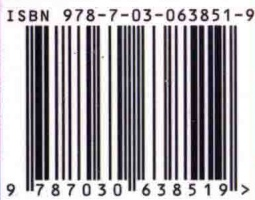

## 细胞生物学（第二版）

异嗜性相互作用（heterophilic interaction）116

异型融合（heterotypic fusion） 306

异质性（heterogeneous）288

抑微管装配蛋白（stathmin）337

抑制蛋白（profilin）350

抑制型的 G 蛋白（inhibitory G protein，Gi 蛋白）148

荧光共振能量转移（fluorescence resonance energy transfer,

FRET) 41

荧光抗体（fluorescence antibody）38

荧光漂白后恢复（fluorescence recovery after photobleaching,

FRAP) 81

荧光素（fluorescein）38

荧光探针（fluorescence probe）38

荧光原位杂交（fluorescence in situ hybridization, FISH）

391

应激反应 381

应力纤维（stress fiber）344，359

游离核糖体（free ribosome）217

有被小泡（coated vesicle）295

有丝分裂（mitosis）418

有丝分裂促进因子（mitosis promoting factor）404

有丝分裂纺锤体（mitotic spindle）421

有丝分裂期（mitotic phase）398

有丝分裂器（mitotic apparatus） 422

有丝分裂前期 396

有丝分裂选择法 402

有丝分裂周期蛋白（mitotic cyclin） 404

有性生殖 431

有氧氧化（aerobic oxidation）223

有义链（sense strand）60

诱导多能干细胞（induced pluripotent stem cell, iPS）457

诱导同步法（induction synchrony）401

诱导血管生成（inducing angiogenesis） 480

愈伤组织（callus，calli）50

原癌基因（proto-oncogene） 482

原肠胚（gastrula）438

原弹性蛋白（tropoelastin）109

原核融合（pronucleus fusion）435

原核生物 rRNA 192

原核细胞（prokaryotic cell）4

原肌球蛋白（tropomyosin，Tm）349，358

原肌球蛋白调节蛋白（tropomodulin）349，356

原胶原（tropocollagen）106

原丝（protofilament）330

原始生殖细胞（primordial germ cell）434

原生质（protoplasm）3

原生质体（protoplast）3

原子力显微镜（atomic force microscope，AFM）46

援救（rescue）333

孕酮（progesterone）404

运动（movement）433

运输小泡（transport vesicle）267

运铁蛋白（transferrin）318

## Z

Z线（Zdisk）356

Z形电子传递链 251

灾变（catastrophe）333

载黑素细胞（melanophore）341

载体蛋白（carrier protein）89

载脂蛋白 B（apolipoprotein B，apoB）211

载脂蛋白 B-100（apolipoprotein B-100，apoB-100）317

再凝缩期（recondensation stage）428

再循环系统（recycling system）290

早老蛋白 -1（presenilin，PS-1）176

早老症（progeria）465

早期内体（early endosome）311

藻胆素（phycobilin）249

造血干细胞（hematopoietic stem cell，HSC）455

詹纳斯激酶（Janus kinase，JAK）171

着丝粒（centromere）382，390

着丝粒蛋白（centromere protein）422

真核生物 rRNA 189

真核细胞（eukaryotic cell）5

整合蛋白（integral protein）73

整联蛋白（integrin）112，126

正选择标记（positive select marker）58

支架（scaffold）326

支架蛋白（scaffold protein）201

支架结合区（scaffold-associated region，SAR）395

支原体（mycoplasma）5

脂多糖（lipopolysaccharide，LPS）178

脂筏（lipid raft）83

脂翻转（flip-flop）273

脂肪细胞（fat cell）272

脂锚（lipid anchor）301

脂锚定蛋白（lipid-anchored protein） 74

脂溶性信使（lipid-soluble messenger）136

脂质体（liposome）71

直接主动运输（direct active transport）98

植物激素（plant hormone）177

植物组织培养（plant tissue culture） 50

指导 RNA（guide RNA，gRNA）211

质膜（plasma membrane）64

质膜伸展（plasma membrane extension）361

质体（plastid）243

质体醌（plastoquinone，PQ或Q）251

质体蓝素（plastocyanin，PC）251

质体球（plastoglobule）246

质子动势（proton motive force， $\Delta p$ ）230

致癌关键基因（cancer critical gene）482

致癌基因（carcinogenic gene） 482

致癌剂（carcinogen）487

致密纤维组分（dense fibrillar component，DFC）393

中等密度脂蛋白（intermediate density lipoprotein, IDL）317

中间体（midbody）425

中间纤维（intermediate filament，IF）363

中间纤维结合蛋白（intermediate filament-associated

中胚层（mesoderm）438

中期（metaphase）418

中期阻断法 401

中心粒周质基质（pericentriolar matrix）331

中心体（centrosome）331，419

中性粒细胞（neutrophil）291

中央纺锤体刺激模型（central spindle stimulation model）

终止与核糖体循环（termination and ribosome recycling）

肿瘤病毒（tumor virus）482

肿瘤坏死因子（tumor necrosis factor，TNF）473

肿瘤坏死因子 $\alpha$ （tumor necrosis factor  $\alpha$ ，TNF $\alpha$ ）175

肿瘤抑制基因（tumor suppressor gene） 482

重编程 457

重叠（overlapping）179

重链结合蛋白（heavy-chain binding protein）280

重酶解肌球蛋白（heavy meromyosin，HMM）352

重塑重复（modulated repetition） 450

重组复合体（recombination complex） 429

周期蛋白A 411

周期蛋白 B-CDK1 420

周期蛋白D 411

周期蛋白E 411

周期蛋白依赖性激酶（CDK1）405

周期蛋白依赖性激酶抑制蛋白（cyclin-dependent kinase

inhibitor, CKI) 410

周期性细胞 399

周转（turnover）333

周质（periphery）348

轴丝动力蛋白（axonemal dynein）338，343

珠状纤维胶原（beaded filament collagen）106

猪泡（cisterna）284

潴泡成熟模型（cisternal maturation model）308

潴泡面（cisternal surface）271

主动运输（active transport）84

主缢痕（primary constriction）390

转氨酶（aminotransferase）239

转氨酶复合物（transamidase complex）283

转胞吞作用（transcytosis）317，321

转变（conversion）483

转分化（transdifferentiation）458

转化细胞系（transformation cell line）49

转基因动物 61

转录激活子（transcriptional activator）448

转录调节子（transcriptional regulator）457

转录调节子ATF6 283

转录抑制子（transcriptional repressor）448

转位蛋白（phospholipid translocator）273

转细胞运输（transcellular transport）84

转移（metastasis）481

转移DNA（T-DNA） 62

转运蛋白（transporter）85，276

转运肽（transit peptide）246

转运肽酶（transit peptidase）219

装配（assembly）331

紫杉醇（taxol）335

自分泌通讯（autocrine signaling） 137

自剪接（self splicing）209

自磷酸化（autophosphorylation）170

自溶（autolysis）291

自噬泡（autophagic vacuole）290

自噬作用（autophagy）289

自我更新（self-renewing）452

自由基理论（free radical theory）464，466

自装配模型（spontaneous self-assembly）322

自组装（self-assembly）17，193

组成型分泌途径（constitutive secretory pathway）313

组成性异染色质（constitutive heterochromatin）386

组蛋白（histone）383

组蛋白二聚体 380

组蛋白修饰酶（histone modifying enzyme） 486

组织培养（tissue culture） 49

组织特异性基因 441

# 生命科学经典教材系列 细胞生物学 (第二版)

本书是王金发教授主持的教育部“国家级精品资源共享课”——“细胞生物学”的配套教材，是王金发教授在连续28年系统讲授细胞生物学课程的基础上编著而成。其显著特点是风格一致，内容安排前后呼应。本书在结构体系上沿袭了第一版的基本风格，注重基础和前沿相结合，突出当今细胞生物学发展的热点；重视细胞生物学理论的源头，对一些重要发现的研究方法和过程给予详细介绍，激发读者对细胞生物学的研究兴趣和灵感。

本书共 15 章，涵盖了细胞生物学的基本内容，并配套教学课件，可作为综合性大学、农林院校、医学院校等相关专业的本科生教材，也可作为细胞生物学网络课程学习的参考教材。此外，本书也可供相关专业的教师、研究生及科研和管理人员参考使用。

