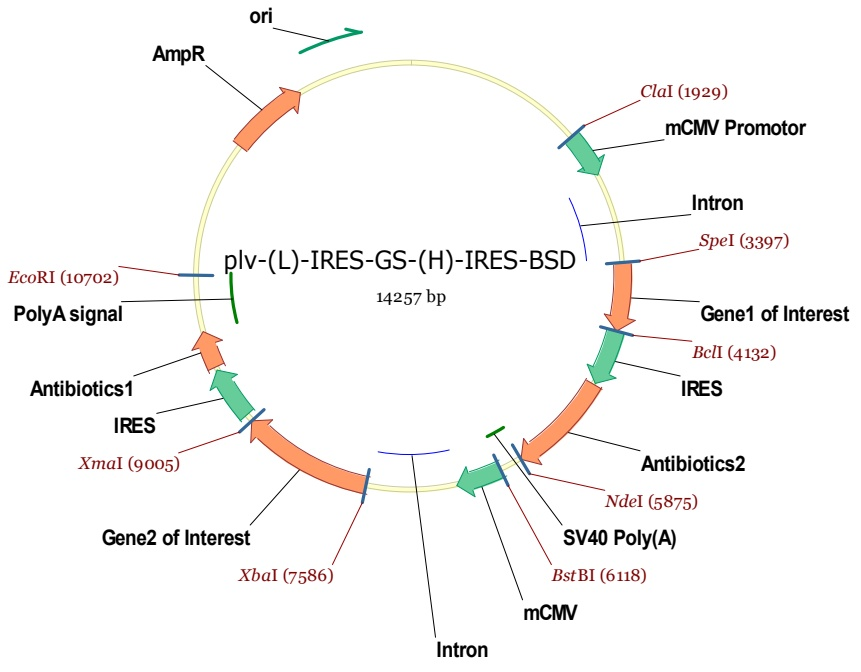

## 北京石油化工学院

## 硕士研究生入学考试《生物化学》考研样题

考试科目:生物化学 满分:150 分 考试时间:3 小时
注意事项:

(1) 答案用钢笔或圆珠笔写在答题纸上, 写在本试题纸上的答案一律无效。
(2) 不用抄题, 按下述格式注明答题顺序号、填写试题答案:

## 一、名词解释（每题4分，共40分）

1. 酶的活性中心:
2. 氨基酸的 PI:
3. 核小体:
4. 电子传递链:
5. 生物氧化:
6. 必需脂肪酸:
7. 尿素循环:
8. 同工酶:
9. P/O 比值:
10. 密码子:

## 二、单选题（每题2分，共40分，答案填在表格内）

| 1 | 2 | 3 | 4 | 5 | 6 | 7 | 8 | 9 | 10 |
| --- | --- | --- | --- | --- | --- | --- | --- | --- | --- |
|  |  |  |  |  |  |  |  |  |  |
| 11 | 12 | 13 | 14 | 15 | 16 | 17 | 18 | 19 | 20 |
|  |  |  |  |  |  |  |  |  |  |

1、DNA 分子不含下列哪种碱基（）。

A、腺嘌呤（A）

B、鸟嘌呤（G）

C、胸腺嘧啶（T）

D、尿嘧啶（U）

2、酶（）。

A、具有饱和现象

B、具有活性中心

C、具有严格的专一性

D、以上都是

3、TCA 循环是在什么条件下进行？（）。

A、有氧或无氧条件下一样，都进行

B、有氧条件下进行

C、有氧条件下进行得快

D、无氧条件下进行

4、生物膜的基本结构为（）。

A、双螺旋

B、三螺旋

C、液态镶嵌模型

D、以上都不是

5、构成蛋白质分子的基本单位是（）。

A、氨基酸

B、核苷酸

C、脂肪酸

D、核酸

6、胞浆中形成的 NADH+H+经苹果酸穿梭后，每 mol 产生的 ATP 数是: ( )。

A、1

B、2

C、3

D、4

7、与支链淀粉具有相同分支结构的是（）。

A、葡萄糖

B、糖原

C、果糖

D、纤维素

8、维持蛋白质二级结构的主要化学键是（）。

A、盐键

B、疏水键

C、肽键

D、氢键

9、核酸对紫外线的最大吸收峰在哪一波长附近？（）

A、280nm

B、260nm

C、200nm

D、340nm

10、酶原没有活性是因为（）。

A、酶蛋白肽链合成不完全

B、活性中心未形成或未暴露

C、缺乏辅酶或辅基

D、是已经变性的蛋白质

11、当氨基酸水溶液的 pH>pI 时，氨基酸（）。

A、带正电

B、带负电

C、净电荷为零

D、以上都不是

12、糖类、脂类、氨基酸氧化分解时，进入三羧酸循环的主要物质是（）。

A、丙酮酸

B、$\alpha$-磷酸甘油

C、乙酰-CoA

D、α-酮戊二酸

13、下面哪种氨基酸没有旋光性（）。

A、甘氨酸

B、丝氨酸

C、组氨酸

D、精氨酸

14、下列哪种物质抑制呼吸链的电子由 NADH 向辅酶 Q 的传递（）。

A、抗霉素 A

B、鱼藤酮

C、一氧化碳

D、硫化氢

15、可用于测量生物样品中核酸含量的元素是（）。

A、碳

B、氢

C、氧

D、磷

16、DNA  $T_{m}$  值较高是由于下列哪组核苷酸含量较高所致？（）

A、G+A

B、C+G

C、A+T

D、C+T

17、1 分子葡萄糖酵解时净生成多少个 ATP？（）

A、1

B、2

C、3

D、4

18、直链淀粉是葡萄糖以（）键连接形成。

A、 $\alpha-1$ ，4糖苷键

B、α-1，6糖苷键

C、β-1，4糖苷键

D、β-1，6糖苷键

19、绝大多数真核生物 mRNA-5'端都有（）。

A、帽子结构

B、poly A

C、起始密码

D、终止密码

20、双链 DNA 的一条链为 5'-AGCCTAG-3', 它的互补链是( )。

A、5'-AGCCTAG-3'

B、3'-TCGGATC-5'

C、TCGGATC

D、AGCCTAG

## 三、简答题（每小题6分，共计36分，答案标清题号）

1. 什么是 G 蛋白（G protein）和 G 蛋白偶联受体(G protein coupled receptor, GPCR)? GPCR 最大的特征是什么？（6 分）

2. 酶联免疫吸附实验（ELISA）的基本原理是什么？（6分）

3. 什么是蛋白质的变性和复性？（6分）

4、某酶遵循米氏方程，则

（1）当 $[S]=K_{m}$ 时， $v=30\mu mol/min$ ， $V_{max}$ 是多少？（3分）

(2) 当 $[\mathrm{S}] = 2 \times 10^{-5} \mathrm{~mol} / \mathrm{L}$, $\mathrm{v} = 40 \mu \mathrm{mol} / \mathrm{min}$, 这个酶的 $\mathrm{K}_{\mathrm{m}}$ 是多少? (3分)

5、什么是底物水平磷酸化？糖酵解中第一次底物水平磷酸化发生在哪一步？（6分）

6、为什么说氨基酸和蛋白质是两性电解质？什么是蛋白质的等电点，

蛋白质在大于、小于或者等于等电点时有何特性？（6分）

## 六、问答题（共3题，合计34分）

1、比较当无抑制剂、竞争性抑制剂，非竞争性抑制剂、反竞争性抑制剂存在时，酶促反应的  $V_{max}$  和  $K_{m}$  的变化。（10 分）
2、简述软脂酸的降解代谢过程，计算 1 分子软脂酸完全代谢为  $CO_{2}$  和  $H_{2}O$  释放出的能量（12 分）。
3、PD-1 抗体药物 Keytruda 是人源化的 IgG 分子，临床上用于多种肿瘤的免疫治疗，近年来被誉为抗肿瘤“神药”。试综述 Keytruda 表达质粒的设计、验证，并简要叙述用 CHO 细胞表达 Keytruda 抗体的大致流程（12 分）

表达质粒 pLV 图谱如下:

```mermaid
graph LR
  A["plv-(L)-IRES-GS-(H)-IRES-BSD"] --> B["Ampr"]
  B --> C["Ori"]
  C --> D["Clai (1929)"]
  D --> E["mCMV Promotor"]
  E --> F["Intron"]
  F --> G["SpeI (3397)"]
  G --> H["Gene1 of Interest"]
  H --> I["BclI (4132)"]
  I --> J["IRES"]
  J --> K["Antibiotics2"]
  K --> L["NdeI (5875)"]
  L --> M["SV40 Poly(A)"]
  M --> N["BstBI (6118)"]
  N --> O["mCMV"]
  O --> P["Intron"]
  P --> Q["Gene2 of Interest"]
  Q --> R["XmaI (9005)"]
  R --> S["Antibiotics1"]
  S --> T["PolyA signal"]
  T --> U["EcoRI (10702)"]
```

flowchart

