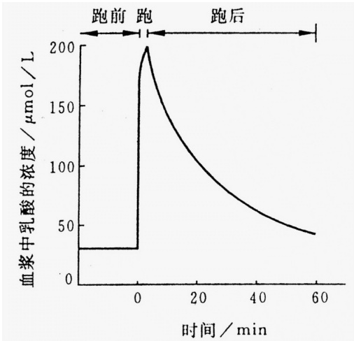

# 华侨大学 2012 年硕士研究生入学考试专业课试卷

(答案必须写在答题纸上)

招生专业 微生物学、生物化学与分子生物学、

生物化工、生物工程

科目名称\_\_\_\_ 生物化学\_\_\_\_ 科目代码\_\_\_\_

834

## 一、名词解释（每个3分，共30分）

1. P/O ratio ; 2. 不对称转录 ; 3. 构象 ; 4.

competitive inhibition ;

5. β 氧化途径；6. 米氏常数；7. 蛋白质四级结构；8. 退火；

9. promoter; 10. allosteric enzyme。

## 二、问答题（120分）

1、比较蛋白质  $\alpha$ -螺旋和 DNA 双螺旋结构中的氢键，包括它在稳定这两种结构中的作用（8 分）。

2、以下列 DNA 片断为模板，F1: 3'—

ATACAGTCGAGCACTGATCAC—5'

F2:  $5'$ —

## TATGTCAGCTCGTGACTAGTG-3'

箭头方向（每个2分，共10分）

a) 若箭头表示复制方向，则哪条链为前导链？
b) 若复制该 DNA，反应体系中至少需要哪些反应物参加？
c) 若箭头表示转录方向，则哪条链为模板链？
d) 如以该模板合成 RNA，反应体系中至少需要哪些反应物参加？
e) 写出由它复制、转录及翻译的产物，并注明各产物的两端（5'、3'、N端、C端）
密 码 表 : UAU 酪 CAG 谷 氨 酰 胺 AUG 蛋 GUC 缬
UGU 半 胱 CUC 亮 AGC 丝 GCU 丙 UCA 丝 CGU 精
ACU 苏 GUG 缬 UCG 丝 CUA 亮 AGU 丝 GAC 天 冬
3、当某一酶促反应的速度从最大速度的10%提高到 90% 时，底物的浓度要做多少改变？写出推导过程。（5 分）

4、在人的膳食中严重缺乏糖时（禁食减肥），为什么易发生酸中毒？酸中毒对人体有哪些危害？（10分）

5、DNA 连接酶催化什么样的反应？它在 DNA 复制中的作用是什么？（6 分）
6、什么是蛋白质的变性，引起蛋白质变性的因素有哪些？(6分)
7、RNA 易被碱水解，而 DNA 不易被碱水解。为什么？（8 分）

## 共 2 页 第 1 页

招生专业 微生物学、生物化学与分子生物学、生物化工、生物工程

科目名称 生物化学 科目代码 834

8、简述翻译的延长过程。(9分)
9、Describe the difference between DNA polymerase I and DNA polymeraseIII in DNA replication. (6 分)
10、在跑 400 米之前、途中、之后，血浆中乳酸浓度如下图:（6 分）

请问:

(1) 肌肉中乳酸的来源是什么?
(2) 为什么乳酸的浓度会迅速上升?
(3) 赛跑过后是什么原因使乳酸浓度下降?

为什么下降的速率比上升的速率慢？

line

| 时间 (min) | 血浆中乳酸的浓度 \((\mu mol/L)\) |
| --- | --- |
| -10 | 30 |
| 0 | 30 |
| ~5 | 200 |
| 60 | ~45 |

11、蛋白质分离纯化技术是蛋白质研究和制备的一项重要技术。请简单说明凝胶色谱法、

离子交换色谱法和亲和色谱法的分离纯化原理。（9分）

12、磺胺类药物抑菌作用属于酶的何种抑制作用，此种抑制有何特点？并阐述其抑菌机
理。（10 分）

13、简述真核生物基因转录调节的特点。(13分)

14、下列化合物需要穿过线粒体膜的进行生化代谢反应: NADH、丙酮酸、乙酰 CoA、脂酰 CoA, 这些物质是如何穿过线粒体膜的? (4 分)

15、写出谷草转氨酶催化的化学反应。（4分）

16、用 $E. coli$ 可溶性提取液与 dATP、dTTP、dGTP 和 dCTP 混合物一起保温。所有这四种前体的 $\alpha$-位磷原于都用 $^{32}\mathrm{P}$ 中标记。一段时间后，用三氯醋酸处理保温混合物，并收集沉淀。从存在于沉淀中的放射性量确定前体参入到 DNA 中去的程度。

①若有一个前体从保温混合物中省去，实际上没有在沉淀中发现放射性。为什么？
②如果只有 dTTP 被标记， $^{32}$ P 会参入到 DNA 中去吗？请解释。
③如果  ${}^{32}$ P 是标记 在前体的 β-位或 γ-位磷原子上, 会发现有放射性参入吗? 请解释。(6分)