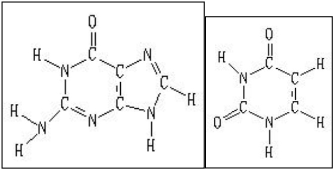

# 华侨大学 2013 年硕士研究生入学考试专业课试卷

# (答案必须写在答题纸上)

招生专业 微生物学、生物化学与分子生物学、生物化工、生物工程

科目名称 生物化学 科目代码 834

## 一、名词解释（每个3分，共30分）

1、Tm(熔解温度)；2、中心法则；3、信号肽；4、Isozyme；5、辅基；6、β-oxidation;
7、Competitive inhibition; 8、Okazaki fragment; 9、一碳单位; 10、Active site

## 二、问答题（15 题，120 分）

1、将下列化学名称与 B 族维生素及其辅酶形式相匹配？（7 分）。

（A）泛酸；（B）烟酸；（C）叶酸；（D）硫胺素；（E）核黄素；（F）吡哆素；（G）生物素。
(1) B1 ; (2) B2 ; (3) B3 ; (4) B5 ; (5) B6 ; (6) B7 ; (7) B11; (8) B12。
(I) FMN; (II) FAD; (III) NAD+; (IV) NADP+; (V) CoA; (VI) PLP; (VII) PMP; (VIII) FH2, FH4; (IX) TPP。

2、通过计算 1mol 乙酰辅酶 A 完全氧化成  $CO_{2}$  和  $H_{2}O$  生成的 ATP 摩尔数，简述该代谢途径的亚细胞部位、关键酶和限速酶、以及重要的生理意义。(12 分)

3、一个单链 DNA 和一个单链 RNA 分子量相同，试述至少 4 种方法将它们区分开？（8 分）

4、说明影响酶促反应速度的主要因素？（6分）

5、以下列 DNA 片断为模板， F1: 3' —ATACAGTCGAGCACTGATCAC—5'

F2: 5' —TATGTCAGCTCGTGACTAGTG—3'

箭头方向（每个2分，共10分）

a）若箭头表示复制方向，则哪条链为前导链？
b) 若复制该 DNA，反应体系中至少需要哪些反应物参加？
c) 若箭头表示转录方向，则哪条链为模板链？
d) 如以该模板合成 RNA，反应体系中至少需要哪些反应物参加？
e）写出由它复制、转录及翻译的产物，并注明各产物的两端（5’、3’、N 端、C 端）

密码表: UAU 酪 CAG 谷氨酰胺 AUG 蛋 GUC 缬 UGU 半胱 CUC 亮 AGC 丝 GCU 丙 UCA 丝 CGU 精 ACU 苏 GUG 缬 UCG 丝 CUA 亮 AGU 丝 GAC 天冬

6、磺胺类药物抑菌作用属于酶的何种抑制作用, 此种抑制有何特点? 并阐述其抑菌机理。(10 分)

7、写出谷草转氨酶催化的化学反应。(4 分)

8、Anfinsen 用核糖核酸酶进行变性—复性实验，在蛋白质结构方面得出重要结论是什么？（12 分）

招生专业 微生物学、生物化学与分子生物学、生物化工、生物工程

科目名称 生物化学 科目代码 834

9、Description: Four types of weak interactions (non-covalent bonds) within and between biomolecules. (4 分)

10、简述翻译的延长过程。(9 分)

11、根据蛋白质的一级结构氨基酸的序列可以预测蛋白质的空间结构，假设有下列19个氨基酸残基序列:（10分）。

1 2 3 4 5 6 7 8

组氨酸-酪氨酸-甘氨酸-脯氨酸-苯丙氨酸-谷氨酸-丙氨酸-甲硫氨酸-

9 10 11 12 13 14 15 16

半胱氨酸-酪氨酸-谷氨酸-丙氨酸-谷氨酰胺-脯氨酸-甲硫氨酸-组氨酸-

17 18 19

半胱氨酸-苯丙氨酸-精氨酸

(1) 预测在该序列的哪一部位可能会出弯或  $\beta-$  转角？
(2) 何处可能形成链内二硫键?
(3) 假设该序列只是大的球蛋白的一部分，下面氨基酸残基中哪些可能分布在蛋白的外表面？哪些分布在内部？

天冬氨酸、亮氨酸、丝氨酸、缬氨酸、谷氨酰胺、赖氨酸

12、DNA 连接酶催化什么样的反应？它在 DNA 复制中的作用是什么？（6 分）

13、蛋白质分离纯化技术是蛋白质研究和制备的一项重要技术。请简单说明凝胶色谱法、离子交换色谱法和亲和色谱法的分离纯化原理。(12分)

14、当某一酶促反应的速度从最大速度的 10% 提高到 90% 时，底物的浓度要做多少改变？写出推导过程。（4 分）

15、标出嘌呤、嘧啶碱基环上每个原子的来源。(6分)

