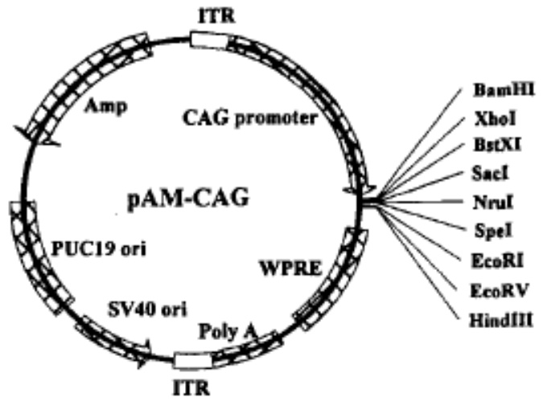
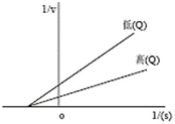

# 华侨大学 2014 年硕士研究生入学考试专业课试卷

# (答案必须写在答题纸上)

招生专业 微生物学、生物化学与分子生物学、生物化工、生物工程

科目名称 生物化学 科目代码 834

## 一、名词解释（每个3分，共30分）

1、反密码子；2、乙醛酸循环；3、酮体；4、操纵基因；5、顺式作用元件；
6、Ribozyme; 7、essential amino acid; 8、Tm(熔解温度);
9、Restriction enzyme; 10、Okazaki fragment

## 二、问答题（120 分）。

1、真核 mRNA 和原核 mRNA 各有何异同特点？(10 分)
2、什么是别构酶？简述别构酶的性质。（8分）
3、请说明 6—磷酸葡萄糖、柠檬酸及 ATP 对糖酵解及糖异生的调控作用。(5 分)
4、遗传密码如何编码？有何特点？（8分）
5、简述化学渗透学说。(6分)
6、以下列 DNA 片断为模板， F1: 3' —ATACAGTCGAGCACTGATCAC—5'

F2: 5' —TATGTCAGCTCGTGACTAGTG—3'

箭头方向（每个2分，共10分）

a）若箭头表示复制方向，则哪条链为前导链？
b) 若复制该 DNA，反应体系中至少需要哪些反应物参加？
c) 若箭头表示转录方向，则哪条链为模板链？
d) 如以该模板合成 RNA，反应体系中至少需要哪些反应物参加？
e）写出由它复制、转录及翻译的产物，并注明各产物的两端（5’、3’、N端、C端）
密码表: UAU 酪 CAG 谷氨酰胺 AUG 蛋 GUC 缬 UGU 半胱 CUC 亮 AGC 丝 GCU 丙 UCA 丝 CGU 精 ACU 苏 GUG 缬 UCG 丝 CUA 亮 AGU 丝 GAC 天冬

招生专业 微生物学、生物化学与分子生物学、生物化工、生物工程

科目名称 \_\_\_\_ 生物化学 \_\_\_\_ 科目代码 \_\_\_\_ 834

7、真核细胞中一个 RNA 初始转录物顺序如下所示，已知这个 RNA 的合成可以被低剂量的  $\alpha$ -鹅膏蕈碱抑制，请写出在细胞质中分离到的相应 RNA 的顺序，并指出该 RNA 的重要结构特征。（10 分）

5' PPPAUU (N) nAUGCCGAUAAGGUAGUA (N) nAUCUCCCUGCAGGG
CGUAACCAAUAAACGACGACGACGUCCCAAUAAAGAC······OH

8、请叙述脂肪酸的  $\beta$  氧化过程。(10 分)

9、在有氧条件下，有些组织如肝脏等彻底氧化一分子葡萄糖产生 32 分子 ATP，而某些组织如骨骼肌、脑组织等彻底氧化一分子葡萄糖产生 30 分子 ATP，请解释原因。（10 分）

10、现给定以下条件:

A. pAM-CAG 质粒载体（图谱如下），图中各元件分别表示:CAG 启动子；WPRE 增强子；ITR 末端反向重复序列；氨苄抗性位点 Amp；牛生长激素 polyA 元件

text_image

ITR
CAG promoter
Amp
pAM-CAG
PUC19 ori
SV40 ori
Poly A
ITR
WPRE
BamHI
XhoI
BstXI
SacI
NruI
SpeI
EcoRI
EcoRV
HindIII

B. 目的基因 TRAIL 两端分别带有 EcoR I 及 HindIII 酶切位点序列。
C. 基因工程菌株 DH5 α

请以给定条件为例，简述基因工程的基本操作程序。(6 分)

招生专业 微生物学、生物化学与分子生物学、生物化工、生物工程

科目名称 \_\_\_\_ 生物化学 \_\_\_\_ 科目代码 \_\_\_\_ 834

11、已知牛血清白蛋白(Bovine serum albumin)等电点约为4.6-5.8，分子量约为66KD；鲑精蛋白(salmine)等电点约为12.1，分子量约10KD，若①pH8.6条件下电泳一定时间，则靠近阳极的组分一般是什么？请解释；②SephadexG$_{100}$柱层析时，先洗脱出来的组分应该是什么？请解释。(每个3分，共6分)
12、请结合学过的知识及最新科技进展谈谈对真核细胞转录后调控的认识。（10分）
13、假设一个酶促反应系统中加入修饰剂 Q，得到如下图所示的结果。问 Q 起什么作用？它与 E 结合还是与 ES 结合，还是与 E 和 ES 都能结合？为什么？（5 分）

text_image

1/v
低(Q)
高(Q)
0
1/(s)

14、试解释糖尿病患者为何出现酮尿？（5分）
15、为什么原核生物启动子的-10区保守顺序中富含AT碱基对？（6分）
16、如果缺乏乳酸脱氢酶，骨骼肌能否完成紧张的肌肉收缩功能，为什么？（5分）