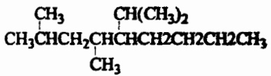
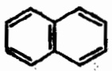
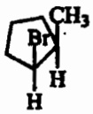
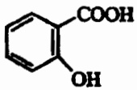
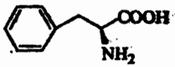
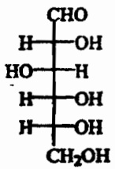
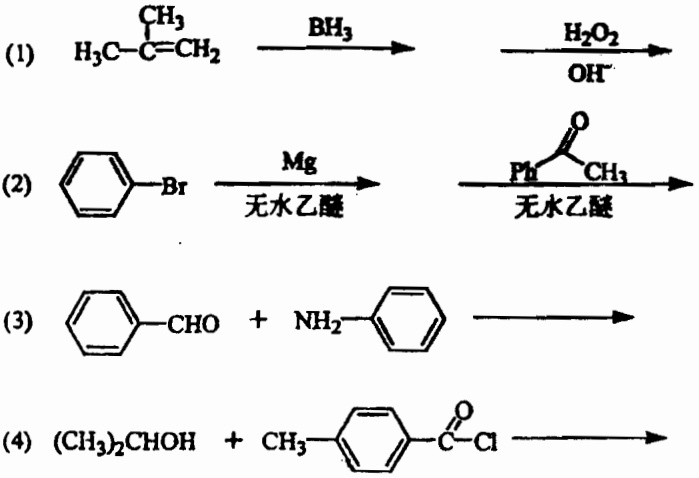
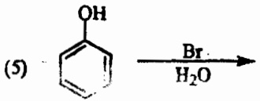
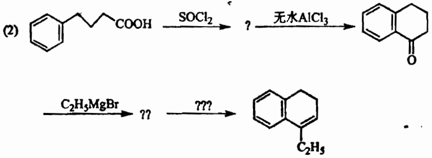
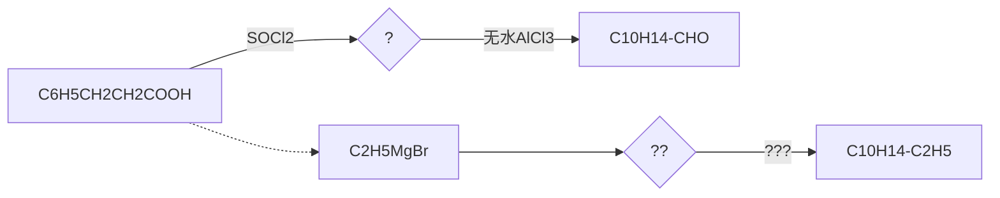

# 兰州大学 2003 年招收攻读硕士学位研究生考试试题

注意:答案请一律写在答题纸上，写在试题上无效。

# 考试科目:生物化学（含有机化学）

## 生物化学部分（共105分）

## 一.是非题:每题1分，共15分。是写“+”，非写“-”，填入题后“(）”中。

1 反转录酶仅具有 RNA 指导的 DNA 聚合酶的活力。 ( )
2 酶反应中，底物类似物的抑制作用和过量底物抑制作用的机制基本上是相同的。 （）
3 磷酸戊糖途径对保持红细胞的正常生理功能非常重要。 （）
4 脂肪组织中的甘油三酯分解产生的甘油必须运到其它部位才能代谢。 （）
5 所有的 $\alpha$ 一氨基酸都能与茚三酮发生颜色反应。 （）
6 生物体内存在的游离核苷酸多是  $3'$ -核苷酸。 ( )
7 形成稳定的肽键空间结构，非常重要的一点是肽键-CO-NH-中的四个原子以及和它相邻的两个 $\alpha$-碳原子处于同一平面。 （）
8 磷酸吡哆醛参与了氨基酸的脱羧过程。 （）
9 别嘌呤醇对次黄嘌呤氧化酶有很强的抑制作用，所以有时用它治疗痛风。 （）
10 丙二酸单酰 CoA 是调节脂肪酸 β-氧化的重要因素。 （）
11 解偶联剂可作为  $K^{+}$  的载体抑制氧化磷酸化作用。 ( )
12 硫胺素焦磷酸的主要功能是协助脱羧酶完成脱羧反应。 （）
13 多肽激素  $\beta$ -LPH 是  $\beta$ -内啡肽的前体。 ( )
14 DNA 的双螺旋结构之所以能够稳定存在主要是由于 DNA 分子中的磷酸基团能够与介质中的阳离子形成牢固的离子键。
15 用定点突变法得到缺失某一个氨基酸残基的突变酶，这个突变的酶蛋白不再具有催化活性，因此可以认为该缺失残基一定是酶结合底物的必需基团。 （）

## 二 选择题:每题1分，共15分。请将答案写在题后“（）”内。

1 下列关于磷酸化叙述错误的是（）。

A 磷酸化和去磷酸化都是酶促反应。

B 磷酸化只能使酶变为活性的形式。

C 磷酸化反应消耗 ATP

D 磷酸化发生在酶的特定部位。

2 体内脱氧核糖核苷酸生成的主要方式是:（）

A 直接由核糖还原

B 由核苷还原

C 由一磷酸核苷还原

D 由二磷酸核苷还原

3 可合成甲状腺素和儿茶酚胺的氨基酸是:（）

A Trp

B Ser

C Tyr

D Thr

4 盐析法沉淀蛋白质的原理是:（）

A 破坏水化膜

B 与蛋白质结合生成不溶性蛋白盐

C 使蛋白质变性

D 改变蛋白质的分子量

5 下列物质中不属于细胞内第二信使的是:（）

A CAMP

B Ca$^{2+}$

C IP3

D PKC

6 Vit B₂ 是下列哪种辅酶的组成成分:（）

A NAD$^{+}$

B CoA

C TPP

D FAD

7 决定大肠杆菌 RNA 聚合酶识别启动子特异性的是:（）

A a 亚基

B β 亚基

C o 亚基

D β'亚基

8 下列脂中哪种含有糖残基:（）

A 卵磷脂

B 神经节苷脂

C 翘磷脂

D 脑磷脂

9 下列哪种酶含有催化功能 RNA 成份:（）

A 核糖核酸酶 P

B RNA 聚合酶

C 反转录酶

D DNA 聚合酶

10 tRNA 分子的结构特征是: ( )

A 有密码子环和 $3^{\prime}$-CCA B 有反密码子环和 $3^{\prime}$-CCA C 有反密码子环和 $3^{\prime}$-polyA D 有密码子环和 $3^{\prime}$-polyA

11 下列哪种试剂可使蛋白质的二硫键打开:（）

A 溴化氰

B 碘乙酸

C 过甲酸

D DNFB

12 不含高能磷酸键的物质是:（）

A ADP

B 磷酸肌酸

C G-6-P

D 磷酸烯醇式丙酮酸

13 机体借助（）作用即可迅速使各种不同的氨基酸脱掉氨基。

A 转氨

B 联合脱氨

C 氧化脱氨

D 非氧化脱氨

14 在多糖和寡糖的生物合成中，葡萄糖的活性形式是:（）

A G-1-P

B G-6-P

C 尿苷三磷酸葡萄糖

D 尿苷二磷酸葡萄糖

15 有关乙酰 CoA 羧化酶，下列哪种描述是不正确的（）

A ATP 别构抑制其活力

B 柠檬酸能够刺激它的活性

C 磷酸化后可导致其失活

D 软脂酰 CoA 抑制它的活性

## 三 填空题:每空1分，共25分。

1 嘧啶环的两个氮原子分别来自于氨甲酰磷酸和\_\_\_\_。

2 乙酰乙酸、D-β-羟丁酸和 \_\_\_\_ 这三种物质统称为酮体。

3 胆固醇是\_\_\_\_类激素的前体。

4 在动物的肝和脂肪组织中有一个复杂的\_\_\_\_酶系，能够催化不饱和脂肪酸的形成。

5 形成一分子尿素可清除二分子氨基氮和一分子\_\_\_\_。

6 人体中的 Vit K 可来源于食物和 \_\_\_\_。

7 溶菌酶在与底物作用时，它的活性中心的 Glu$_{35}$ 可以提供一个质子进行\_\_\_\_催化。

8 α-鹅膏蕈碱能抑制真核生物的\_\_\_\_。

9 在 DNA 复制过程中，DNA 聚合酶是从 \_\_\_\_ 引物的 3'-OH 端开始合成新的 DNA 链。

10 细菌的 DNA 旋转酶是一种类型 II 的拓扑异构酶,它可连续引入\_\_\_\_到同一个双链闭环 DNA 分子中去。

11 RNA 分子的双螺旋区以及 RNA-DNA 杂交双链具有与 \_\_\_\_ DNA 相似的结构。

12 细菌中限制性内切酶总是与\_\_\_\_酶成对出现。

13 在分析核酸样品时，可用紫外分光光度计读出 260nm 与 280nm 的 OD 值，从  $OD_{260}/OD_{280}$  的比值即可判断样品的 \_\_\_\_。

14 溶液中多肽链折叠的结果使自由能\_\_\_\_。

15 在脱氧血红蛋白中,四个亚基通过 \_\_\_\_ 互相连接起来。

16 疏水相互作用在生理温度范围内随温度升高而\_\_\_\_。

17 向 Gly 溶液中加入过量甲醛,再用标准 NaOH 滴定,结果显示 Gly 的 PK₂'\_\_\_\_2-3 个 PH 单位。

18 y-羧基 Glu 首先在 \_\_\_\_ 中被发现, 它也存在于某些具有结合 Ca$^{2+}$功能的其它蛋白质中.

19 皮质醇的分泌受垂体前叶分泌的\_\_\_\_激素的调控.

20 在盐皮质激素中，\_\_\_\_的生理效应最强.

21 在机体各组织中,前列腺素是\_\_\_\_酶的抑制剂或激活剂.

22 雌二醇进入靶细胞内,与专一性受体结合形成激素-受体复合物,这个复合物本身即是一种\_\_\_\_增强子,导致大量特异蛋白质的合成

23 维生素 $D_{3}$ 在动物体内的活性形式是\_\_\_\_。

24 促黄体生成激素、促甲状腺激素和促卵泡激素三者的\_\_\_\_亚基分子量相同, 可以互换.

25 被激素-受体复合物激活的 G 蛋白的活性形式是 \_\_\_\_

四 问答题:共50分。

1 请说明为什么 EMP 途径不依赖于  $O_{2}$ ，而 TCA 循环却必须在有  $O_{2}$  的条件下才能进行？（8 分）

2 大肠杆菌中焦磷酸酶可催化焦磷酸水解为正磷酸，该酶分子量为 120,000，由六个相同的亚基组成，亚基之间无协同性。酶提纯后的  $V_{max}$  为每毫克酶 2800 活力单位。对这个酶，一个活力单位定义为在 37℃

# 兰州大学 2003 年招收攻读硕士学位研究生考试试题

# 注意:答案请一律写在答题纸上，写在试题上无效。

和 15 分钟内在标准测定条件下水解  $10 \mu mol$  焦磷酸所需的酶量。

a 当底物的浓度比 K 大得多时，每毫克酶每秒钟水解多少摩尔底物？
b 每毫克酶中活性部位有多少摩尔？（假设每个亚基上有一个活性部位）
c 此酶的转换数是多少？（8 分）

3 有一蛋白质在某组织内含量较低，很难分离提纯。现已知其分子量，并从其它实验室要来该蛋白质的抗体，问用哪些实验方法可以初步证实组织内的确含有该蛋白质？（8 分）
4 简述蛋白质分子翻译后的加工过程。(9 分)
5 请写出（1）完整线粒体内 NADH 至  $O_{2}$  呼吸链的组成顺序；

(2) 产生偶联 ATP 合成的部位。
(3) 三个作用于这段呼吸链不同部位的抑制剂的名称及作用点。(8分)

6 简述代谢的基本要略。(9 分)

1

## 有机化学部分（45分）

## 1 命名下列化合物(12 分)

chemical

Chemical structure of a branched alkane with methyl and ethyl substituents

(1)

(2)

(3)

(4)

(5)

## 2. 回答下列问题(8 分)

(1) 由肌肉中取得的乳酸的比旋光度 $[\alpha]_{D}^{20}=+3.8^{\circ}$ ，指出它表示的意思。
(4 分)

(2) 己知糖类化合物的相对构型是通过和 D-甘油醛相比较来确定的，请指出右边葡萄糖的相对构型。(2 分)

chemical

Chemical structure of a glycoside with multiple hydroxyl groups and a methyl group

(3) 环己烷的构象有两种:船式和椅式，其中能量比较低而稳定的优势构象是哪一种？（2分）

## 3. 写出下述化学反应的主产物（14分）

chemical

Chemical reaction showing bromination of a benzene derivative with water to form an alcohol

共5页第4

## 兰州大学 2003 年招收攻读硕士学位研究生考试试题 注意:答案请一律写在答题纸上，写在试题上无效。

## 4. (11 分)

(1) 已知环己醇在水中不溶解，苯酚微溶于水。请设计方案把含上述两种化合物的混合物分离开。(5 分)

flowchart

试填出上面合成反应中空缺的三个化合物。(6分)