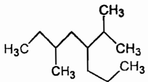
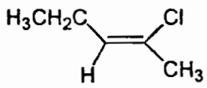
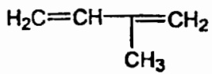
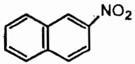
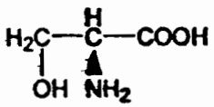
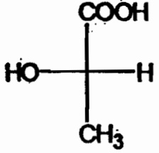

# 兰州大学 2004 年招收攻读硕士学位研究生入学考试

# 考试科目:生物化学（含有机化学）

所有答案必须写在答题纸上，并写清题号

## 生物化学部分（共105分）

一是非题:每题1分，共15分。是写“+”，非写“-”。

1. 蛋白质经碱水解后会产生消旋现象，所得产物为 D-Aa。 ( )
2. 从热力学角度考虑，完全暴露在水环境中的多肽片段较完全埋藏在蛋白质分子非极性内部的多肽片段更容易形成α-螺旋。 （）
3. 酶之所以具有底物专一性是因为酶的活性部位与底物的形状正好互补。 （）
4. 赖氨酸类酶的赖氨酸  $\varepsilon$  —氨基与底物羰基形成西佛碱属于酶的共价催化方式。 （）
5. 泛酸不仅出现在CoA中，也是构成ACP的成份。 （）
6. 核酸降解成单核苷酸后，紫外吸收值上升。 （）
7. Polyd(A-T)比Polyd(G-C) $T_{m}$ 值高。()
8. 性腺和肾上腺皮质分泌的绝大多数都是甾醇类激素，少数为脂肪酸衍生物激素。
9. 细胞色素C是唯一水溶性的细胞色素。
10. 转酮酶催化酮糖供体上二碳单位的转移，反应需 TPP 为辅酶。 （）
11. 烯脂酰辅酶A水化酶专一性极强，只作用于反式烯脂酰辅酶A。 （）
12. 由于缺乏分解尿酸的能力，人和猿类只能将尿酸作为嘌呤碱基代谢的终产物。（）
13. 磷酸戊糖途径和苹果酸穿梭可为脂肪酸的合成提供NADPH。 （）
14. 在 20 种基本氨基酸中，只有 Trp 和 Met 没有密码的简并性。 （）
15. RNA 复制酶除识别病毒自身的 RNA 外，还可识别宿主细胞的 RNA。 （）

## 二 选择题:每题1分，共15分。

1: 存在 Y-肽键的物质是 \_\_\_\_

A 谷胱甘肽

B 肌肽

C 短杆菌肽 S

D 脑啡肽

2. 透析和超过滤常用于 \_\_\_\_

A 分离各种大小不等的蛋白质分子

B 蛋白质溶液的浓缩和脱盐

C 过滤沉淀物

D 吸附杂质

3. 胰凝乳蛋白酶的转换数是  $100s^{-1}$ ，DNA 聚合酶是  $15s^{-1}$ ，下面的叙述中正确的是 \_\_\_\_

A 胰凝乳蛋白酶结合底物比 DNA 聚合酶有更高的亲和性。
B DNA 聚合酶比胰凝乳蛋白酶结合底物有更高的亲和性。
C 在饱和底物水平下，胰凝乳蛋白酶反应速度比 DNA 聚合酶更大。
D 在不饱和底物水平下，胰凝乳蛋白酶反应速度比 DNA 聚合酶更大。

4. 醛缩酶的系统编号为\_\_\_\_

A EC4.1.2.7

B EC 3.1.2..7

C EC 2.1..2.7

D EC 6.1.2.7

5. 砷化物的毒理作用在于破坏了 \_\_\_\_ 从而抑制丙酮酸脱氢酶复合体。

A FAD

B NAD $^{+}$

C 辅酶A

D 硫辛酸

6. 缺乏维生素 $B_{12}$ 的病人在尿中排泄异常大量的 \_\_\_\_

A 琥珀酸

B 草酰乙酸

C 乳酸

D 甲基丙二酸

7. 反密码子 I G C 可以识别的密码子是 \_\_\_\_

A GCG

B GCA

C ACG

D ICG

8. 用碱水解RNA时，可得到\_\_\_\_

A. 3' —与5' —核苷酸的混合物

B 2' -与5' -核苷酸的混和物

C 2'一与3'一核苷酸的混合物

D 只有  $5'$  —核苷酸

9. 下列关于真核细胞 mRNA5' 一帽子的叙述中，不正确的是 \_\_\_\_

A 可抗 5' — 核酸外切酶降解

B 可能与蛋白质合成的正确起始有关

C 可协助核糖体与 mRNA 结合

D 与 mRNA 从细胞核到细胞质的转移有关

10. 胰岛素和表皮生长因子的受体是一种\_\_\_\_

A 磷酸化酶

B 激酶

C 脱氢酶

D 脂酶

11. 下列对 G 蛋白的描述中，不正确的是 \_\_\_\_

A G蛋白具有  $GTP_{ase}$  活性

B G蛋白活性形式为G.-GTP

C EF手结构是激活G蛋白的跨膜受体所具有的普遍性质

D 激素受体复合物可激活G蛋白

12. 下列物质中，不抑制呼吸链中电子传递体的是 \_\_\_\_

A 鱼藤酮

B 抗霉素A

C

CO

D

寡霉素

13. 谐解途径中磷酸甘油醛脱氢酶催化的反应与下列哪个基团无关\_\_\_\_

A ADP

B  $H_{3}PO_{4}$

C

酶活性中心的一SH

D

NAD'

14. 下列哪一个物质不是酮体代谢的中间物 \_\_\_\_

A 乙酰乙酸

B HMGCoA

C

乙酰乙酰 CoA

D

草酰乙酸

15. 下列哪种辅酶中不含 AMP \_\_\_\_

A CoA

B FMN

C

FAD

D

NAD$^{+}$

## 三 填空题:每空 1 分，共 23 分。

1. 在正丁醇:醋酸:水的系统中进行纸层析时，Lys、Tyr、Ala 混合物中各氨基酸的  $R_{f}$  值从大到小为 \_\_\_\_。

2. 用磺酸型离子交换树脂进行氨基酸的分离时,有效的洗脱方法是\_\_\_\_和\_\_\_\_。

3. 对一个遵从米氏方程的酶来说，当[S]=Km，竞争性抑制剂浓度[I]=K$_{i}$时，反应的初速度是\_\_\_\_。

4. 有光时视紫红质分解为视蛋白和 \_\_\_\_

5. B—DNA 双螺旋模型中的碱基堆积距离为 \_\_\_\_。

6. tRNA 中  $\Psi$  是指 \_\_\_\_ 核苷酸。

7. 将 RNA 变性后转移到纤维素膜上与探针杂交的方法称为 \_\_\_\_。

8. 加压素又称\_\_\_\_，是调节水盐代谢的重要激素。

9. 由于肌肉中无\_\_\_\_酶，所以肌糖原分解后不转变为血糖，而是产生 ATP。

10. 糖异生过程的酶分布在细胞的\_\_\_\_。

11. dTMP 合成的直接前体是 \_\_\_\_。

12. 嘧啶环的元素来源为 \_\_\_\_。

13. 细胞中分解代谢和合成代谢的单向性往往是通过 \_\_\_\_ 来实现的。

14. 在大肠杆菌蛋白质合成过程中，起始密码子的辨认与\_\_\_\_亚基有关。

15. 除\_\_\_\_ 外所有氨酰—tRNA 必须与 Tu—GTP 结合后才能进入 70s 核糖体的 A 位点。

16. 在肽链合成终止阶段，肽酰转移酶活力变为 \_\_\_\_ 活力从而释放出肽链。

17. 在多肽合成中，高尔基体的作用为 \_\_\_\_ 和 \_\_\_\_。

18. 大肠杆菌 DNA 连接酶以 \_\_\_\_ 作为能量来源。

19. 大肠杆菌 RNA 聚合酶中 \_\_\_\_、\_\_\_\_亚基被称为起始因子。

20. DNA 复制过程中，碱基的配对受到双重核对:\_\_\_\_和\_\_\_\_。
四 问答题:共 52 分。

1. 酸水解一个五肽，得 Glu、Glu、Tyr、Tyr、Lys。胰蛋白酶可使原五肽裂解成两个片段，在 pH=7.0电泳时，其中一个片段移向正极，另一个片段移向负极。用DNFB处理其中一个片段后，再进行酸解，得DNP-Glu。用糜蛋白酶处理原五肽可得两个二肽和一个自由Glu。请写出此五肽的氨基酸排列顺序并简要说明理由。（6分）

2. 当红细胞内己糖激酶和丙酮酸激酶分别受到抑制时，血红蛋白的携氧功能有什么变化？（6分）
3. 设计实验证明某酶活性中心含有必需基团—SH。(6分)
4. 举例说明激素分泌的负反馈调节作用。(6分)
5. 细胞内氧化还原反应是如何偶联 ATP 的生成的？（8 分）

o
||

用结构式表示经标记的  ${}^{13}CH_{3}-{}^{14}C-SCoA$  参与 TCA 循环后脱去两个  $CO_{2}$  的过程。(6 分)

7. 简述乙酰辅酶 A 羧化酶的催化机制及活性调控（6 分）
8. 写出肌肉组织中氨基酸的氨基转变为尿素的过程（8分）

有机化学部分(45 分)

## 五、命名下列户合物或写出结构式(10分):

chemical

Chemical structure of a substituted cyclohexane with methyl groups and alkene side chain

1.

chemical

Chemical structure of a chlorinated alkene with methyl and hydrogen substituents

2.

3.

4.

## 5. 顺-1，3-二甲基环戊烷；

chemical

Chemical structure of a carboxylic acid with hydroxyl and amino groups

6.

## 7. 丙烯醛.

## 六、回答下列问题（17分）:

1. 芳香性化合物在化学性质上一般都相当稳定，不易被氧化，不易进行加成反应，而容易发生亲电取代反应。从结构上来说，芳香性化合物必须满足休克尔规则。请阐述休克尔规则的内容。(4分)
2. 手性是自然界普遍从在的现象，在生命体的生理活动中具有十分重要的意义。手性化合物是指一个化合物与其对映体之间互为镜影但又不能彼此重叠几乎为左右手关系的化合物。手性化合物的构形有绝对构型与相对构型。绝对构型确定的经典方法是 X-Ray 的单晶衍射。请问手性化合物的相对构型是
3. 对于 L-苏氨酸，表征其特性的理化数据中有一组为: $[\alpha]_{D}^{20}=-28.4^{\circ}$  (1.0,  $H_{2}O$ )，它的意思是什么？(3分)
4. 环己烷和环己烯都是无色透明的液体，如何用简单的方法把这二者加以区分？写出相应的化学反应式。（4分）
如何确定的？下述的乳酸从其Fischer投影式来看，其绝对构型为S，其相对构型是什么？（6分）

chemical

Chemical structure of a diol compound with carboxylic acid, hydroxyl, and methyl substituents

## 七、完成下列化学反应:（18分）

1.  $\ce{C6H5 + Cl2 -> ?}$
2.  $\ce{C6H5Br + Mg ->[无水乙醚] ? ->[ (i) CO2][ (ii) H+3O·] ?}$
3.  $\left\langle+\mathrm{Br}\rightarrow? \right.$   $\xrightarrow{KOH,乙醇}$   $\left\langle\right\rangle$   $\xrightarrow{H_{2}C=CHCHO}$  ?
4.  $\ce{C6H5 + C6H5Cl ->[无水AlCl3] ?}$
5.  $\begin{array}{c} CH_{2}OH \\ | \\ O \\ \downarrow \\ CHOH \\ \downarrow \\ CHOH \\ \downarrow \\ CH_{2}OH \end{array} \xrightarrow{\text{PhNHNH}_{2}} ? \xrightarrow{\text{过量 PhNHNH}_{2}} ?$
6.  $C_{15}H_{31}\overset{O}{\underset{n}{COC}}_{2}H_{5}\xrightarrow[\Delta]{NaOH}$  ?

考试科目:生物化学(含有机化学)