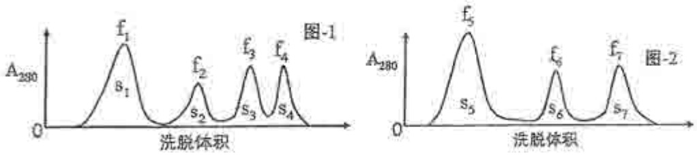

# 中山大学

## 二〇一一年攻读硕士学位研究生入学考试试题

科目代码:654

科目名称:生物化学（A）

考试时间:1月16日上午

考生须知

全部答案一律写在答题纸上，答在试题纸上的不计分！请用蓝、黑色墨水笔或圆珠笔作答。答题要写清题号，不必抄题。

## 一、填空题（每题1分，共30分）请将答案写在答题纸上，并标明题号。

1. 含 Pro 残基的 β-turn 的形成需要 \_\_\_\_ 的催化。
2. 天然α螺旋的对映异构体是\_\_\_\_。
3. 最坚韧的纤维状蛋白质是\_\_\_\_。
4. 目前，测定蛋白质分子量最准确的方法是\_\_\_\_。
5. 第一个被解析出晶体结构的蛋白是\_\_\_\_。
6. Thr 手性碳原子个数与 Leu 手性碳原子个数之和是 \_\_\_\_。
7. 人体内的2,3二磷酸甘油酸浓度升高，导致Hb与氧的亲和力\_\_\_\_。
8. 某肽不含 Pro、Arg 和 Lys 且羧肽酶不能水解，则此肽是 \_\_\_\_。
9. 纤维素是D-葡萄糖单体通过\_\_\_\_糖苷键连接而成的聚合物。
10. 鞘脂的骨架结构是\_\_\_\_。
11. 在细胞内传递激素效应的物质称为\_\_\_\_。
12. 固定化酶的方法主要有不溶性酶法，可溶性酶法和 \_\_\_\_。
13. 甲硫氨酸和 \_\_\_\_ 只有一个密码子。
14. 某 tRNA 的反密码子为 IGC，其可识别的密码子是 GCU，GCC 和 \_\_\_\_。
15. 正常状态下，\_\_\_\_是肌肉最理想的能量提供者。
16. 生物体内的维生素 C 和维生素\_\_\_\_被称为天然抗氧化剂。
17. 一个转录单位通常应包括启动子序列，编码序列和\_\_\_\_序列。
18. 在生物体内糖转变为蛋白质的中间产物是\_\_\_\_。
19. 女性的一条 X 染色体无转录活性的主要原因是染色体本身高度浓缩以及 \_\_\_\_。
20. 高等动物体内除酶和激素对代谢有调节作用外，\_\_\_\_对代谢也有调节作用。
21.转氨酶催化的反应的平衡常数接近于\_\_\_\_。

22. 膜蛋白和分泌蛋白通常在内质网和高尔基体受到\_\_\_\_修饰。
23. 嘌呤核苷酸合成过程中最先合成的核苷酸是\_\_\_\_，进而再转变成其他的嘌呤核苷酸。
24. 细胞核蛋白质结构中通常有一段特定的序列，称之为\_\_\_\_。
25. DNA 序列中调节转录活性的结构元件统称为 \_\_\_\_。
26. mRNA 前体中 AAUAAA 序列是一个 \_\_\_\_ 信号。

27. 一个 mRNA 前体经加工可能获得几个不同大小的成熟 mRNA 分子, 这是因为存在\_\_\_\_现象。

28. 逆转录病毒的逆转录酶可以催化RNA指导的DNA合成，\_\_\_\_以及DNA指导的DNA合成等3个不同的反应。

29. 端粒酶(Telomerase)实际上是一个\_\_\_\_酶.

30. dTMP 是由 \_\_\_\_ 通过甲基化反应而来。

## 二、是非题（每题1分，共30分）

1. 活性中心包含 Asp 残基的蛋白水解酶称为天冬氨酸蛋白酶。
2. 构成乙酰胆碱受体离子通道的 $\alpha$ 、 $\beta$ 、 $\gamma$ 和 $\delta$ 亚基属于同源蛋白。
3. 具有手性碳原子的化合物一定具有旋光性。
4. 蛋白质、DNA 和 RNA 都具有高级结构。
5. SDS-PAGE 时，不同大小蛋白质分子的电荷/质量比值趋近于相同。
6. α-D-吡喃葡萄糖与β-D-吡喃葡萄糖是一对旋光异构体。
7. 活细胞中 tRNA 的空间结构呈“L”型。
8. 酶与天然底物的亲和力比与过渡态类似物的亲和力高。
9. 完成折叠的蛋白质，其分子内氢键的数目倾向于达到最大。
10. 在生命活动中，核苷酸只起遗传信息载体的作用。
11. 异头物（anomers）是指仅在氧化数最高的碳原子具有不同构型的糖分子的两种异构体。
12. 受体的本质是蛋白质，少数是糖脂。
13. 消光值（E）在数值上等于透光度倒数的对数。
14. 一种酌多少种底物就有多少种 Km 值。
15. RNA 是基因表达的第一个产物。
16. 糖苷中的配糖体可以是除糖以外的任何分子。
17. 非蛋白氮是指血液中除蛋白质外的其他含氮物质所含的氮，其中尿素氮约占75%。
18. 人体内能使葡萄糖磷酸化的酶是己糖激酶和磷酸果糖激酶。

19. 共价调节酶的活性受 ATP 的共价修饰调节。
20. 线粒体 DNA 复制时需要使用 RNA 引物。
21. 谷胱甘肽 (Glutathione, GSH) 是一个典型的 3 肽，具有 2 个肽键。一个 α 氨基和一个 α 胶基。
22. 脱氧核糖核苷酸中的脱氧核糖直接来源于 dPRPP。
23. 由于遗传密码存在简并性，所以每一个氨基酸对应有多个 tRNA。
24. 甲硫氨酸（Methionine）含有一个活泼甲基，因此，是机体甲基化反应中甲基的主要直接供体。
25. 一个基因 mRNA 的转录通常是从编码链 ATG 处开始的。
26. 血浆中含有合成蛋白质所需的各种氨基酸，且每种氨基酸的浓度基本一致。
27. 核苷酸从头合成的特征不是先合成碱基，然后碱基再与核糖和磷酸结合。
28. 氨基酸可以通过脱氨基也可以通过脱羧基进行代谢。
29. 多聚腺苷酸聚合酶(Polyadenylate polymerase) 催化 mRNA 加尾时不需要模板。
30. 某些氨基酸对人类而言之所以是必需氨基酸，是因为人类不能合成其骨架的碳链部分。

## 三、问答题（每题10分，共90分）

1. 有 5 种蛋白质， $P_{1}$ 、 $P_{2}$ 、 $P_{3}$ 、 $P_{4}$ 、 $P_{5}$ ，它们的等电点  $pI_{1}$ 、 $pI_{2}$ 、 $pI_{3}$ 、 $pI_{4}$ 、 $pI_{5}$  大小排序为  $0 \rightarrow pI_{1} \rightarrow pI_{2} \rightarrow pI_{3} \rightarrow 7.0 \rightarrow pI_{4} \rightarrow pI_{5} \rightarrow 14$ 。将含有 5 种蛋白质的混和液各 3ml 分别加入两种不同介质的离子交换层析柱（假定所有缓冲液的 pH 为 7.0，柱床体积为 20ml，能完全吸附带相反电荷的蛋白质），然后使用 NaCl 进行梯度洗脱（两柱洗脱流速相同），紫外检测并记录洗脱曲线如图-1 和图-2。如果洗脱峰用  $f_{n}$  表示，峰面积用  $S_{n}$  表示，请回答:（1）哪个图是阳离子交换层析的结果，哪个图是阴离子交换层析的结果？（2）每个洗脱峰各自对应哪些蛋白？（3）理论上，洗脱峰的面积之间有哪些等量关系？（4）哪些蛋白质的等电点最接近？

2. 推导单底物酶的 Michaelis-Menten 方程，并说明必要的推导依据。
3. 离子跨膜运输的方式有哪些，各有何特点？举例说明它们是如何维持膜内外正常离子浓度的。
4. 核苷酸是细胞合成核酸的原料，在核苷酸的合成过程中，细胞通过何种方式来调节不同核苷酸量的平衡？试分析之。
5. 实验测得天冬氨酸氨基转移酶（Aspartate aminotransferase）是哺乳动物肝脏氨基转移酶中活性最高的，为什么？

6. 多肽化学合成和生物学合成的延伸方向是否一致？结合其合成过程进行解释。
7. 宿主细胞中引入外源 DNA（如质粒）的大量表达通常会导致细胞内部代谢的改变（也称代谢负荷）。试分析代谢负荷对宿主细胞代谢会造成哪些可能的影响？
8. 你是否同意 RNA 的不稳定性有利于自然选择的说法，为什么？
9. 细胞中的核酸总是与蛋白结合在一起。简述在实验操作中分离和纯化核酸的常用方法及原理。