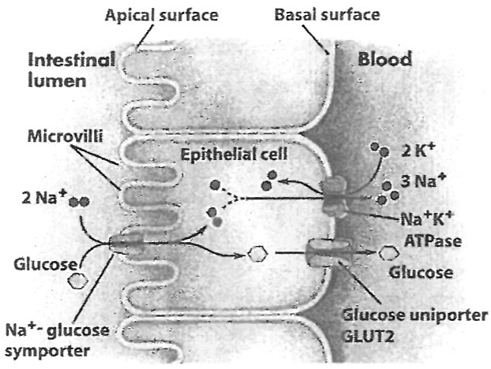
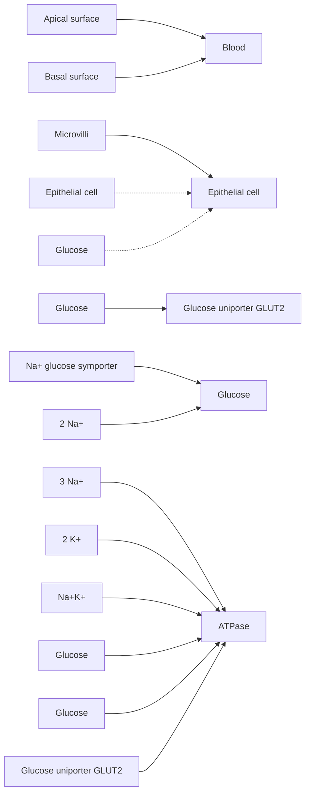

# 中山大学

# 二〇一二年攻读硕士学位研究生入学考试试题

科目代码: 654

科目名称: 生物化学（一）

考试时间:1月8日上午

考生须知

全部答案一律写在答题纸上，答在试题纸上的不计分！请用蓝、黑色墨水笔或圆珠笔作答。答题要写清题号，不必抄题。

## 一.填空题:（每题1分，共30分），答案请标明每题的序号。

1. 用谷氨酰胺转移酶（Glutamine amidotransferase）抑制剂处理正在生长的细胞，核苷酸合成过程中的\_\_\_\_中间产物将会堆积。
2. 在蛋白质生物合成（翻译）过程中，氨基酸的活化形式是\_\_\_\_。
3. 一种 tRNA 上的反密码子最多可以识别\_\_\_\_个密码子。
4. 在尿素合成过程中，其中的一个 N 直接来源于\_\_\_\_氨基酸。
5. 磺胺类药物的作用机制是干扰\_\_\_\_的代谢。
6. 机体从头合成的第一个嘌呤核苷酸是\_\_\_\_。
7. 多聚腺苷酸聚合酶(Polyadenylate polymerase) 也是一个聚合酶，但其特点是在催化 mRNA 加尾时不需要\_\_\_\_。
8. 遗传密码表中所有密码子对应的氨基酸有\_\_\_\_个。
9. tRNA 3\`端的核苷酸(碱基)是\_\_\_\_。
10. 真核生物 80S 核糖体是由一个 60S 的大亚基和一个 \_\_\_\_ S 的小亚基构成。
11. 精氨酸的等电点是 \_\_\_\_ (pK₁=2.17, pK₂=9.04, pKₙ=12.48)。
12. 在 280nm 吸收最强的标准氨基酸是\_\_\_\_。
13. 从沿海地区到西藏后，人体内的 BPG 浓度升高，导致 Hb 与氧的亲和力\_\_\_\_。
14. 柱层析的主要种类有分子筛层析、离子交换层析、亲和层析和 \_\_\_\_。
15. 粗肌丝的肌球蛋白分子头部有 \_\_\_\_ 结合位点和肌动蛋白结合位点。
16. 由 β (1→4)糖苷键连接 D-葡萄糖产生的天然多糖是 \_\_\_\_。
17. 鞘脂的骨架不是甘油，而是\_\_\_\_。
18. 0 连接指寡糖与 Ser 或 Thr 残基的侧链羟基 O 连接，N 连接指 \_\_\_\_。
19. 酶在体内的活性调节方式主要有别构调节和\_\_\_\_。
20. 在 DNA 的自动化测序中，荧光基团可标记在 ddNTP 或 \_\_\_\_ 上。
21. 心肌梗死患者的血清中肌酸激酶和\_\_\_\_酶的活性增高，常用于心肌梗死的诊断。
22. 乳酸循环是耗能过程，2 分子乳酸异生成葡萄糖时需消耗\_\_\_\_分子 ATP。
23. 免疫球蛋白 IgM 能固定补体，其抗原受体位于 \_\_\_\_。
24. 人体内的激素在发挥其调节作用后主要在肝内被分解转化，这一过程称为\_\_\_\_。
25. 蛋白聚糖由糖胺聚糖共价连接于核心蛋白组成，其加工场所主要在\_\_\_\_。
26. 生长因子主要有内分泌，旁分泌和\_\_\_\_等三种作用方式。
27. 体内高能磷酸化合物的生成方式有底物水平磷酸化和\_\_\_\_两种。
28. 蛋白质内含子通常具有\_\_\_\_酶活性。
29. 利用磷酸化来修饰酶的活性时，其修饰位点通常在\_\_\_\_残基上。
30. 有些肽类激素能促进蛋白质的生物合成是因为细胞内的 cAMP 浓度提高，激活了\_\_\_\_酶。

## 二. 是非题（每题1分，共30分），答案请标明每题的序号。

1. $\mathrm{N}^{5}-\mathrm{CH}_{3}-\mathrm{FH}_{4}$ 携带有甲基，为机体内大多数甲基化反应提供甲基。
2. DNA polymerase 和 RNA polymerase 都有校读（proofreading）活性。
3. 转氨酶可催化谷氨酰胺发生转氨基作用生成 $\alpha$-酮戊二酸。
4. 在蛋白质生物合成过程中识别起始 AUG （initiation codon AUG）和开放读框中的 AUG（internal codon AUG）的 tRNA 不一样。
5. 胰岛素的A链和B链是由同一个基因编码的。
6. DNA 复制和转录过程中，新链的合成方向都是从 5\`到 3\`方向。
7. 多肽固相化学合成和生物合成的延伸方向是一致的。
8. 甲硫氨酸(Methionine)是人体必需氨基酸。
9. 机体尿素合成障碍是导致尿酸水平增加的主要原因之一。
10. 糖代谢中磷酸戊糖途径产生的脱氧核糖主要用于脱氧核糖核苷酸的生物合成。
11. 天然单糖为D构型，因此其旋光性向右。
12. 朊病毒是一种易于被诱导发生构型变化的蛋白质。
13. 细胞内的DNA出现三链或四链结构，说明该细胞处于不正常状态。
14. SDS-PAGE时，不同大小蛋白质分子的电荷/质量比值趋于相同。
15. 酶可以降低生化反应的活化能，因此可以改变反应的平衡常数。
16. 肌红蛋白与氧分子的结合都具有正协同效应。
17. 膜脂中不饱和脂肪酸主要是顺式构型。
18. 蛋白质具有高级结构，而DNA和RNA没有高级结构。
19. $\alpha$-D-吡喃葡萄糖与 $\beta$-D-吡喃葡萄糖不是对映异构体。
20. G蛋白和小G蛋白是细胞膜结合蛋白。
21. 生物固氮作用通常需要厌氧环境主要是因为钼铁蛋白对氧非常敏感。
22. 半胱氨酸和甲硫氨酸是体内硫酸根的主要供体。
23. 蛋白质的寿命通常与其成熟蛋白质的C端氨基酸序列有关。
24. 氨甲酰磷酸在体内可以合成尿素和嘌呤。
25. 氨在水中的溶解度小于尿酸。
26. 某些DNA序列既可以作为增强子又可以作为沉默子。
27. ppGpp 在细菌缺乏氮源时被合成。
28. 天冬氨酸是由柠檬酸循环中的中间物质经转氨作用而形成的。
29. 在高乳糖，低葡萄糖的情况下，乳糖操纵子的转录活性比高乳糖，高葡萄糖的情况更高。
30. 一氧化氮受体是可溶性 GC 受体。

## 三.问答题（每题10分，共90分），答案请标明每题的序号。

1. 简述胶原蛋白和丝蛋白在结构和氨基酸组成上的特点及其与功能的适应。

2. ATP 中存在“高能磷酸键”的含义是什么？举三类 ATP 作为能量被消耗的例子。

3. 根据下图说明葡萄糖在小肠被吸收进入血液循环的机制。

flowchart

4. 某研究小组分离到一个新的噬菌体，测得其DNA碱基组成为:A, $22\%$ ; T, $33\%$ ; G, $25\%$ ; C, $20\%$ 这些信息说明了什么？请解释。
5. 正常人血浆中含有蛋白质合成所需的各种氨基酸，但含量并不均衡，其中丙氨酸（Alanine）和谷氨酰胺（glutamine）浓度明显高于其他氨基酸，为什么？
6. 有两种途径消耗 ATP 将天冬氨酸（Asp）转变成天冬酰胺（Asn）。许多细菌的 Asn 合成酶利用 $\mathrm{NH}_4^+$ 作为氮源，而哺乳动物 Asn 合成酶利用谷氨酰胺（Gln）作为氮源。由于合成 Gln 需要额外消耗 ATP，为什么哺乳动物采用这一条途径？
7. 简述第二信使(second messenger)的主要类别及其作用机制。
8. 酶的化学本质是蛋白质，因而通常在低温下保存。但有一类酶在低温下容易失活，称冷不稳定酶，试分析冷不稳定酶失活的可能原因。
9. 在基因工程中，为了从宿主细胞分离获得外源基因的产物，需要根据目的蛋白的特性采用相应的技术。列出5种常用蛋白质分离纯化技术，并说明它们分别根据蛋白质的什么特性。