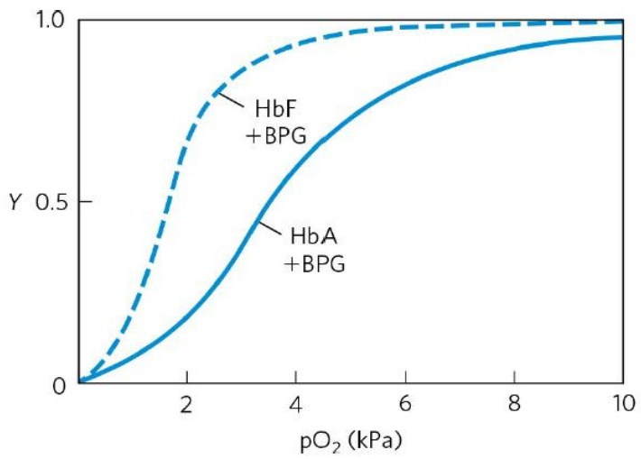

# 上海科技大学 2024 年攻读硕士学位研究生

# 招生考试试题

科目代码:338

科目名称:生物化学

## 考生须知:

1. 本试卷满分为 150 分，全部考试时间总计 180 分钟。
2. 所有答案必须写在答题纸上，写在试题纸上或草稿纸上一律无效。

## 一、名词解释（每小题5分，共15分）

1. 氢键（解释时请列举能形成该相互作用的原子类型,并指明共有几个原子参与氢键形成）
2. DNA 拓扑异构酶
3. 光合作用

## 二、单选题（每小题 1.5 分，共 30 分）

1. 以下哪种氨基酸是芳香族氨基酸（）

A. 亮氨酸
B. 精氨酸
C. 苯丙氨酸
D. 半胱氨酸

2. 以下哪种不属于生物分子间非共价相互作用？（）

A. 范德华力
B. 盐桥
C. 配位键
D. 二硫键

3. 以下哪种不属于蛋白质二级结构（）

A. 无规卷曲
B.  $\beta$  转角
C.  $\beta$  折叠

D. 三股螺旋（triple helix）

4. 以下哪种关于马达蛋白（motor protein）的描述是错误的（）

A. 肌球蛋白是有纤维状的尾和球状的头组成的棒状分子

B. F-肌动蛋白是一种单体，由它聚合成纤维状的 G-肌动蛋白
C. 肌球蛋白沿肌动蛋白细丝划行，最终引起肌肉收缩
D. 肌球蛋白和肌动蛋白之间的相互作用会受到神经系统释放的钙信号调控

5. 以下哪种关于糖类的描述是错误的（）

A. 糖蛋白中的糖链部分可以被凝集素识别
B. 蔗糖与乳糖是常见的二糖
C. 淀粉是动物细胞中主要的贮能多糖
D. 脂多糖是革兰氏阴性菌细胞壁的特有结构成分

6. 以下哪个关于蛋白质翻译的描述是错误的（）

A. 丙氨酸是所有蛋白质合成中的起始氨基酸
B. 氨酰-tRNA 合成酶帮助使得氨基酸结合到特定 tRNA 上
C. 翻译的不同阶段需要多种特异性的蛋白质因子的参与
D. 许多抗生素与毒素可以抑制蛋白质翻译

7. 对于下面的酶催化反应，为什么米氏方程中不包含 $k_{2}$ 项？（）

$$
\mathrm{E} + \mathrm{S} \xrightarrow [ k _ {- 1} ]{k _ {1}} \mathrm{ES} \xrightarrow {k _ {2}} \mathrm{E} + \mathrm{P}
$$

A. 为了简化数学计算
B. 米氏方程只适用于起始反应速率
C.  $k_{2}$  包含在  $K_{m}$  里
D. 米氏方程只描述 ES 复合物的生成

8. 关于多次跨膜蛋白，以下哪项陈述是正确的？（）

A. 疏水相互作用将它们锚定在膜内
B. 蛋白质和膜脂的脂肪酰基链之间发生离子间的相互作用
C. 这些膜蛋白可以通过高离子强度的溶液来溶解
D. 这些蛋白一定是在细胞表面

9. 糖原水解的主要产物是:（）

A. 葡萄糖-6-磷酸
B. 葡萄糖-4-磷酸
C. 葡萄糖-2-磷酸
D. 葡萄糖-1-磷酸

10. 线粒体中, 将 1 分子丙酮酸完全氧化转化为 3 分子 $\mathrm{CO}_{2}$, 产生 NADH:

$FADH_{2}$ : \_\_\_\_ GTP。 （）

A. 2: 2: 2
B. 3:1:1
C. 3:2:1

D. 4:1:1

11. 关于胆固醇的合成，以下哪种说法不正确:（）

A. HMG-CoA 还原酶催化 HMG-CoA 还原为甲羟戊酸是关键限速步骤
B. Acetyl-CoA 是胆固醇 27 个碳原子的来源
C. 细胞内的高胆固醇水平会抑制胆固醇的合成
D. 胆固醇的合成在线粒体基质中进行

12. 椰子油只含有极少量的不饱和脂肪酸，但为什么其熔点低呢？（）

A. 椰子油含有大量长链脂肪酸
B. 椰子油含有大量短链脂肪酸
C. 椰子油含有大量含支链的脂肪酸
D. 椰子油含有大量甘油三酯

13. 蛋白质的翻译后共价修饰可能会改变酶活性，以下哪一项不被视为共价修饰？（）

A. 磷酸化修饰
B. 泛素化修饰
C. 乙酰化修饰
D. 镁离子的结合

14. 氰化物中毒时呼吸链中受抑制的部位存在于:（）

A. NADH→FMN
B. FMN→CoQ
C. CoQ→细胞色素 C
D. 细胞色素氧化酶→ $O_{2}$

15. 在乳糖操纵子的调控中，当葡萄糖和乳糖同时存在时，CAP/CRP 蛋白的状态是 \_\_\_\_。（）

A. 结合 cAMP
B. 不结合 cAMP
C. 结合 RNA 聚合酶
D. 降解乳糖

16. 着色性干皮病（Xeroderma pigmentosum, XP）是一种遗传性疾病。患者对紫外线特别敏感，对紫外线诱发形成的嘧啶二聚体不能进行切除、修复，故暴露于阳光下的体表部位，在儿童期即很易诱发癌变。XP 患者通常有哪个缺陷？（）

A. BER（碱基切除修复）
B. NER（核苷酸切割修复）
C. MMR（错配修复）
D. NHEJ（非同源末端连接）

17. 端粒酶（telomerase）的主要功能是\_\_\_\_。（）

A. 加速端粒缩短
B. 保护端粒免受损伤
C. 刺激端粒分裂
D. 阻止端粒合成

18. 在 CRISPR-Cas9 系统中，Cas9 是\_\_\_\_。 （）

A. 一种 RNA 序列
B. 一种来源于真核生物的蛋白质
C. 一种 DNA 链
D. 一种酶

19. 参与原核细胞 DNA 复制的酶类包括: (1) DNA 聚合酶III; (2) DNA 聚合酶I; (3) 解旋酶 (DNA helicase); (4) 引物酶 (primase); (5) DNA 连接酶 (ligase)。其作用顺序是\_\_\_\_。 ( )

A. （4）、（3）、（1）、（2）、（5）
B. (3)、(2)、(4)、(1)、(5)
C. (4)、(2)、(1)、(5)、(3)
D. (4)、(2)、(1)、(3)、(5)
E. (3)、(4)、(1)、(2)、(5)

20. 下列关于 $\sigma$ 因子的叙述哪一项是正确的？（）

A. 是 RNA 聚合酶的亚基，起辨认转录起始点的作用
B. 是 DNA 聚合酶的亚基，容许按  $5' \rightarrow 3'$  和  $3' \rightarrow 5'$  双向合成
C. 是 50S 核蛋白体亚基，催化肽链生成
D. 是 30S 核蛋白体亚基, 促进 mRNA 与之结合

## 三、判断题，正确的题请在答题纸上填写“√”，错误的题请填写“×”（每小题 1.5 分，共 30 分）

1. 信号肽通常在被转运多肽链的 C 端。（）

2. 合成后多肽的糖基化主要发生在内质网与高尔基体。（）

3. 蛋白质二级结构主要依靠离子键来维系。（）

4. 蛋白质变性时其内部的共价键遭到破坏，引起天然构象解体。（）

5. 许多内在膜蛋白质和分泌蛋白质都是糖蛋白。（）

6. 蛋白质处于等电点时溶解度最大。（）

7. ω-氧化主要在线粒体中进行来降解含有支链的脂肪酸。（）

8. 在哺乳动物中，尿素的氮原子之一的前体是天冬氨酸。（）

9. 细胞膜的成膜脂质主要是磷脂。（）

10. 一个 GTP 分子水解的自由能大致等于一个 ATP 分子水解的自由能。（）

11. 线粒体的内膜两侧的质子梯度驱动了电子传递链的运行。（）

12. 哺乳动物、鸟类和鱼类都通过在肝脏合成尿素排出体内的含氮代谢物。（）

13. 与多肽激素不同，类固醇激素更可能在细胞质或细胞核中具有相关受体。（）
14. 在酶的竞争性抑制中，抑制剂与酶的底物具有不同的酶结合位点。（）
15. miRNA 可以通过促进靶基因的转录来增强基因表达。（）
16. DNA 的二级结构受到离子浓度的影响, 高浓度的镁离子有助于稳定 DNA 的结构。( )
17. 逆转录酶催化 RNA 指导的 DNA 合成不需要引物。（）
18. 在高等物种的胚胎早期发育阶段，基因组中转座子通常处于抑制状态，它们不会对宿主细胞的发育造成影响。（）
19. 增强子可以通过直接编码蛋白质来实现对基因的调控。（）
20. DNA 复制时，形成磷酸二酯键所需的能量来自 ATP 水解。（）

## 四、简答题（每题5分，共30分）

1. 蛋白质按照外形和溶解度可分为哪三类？请选取其中两类，分别举出该类别下的一种具体的蛋白质名称。
2. 什么是蛋白质三级结构？请列出两种维系三级结构的作用力。
3. 乳酸化修饰（lactylation）是 2019 年发现的一种新型翻译后修饰类型。研究发现，代谢过程中积累的乳酸可以作为前体物质导致组蛋白赖氨酸发生乳酸化修饰。体外培养的某一种细胞中，组蛋白的乳酸化修饰显著增强，请问该细胞可能发生了哪些代谢通路的改变，及何种改变（上调或者下调）？
4. 从以下几个方面比较脂肪酸降解和合成的异同:（1）反应场所；（2）酰基载体；（3）还原剂和氧化剂
5. 在原核生物如大肠杆菌（E. coli）中，许多编码参与氨基酸生物合成的酶的操纵子（operon）通常以编码一段先导肽（leader peptide）开头。该肽没有已知的酶功能，但是却富含在操纵子中编码的酶所合成的氨基酸。请问这个先导肽的作用是什么？
6. 简述同源重组修复(Homologous Recombination, HR)和非同源重组修复（Non-Homologous End Joining, NHEJ）的差别。

## 五、问答题（每题15分，共45分）

1. 如图 1 所示，怀孕母体中胎儿血流和母体血流里的血红蛋白对氧分子结合曲线的测量结果存在显著差别。已知胎儿红细胞表达的血红蛋白 HbF 由两个  $\alpha$  亚基和两个  $\gamma$  亚基组成，而成人红细胞中血红蛋白 HbA 由两个  $\alpha$  亚基和两个  $\beta$  亚基组成。

(1) 你认为哪种血红蛋白（HbF 或 HbA）对氧分子的亲和力更高？请根据图 1 分别估计 HbF 和 HbA 对氧分子结合的平衡解离常数，以 $\mathrm{pO}_{2}$ 表示。（5 分）
(2) HbF 与 HbA 表现出显著不同的氧分子亲和力, 其生物学意义是什么? (2 分)
(3) 当把 HbF 和 HbA 样本中的代谢物 BPG 去除, 研究者发现二者的氧结合曲线均不同程度往左移。这说明 BPG 去除相对于 BPG 存在的条件, 两种血红蛋白的氧亲和力增强还是减弱? 请解释为何 BPG 浓度的改变会影响血红蛋白与氧的结合。(3 分)
(4) 参与波尔效应的两种物质, 其在生物体中的浓度变化也会类似于 BPG 影响血红蛋白对氧分子的结合。请指出这是哪两种物质, 并从血红蛋白分子内相互作用的角度来解释这两种物质产生别构效应的分子基础。(5 分)

line

| pO2 (kPa) | HbF + BPG (Y) | HbA + BPG (Y) |
| --- | --- | --- |
| 0 | 0 | 0 |
| 2 | ~0.75 | ~0.25 |
| 4 | ~0.95 | ~0.65 |
| 6 | ~0.98 | ~0.85 |
| 8 | ~0.99 | ~0.92 |
| 10 | ~1.0 | ~0.95 |

图 1

2. 你有一个糖尿病模型小鼠，但你不知道这只小鼠的哪些基因/蛋白受到影响。为了发现相关基因/蛋白，你计划将胰岛素注射到小鼠体内:

(1) 注射后, 你发现血液中物质 X 的浓度大大降低。物质 X 的转运蛋白具有 12 个跨膜螺旋, N 和 C 末端都位于细胞质一侧。请问物质 X 是什么? 以及它的转运蛋白是什么? 转运方式有什么特征 (主动运输/被动运输)? (3 分)
(2) 在第一次实验后, 你忘记向小鼠注射额外的胰岛素。你发现小鼠肝脏中产生了物质 Y, 并且小鼠有独特的气味。物质 Y 的生产途径始于细胞器 Z 中的乙酰辅酶 A。请问细胞器 Z 是什么? 物质 Y 是什么? 阐明 Y 的具体产生途径。(8 分)
(3) 经过仔细的研究, 你发现胰岛素基因发生了突变, 导致成熟的胰岛素无法产生。请猜测这种突变如何影响胰岛素的产生? (4 分)

3. 比较和对比真核生物和原核生物中 mRNA 转录的控制方式。（15 分）