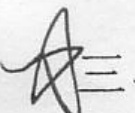
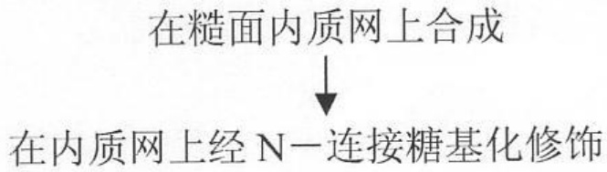
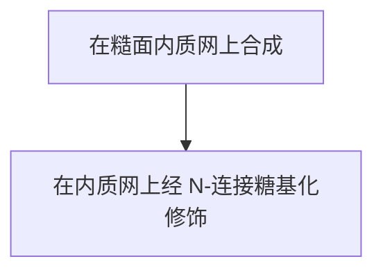
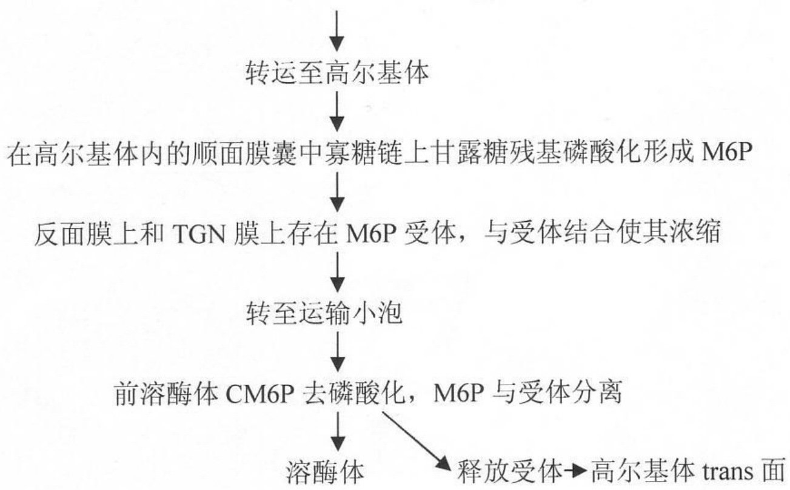
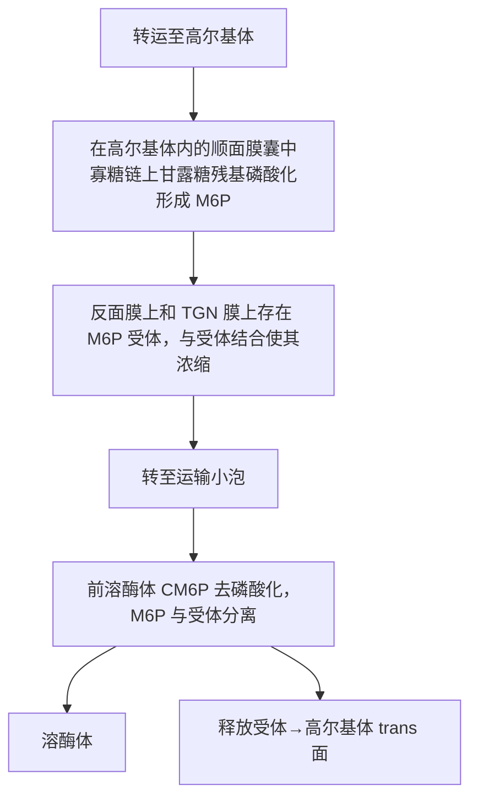

## 试题名称:细胞生物学

## 一、名词解释（每小题4分，共40分）

(简要说明其性质及其在细胞中的作用或机理, 一般不超过 100 字)

1、单位膜（unit membrane）
2、5.8S rRNA
3、非循环式光合磷酸化（noncyclic photophosphorylation）
4、结合素蛋白（adaptin）
5、转基因植物（transgenic plant）
6、紫杉醇 (Taxol)。能促进微管装配，并使已形成以微管稳定
7、泛素化途径 (ubiquitination pathway)
8、中间体 (midbody)在分裂沟下方,除肌动蛋白设一还有微宫,小腺泡迅速聚集,共同形成一段茎层
9、募集结构域 (caspase recruitment domain) caspase 2.9 含有募集结构域，这种结构域
0、蛋白质分选(protein sorting)

## 二、填空题（每小题3分，共15分）

1、现在已知，亲核蛋白的核输入及RNA分子等的核输出主要是通过\_\_\_\_运输完成的，此过程是由\_\_\_\_和\_\_\_\_介导的、需要消耗\_\_\_\_能量、具有高度的\_\_\_\_、并具有\_\_\_\_性。

2、用 $^{3}\text{H}$ 嘧啶核苷标记证明, mtDNA 复制时间主要在细胞周期的 \_\_\_\_ 期, DNA \_\_\_\_ 随后 \_\_\_\_ 。
3、研究结果已表明细胞骨架中间纤维蛋白来源于同一基因家族，具有高度的\_\_\_\_，同型的中间纤维蛋白基因具有几乎一致的\_\_\_\_的结构，中间纤维蛋白的表达和分布具有严格的\_\_\_\_。
4、受体酪氨酸激酶（receptor tyrosine kinases）是细胞表面一大类重要受体家族，它的胞外配体是\_\_\_\_，其自磷酸化的结果是\_\_\_\_的活性，磷酸化的酪氨酸残基可被含有\_\_\_\_所识别并与之结合，由此启动信号转导。
5、染色体 DNA 的三种关键功能元件（functional elements）是 \_\_\_\_ 、 \_\_\_\_ 和 \_\_\_\_ 、它们的功能分别是 \_\_\_\_

和

P404

P331
P406
P375
P460
P191

、选择题 （每小题4分，共20分，圈出你所认为是正确的陈述）

1、乳类的细胞周期一般分为 G1，S，G2，M 四个时期，在 G1 期:

a. DNA 开始合成。
b. 存在一个检验点(check point)，过了这一点，细胞必须完成分裂。
c. 一般来说，G1期在细胞分裂的4个时相中历时最短。
d. 在 G1 期细胞含大量合成各种大分子，例如:DNA，糖类，蛋白质以及脂类等。
e. 以上答案都不对。

2、癌细胞的基本特征是:

a. 细胞分裂速度增快。√

b. 失去了运动和分裂的接触抑制(contact inhibition)，所以不能在琼脂中形成克隆。

c. 肿瘤抑制基因表达增高。

d. 具有侵润性和扩散性。√

e. 以上答案都不对

3、核纤层蛋白（lamin）是:P41，P351

a. 一个具多成员的蛋白家族。

b 核纤层蛋白表达并不具有组织特异性。

c.核纤层蛋白具激酶活性，可以直接磷酸MPF (metaphase promoting factor)。

d. 核纤层蛋白参于细胞凋亡过程。

e. 以上答案都不对

4、对于干细胞:

a. 动物胚胎干细胞具有全能性(totipotency)。
b. 动物多能造血干细胞也具有全能性。
c 在动物细胞发育过程中，细胞核的分化全能性会逐步减弱变窄。
d. 从多莉羊试验看出，动物体细胞可以独立分化诱导成一个完整的新个体。
e. 以上答案都不对

5、绿色荧光蛋白 GFP(Green Fluorescent Protein)基因与目的基因融合后，转入细胞后可以:

a. 检测融合蛋白质在细胞中的准确定位。

b. 检测目的基因所编码的蛋白在细胞中的含量。

c. 检测目的基因所编码的蛋白在细胞中的分子结构。

d. 检测融合蛋白质在细胞中的表达量。

e. 以上答案都不对。

## 四、问答题（共75分）

1、通过列举实验检测例据，说明一般公认的线粒体呼吸链的几个组分在其内膜上排列顺序的依据及其它们的具体排列顺序；并进一步说明呼吸链各组分的物质组成及其作用。(20分)

2、试述溶酶体酶在细胞中的合成、糖基化加工和修饰（M6P）及其被分选转运的过程与相关的作用机理。（20分）

3、详细讨论线粒体与细胞凋亡的关系。(15分)

4、真核细胞的基因表达可以在不同层次上进行调控，详述可以在哪些层次上进行调控，如何调控？并针对每个层次的调控，说明用什么实验手段可以阻止这一调控。（20分）

# 中国科学院 & 中国科学技术大学

# 2004 年硕士学位研究生入学考试试题参考答案

## 试题名称:细胞生物学

## 一名词解释（答案要点）

1. 单位膜是生物膜研究模型之一，1959年J。D。Robertson提出。认为生物膜结构是由蛋白质----脂质----蛋白质的三明治的形式构成。
2.5.8SrRNA 是真核细胞的 80S 核糖体 60S 大亚基的核酸成分之一, 含 160 碱基, 在 80S 核糖体的构成及其与 r 蛋白质相互作用完成蛋白质的合成功能中发挥作用。
3.PSII 接受红光后, 激发态 P680 从水中光解得到电子, 传递给 NADP, 电子传递经过两个光系统, 在传递过程中产生的 H 梯度驱动 ATP 的形成, 电子传递是一个开放通道。
4.结合素蛋白能结合网格蛋白和识别跨膜受体胞质面的尾部肽信号，通过网格蛋白有被小泡介导跨膜受体及其结合配体的选择性运输。
5. 是细胞工程技术之一。包括:具有重要应用价值的目的基因和载体的构建、导入植物细胞（原生质体）、转化细胞克隆培养、再生转基因植株，各层次的转化检测。

## 二、填空题

1、核孔复合体的主动 信号识别和载体，ATP 选择性 双向
2、S G2 先复制 线粒体分裂。

3 同源性 内含子/外显子 组织特异性。

4 可溶性或膜结合的多肽或蛋白类激酶（生长因子等），激活了受体的酪氨酸蛋白激酶的活性，含有SH2结构域的胞内信号蛋白

5 复制起点，着丝粒 端粒 保染色体在细胞周期中自我复制和世代连续性；使复制的染色体平均分配到子细胞中；保持染色体的独立性和稳定性。

## 三、选择题

答案均在<细胞生物学>(翟中和 王喜忠 丁明孝主编)(面向21世纪课程教材)中

1.p331
2.p404
3.p375
4.p460
5.p191

## 四、问答题（答案要点及参考资料）

1. 通过测定呼吸链各组分的的氧化还原电位值确定其排列顺序。为:复合物 I、II、III、IV。具体组成及其作用详见高教出版社的“细胞生物学” P213-214。
2.溶酶体酶是在 rER 处合成的。其作用机制由信号假说解释。糖基化加工是在 rER 和 G 处进行的，属于 N 连接寡糖链，通过信号班介导 M6P 的磷酸化修饰及受体介导的膜泡运输，并与胞内体融合至溶酶体内。（详见高教出版社的“细胞生物学” P186--187）
3. 答案在<细胞生物学>(翟中和 王喜忠 丁明孝主编)(面向21世纪课程教材)中 p459-p466
4、答案在<细胞生物学>(翟中和 王喜忠 丁明孝主编)(面向21世纪课程教材)中 p428-p441

6. 紫杉醇: 是在微管结构和功能研究中, 一种微管特异性药物 (工具药物), 紫杉醇能促进微管装配, 并使已形成的微管稳定。教材中用紫杉酚 (taxol)。

7. 泛素化途径:是蛋白质降解的一种途径，在 ATP 供能情况下，泛素与非特异性泛素激活酶共价结合，形成 E1-泛素复合体，E1-泛素复合体在将泛素转移给泛素结合酶 E2，E2 在特异的泛素蛋白连接酶 E3 的作用下，将泛素直接转移到蛋白质的赖氨酸残基上，之后另外一些泛素分子相继于前一个泛素分子的赖氨酸残基结合，逐渐形成一条多聚泛素链。泛素化的蛋白质被蛋白酶体复合物逐步降解。

8. 中间体: 在分裂沟的下方, 由肌动蛋白, 微管, 小膜泡等物质聚集, 共同构成一个环形致密层, 称为中间体。中间体将一直持续到两个子代细胞完全分离。在胞质分裂开始时, 肌动蛋白和肌球蛋白在中间体处装配成微丝, 并相互形成微丝束, 环绕细胞。

9. 募集结构域: caspase2, 9 含有与凋亡起始者死亡效应子结构域不同但很类似的结构域,这种结构域被称为 caspase 募集结构域, 它是募集 caspase2, 8, 10 所必须的, 从而活化凋亡的起始。caspase 以无活性的酶原形式存在, caspase 募集结构域是引起凋亡起始者 (caspase2,8,10) 活化的结构域, 这种活化方式称为同性活化。

10. 蛋白质分选: 是蛋白质的定向转运过程。大部分的蛋白质在细胞基质中的核糖体中合成,然后转运至细胞的特定部位,并装配成结构与功能的复合体。广义上讲,这一过程还包括蛋白质从合成至降解的整个过程。

选择题:

1. e
2. acd
3. a
4. c
5. abd

问答题:

1 题:

复合物 1: 是 NADH-CoQ 还原酶, 又称 NADH 脱氢酶, 由 25 条以上的多肽链组成, 以二聚体形式存在。每个单体含有一个黄素单核苷酸 (FMN) 和至少 6 个铁硫蛋白。

作用:催化 NADH 的 2 个电子传给辅酶 Q，同时发生质子的跨膜输送。既是电子传递体又是质子移位体。

复合物 II: 琥珀酸—CoQ 还原酶由 4 条多肽链组成, 含有黄素腺嘌呤二核苷酸 FAD, 2 个铁硫蛋白和一个细胞色素 B.

作用:催化电子从琥珀酸通过 FAD 和铁硫蛋白传给辅酶 Q。它不能使质子跨膜移位。

复合物 III: CoQ—细胞色素 C 还原酶, 由 10 条多肽链组成以二聚体形式存在, 含有 2 个细胞色素 B, 一个细胞色素 C1 和一个铁硫蛋白。

作用:催化电子从辅酶 Q 传给细胞色素 C，同时发生质子的跨膜输送

复合物 IV: 细胞色素氧化酶, 由 6-13 条多肽链组成, 以二聚体形式存在, 每个单体含有细胞色素 a 和 $a_3$ 及两个铜原子。

作用:催化电子从细胞色素 C 传给氧，同时发生质子的跨膜输送。

2 题:

过程:

flowchart

flowchart

机制:信号假说

3 题:

对于信号传导引起的凋亡，可分为线粒体依赖和非线粒体依赖两种情况。在此讨论线粒体依赖引起的细胞凋亡。

在这个过程中需要细胞色素 C 从线粒体中转移至胞质溶腔中。在正常健康细胞中, 细胞色素 C 位于线粒体内外膜间。细胞色素 C 释放到胞质中, 细胞色素 C 与 Apaf1 结合, 使 Caspase 9 活化, 引起一系列级联反应, 导致细胞凋亡。

细胞色素 C 由线粒体中转移至胞质中，与线粒体膜上 Bcl-2 蛋白家族有着重要的关系，Bcl-2 家族蛋白在决定细胞的存在与死亡具有关键作用。这个家族的一些蛋白是抗凋亡蛋白（Bcl-2），而另外一些是助凋亡蛋白（Bax），它们可以形成同形体，异形体不同复合物。他们在细胞膜上的状态，决定凋亡的激活或是抑制，高水平的 Bax 导致 Bax 同形体形成，这种结构允许离子注入线粒体，导致细胞色素 C 进入胞质，引起凋亡。相反，Bal-2/Bax 复合物阻止细胞色素 C 进入胞质，抑制凋亡。其他一些化合物例如 Bad，可以通过阻止 Bcl-2/Bax 复合物的形成，而允许 Bax/Bax 复合物形成，促进细胞色素 C 进入胞质引起凋亡。

题 4:

真核细胞基因表达的调控是多级调控系统，主要发生在三个彼此相对独立的水平上:

转录水平的调控，决定某个基因是否会被转录，并决定转录的频率。真核细胞在特定时间通过差别基因转录选择性地合成蛋白质，转录水平的调控包括转录的激活和转录的阻抑，既与顺式调控元件有关，又与反式作用因子有关；

加工水平的调控, 决定初始 mRNA 转录物 (hn RNA) 被加工为能翻译成多肽的信使 RNA (mRNA) 的途径, 选择性剪接是一种广泛存在的 RNA 加工机制, 通过这种方式, 一个基因编码两个或多个相关的蛋白质, 产生蛋白质多样性, 这是在 RNA 加工水平上调节基因表达的重要方式;

翻译水平的调控，决定某种 mRNA 是否会真正得到翻译，如果能得到翻译，还决定翻译的频率和时间的长短。翻译水平的调控机制，一般都是通过细胞质中特异的 mRNA 和多种蛋白质之间的相互作用来实现的。涉及到 mRNA 的蛋白质定位，mRNA 翻译的调控和 mRNA 稳定性的调控等。