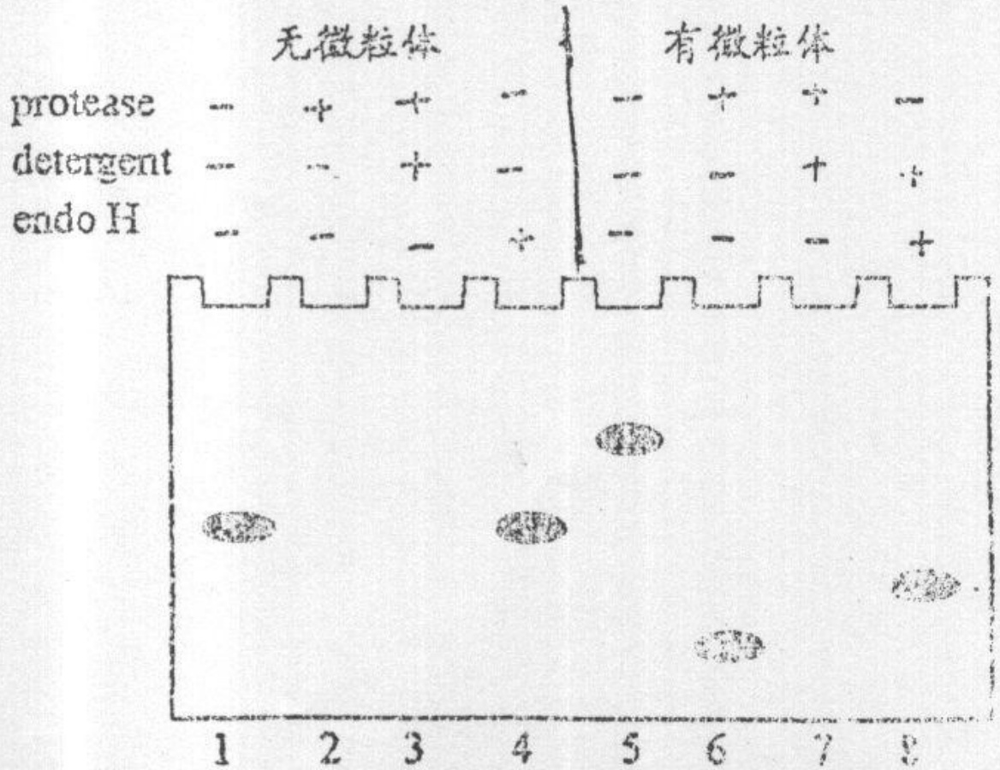

考试科目:细胞生物学

适用专业:植物学、动物学、生物化学与分子生物学、生态系统。
研究方向:以上各专业方向

## 一. 名词解释(每小题3分，共45分):

1. 支原体(mycoplast);
2.胞外基质(extracellular matrix);
3.脂质体(liposome);
4. 膜骨架(membrane associated cytoskeleton);
5.间隙连接(gap junction);
6.胞内体(endosome);
7.蛋白水解酶复合体(proteasome);
8.端粒酶(telomerase)
9. 微管组织中心(MTOC);
10.成熟促进因子(M-phase-promoting factor, MPF);
11.癌基因(oncogene);
12.细胞全能性(cell totipotency);
13.兼性异染色质(facultative heterochromatin);
14.  $Na^{+}-K^{+}$ 泵( $Na^{+}-K^{+}$ pump);
15.内囊体(thylakoid).类

## 二 简答题(每小题5分，共20分):

1. 细胞可通过哪些方式限制质膜蛋白的二维流动性？
2.人基因组 DNA(3×10$^{6}$bp)全部包装成核小体结构，需要核心组蛋白各多少个分子？细胞通过何种进化机制满足如此多的蛋白分子的快速合成？

3. 如果细胞内某种蛋白质分子其 N-端含有一段 ER 信号序列，中间含有一段核定位信号序列(NLS)，请问该蛋白的转运命运如何，为什么？
4.动物细胞和植物细胞具有不同机制实现对营养物的摄取，请予以简要说明。

## 三. 论述题(第1题必做，第2、3题任选一题回答，共25分):

1. 试述真核细胞内蛋白质的合成、修饰与分选途径。(15 分)
2.试述细胞信号传递通路中有哪两种分子开关蛋白的作用机制。(10分)
3.试述细胞增殖与细胞凋亡(apoptosis)在发育中的相互关系。(10分)

## 四. 实验分析题(10 分):

来源于 rER 的微粒体(nMicrosome)可用于体外研究蛋白质的合成与跨膜转移。已知:蛋白酶(protease)不能降解在微粒体内的蛋白质；去垢剂(detergent)能够破坏脂双层(lipid bilayer)；内糖苷酶 H(endo-glycosidase H, 简称 endo H)能够去除在 ER 内形成的 N-连接寡糖。

在有和没有微粒体的非细胞体系中(cell-free system)，将 mRNA 翻译成蛋白质，然后分别对非细胞体系作如下四种处理:(1) 只加入 Protease；(2) 加入 Protease and detergent；(3) 加入 Detergent and endo H；(4) 不加入这三种物质。之后对该蛋白质进行 SDS-聚丙烯酰胺凝胶电泳，结果如图所示:

text_image

无微粒体
protease - + + - - + + - -
detergent - + + - - - + +
endo H - - - - + - - - - +
有微粒体
1 2 3 4 5 6 7 8
1 2 3 4 5 6 7 8

注 “+” 和 “-” 分别代表蛋白质合成后，向非细胞体系加入或不加入该物

试问:A. 简要解释泳道 1\~4 的结果。
B.有微粒体时，该蛋白是完全进入微粒体还是成为微粒体跨膜蛋白？
C.为何泳道8的蛋白质迁移率比泳道5大?
D.根据哪两条蛋白质电泳带比较，可以说明该蛋白质有一段氨基酸(如信号序列)被微粒体内的酶水解？