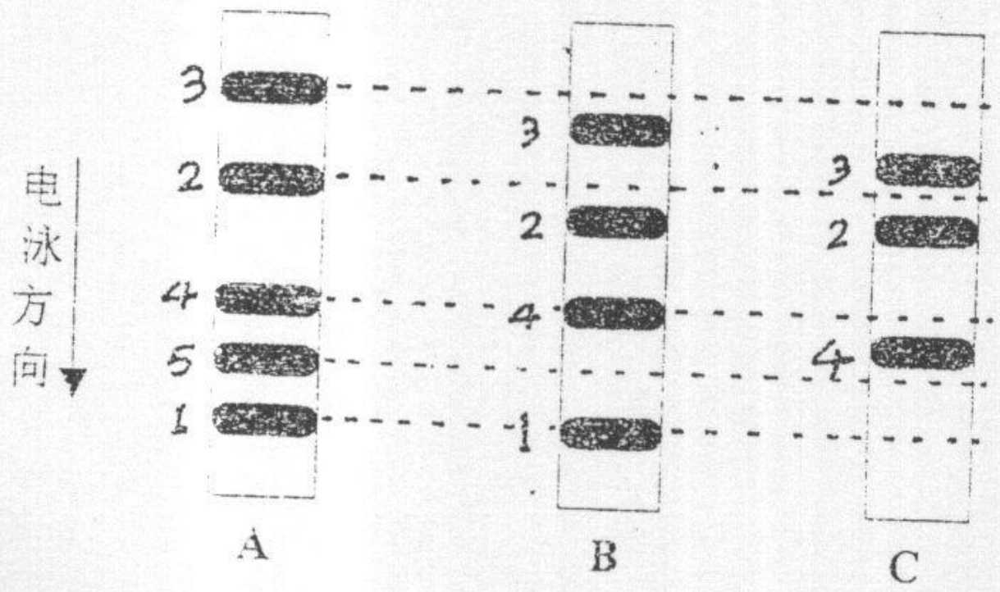

## 2002年攻读硕士学位研究生入学考试试题

考试科目:细胞生物学

科目代号:437#

适用专业:植物学、动物学、生态学、生物化学与分子生物学

(试题共5页)

(答案必须写在试卷上，写在试题上不给分)

一、Give the significance (not the definition) of the following terms or phrases.
Say what they do or why they are important. (10 points; Answer these questions in Chinese or English)

1. stem cell;
2. cell cycle checkpoints;
3. receptor-mediated endocytosis;
4. $\mathrm{Na}^{-}-\mathrm{K}^{+}$ ATPase;
5. molecular chaperones.

二、填空题(每空1分，共15分)

1. 胶原(collagen)是一种分泌蛋白, 其合成通路和其它分泌蛋白类似,先在( )切除信号肽, 然后在( )装配形成三股螺旋的前胶原分子(procollagen), 同时在( )被糖基化等加工修饰, 最后在( )形成成熟的胶原分子(collagen molecule), 之后装配成胶原。胶原能够赋予组织( )能力。

2. 动物细胞靠（）维持渗透压平衡，植物细胞靠（）维持渗透压平衡，淡水原生生物细胞靠（）维持渗透压平衡。

3. 细胞分化的实质是()。

4. 蛋白质进入细胞器主要有三种方式，即（）、（）和（）。

5. 蛋白二硫键异构酶存在于内质网中，其一级序列（）保证该酶滞留在内质网中。
6. 染色体末端的（）在细胞衰老过程中，随着 DNA 复制而逐渐（）。

## 三、选择题(每小题2分，共20分)

1. 一些 kinesin(驱动蛋白)相关性蛋白, 如 CHO1/MKLP1 能使反向排列的微管滑动。若这些蛋白质对有丝分裂有帮助, 那么其在有丝分裂的哪个时期发挥作用:

①前期；

②中期；

③后期；

④末期.

2.下列哪种缺陷能导致生物大分子储积在溶酶体内:

①吞噬缺陷；②溶酶体膜H$^{+}$-泵缺陷；③核酸酶缺陷；④自噬缺陷。

3.两个细胞融合以后，其质膜蛋白混合为下列那种说法提供了证据:

①质膜蛋白自旋运动；

②流体镶嵌模型；

③生物膜的脂双层结构；

④两种不同细胞质膜蛋白相互作用.

4.如果丧失紧密连接，位于上皮细胞游离面和基底面的质膜蛋白将:

①保持各自分布区域不变；

②混合:

③分布区域更加明显；

④降解.

5. 正常 RB 基因翻译形成的 RB 蛋白功能是:

①抑制转录；

②活化转录；

③抑制翻译；④活化复制.

6.下列哪种细胞桥粒(desmosomes)含量最丰富:

①平滑肌细胞；②血红细胞；③皮肤上皮细胞；④神经细胞.

7.为了研究消化道上皮细胞分泌消化酶的活动，哪种方法最合适:

① 细胞分级分离技术；

②匀浆技术；

③放射自显影技术；

④扫描电镜技术.

8. 比较高尔基体顺面管网结构(CGN)与反面管网结构(TGN)内的蛋白质, 将发现:

①二者相同: ②CGN内的蛋白质糖基化，TGN内蛋白质没有；
③CGN 内的蛋白质没有糖基化，而 TGN 内蛋白质被糖基化；
④CGN 和 TGN 内的蛋白质都被糖基化等加工修饰.

9.哪种分子不能以分子开关的形式在细胞信号传递过程中传递信号:

①Ras 蛋白； ②G-蛋白； ③蛋白激酶； ④cAMP.

10.下列哪种分子能够调节血压:

①cAMP; ②NO: ③CO; ④PKC.

## 四、实验分析题(共30分)

1. 下面是有关细胞骨架蛋白最近几年的研究进展。请根据每个实验的发现得出相应的结论:(每小题3分，共12分)

(1)有些鱼色素上皮细胞的小泡(small vesicles)内含有色素分子，这些色素小泡能够根据环境中某些化学物质的刺激而聚集或者分散于细胞中，从而改变鱼的体表颜色。当色素小泡被诱导聚集以后，再向该上皮细胞中加入化学物质 Nocodazole，发现这些小泡不能再分散；

(2)当动物细胞用秋水酰素处理以后, 微管解聚并在中心体周围消失。如果去掉秋水酰素, 微管又能够从其消失的地方逐渐生长出现;

(3)当把心肌细胞的肌动蛋白(actin)基因导入正常情况下只合成骨骼肌
肌动蛋白的培养细胞以后,外源基因表达的肌动蛋白能够和培养细胞
自身的肌动蛋白分子结合形成具有正常形态和功能的肌动蛋白纤维:

(4) $Y$-管蛋白($Y$-tubulin)和 pericentrin 蛋白组织在一起, 形成一个特殊的结构。从 $G_2$ 时期的蛙卵细胞抽提物中发现含有这种结构, 能够在体外诱导管蛋白聚合成微管, 免疫染色发现, 这种结构含有 pericentrin 蛋白。

2. 根据对真核细胞周期调控的了解，解释下面的实验观察结果:(共8分)

(1)正常的细胞周期运转需要经过 $G_{2}$ 期才会发生染色体凝缩和核膜破裂。当MPF注射到刚好经历S期的细胞后，细胞立即发生染色体凝缩和核膜破裂事件:(4分)
(2)当异常的、不能降解的 M-cyclin 导入细胞后, 细胞能够进入有丝分裂,但不能退出有丝分裂而重新进入 $G_{1}$ 期; (2 分)
(3)通过突变使催化蛋白质去磷酸化的磷酸酶失活以后, 结果核膜重建大大推迟。(2分)

3. 根据下面的实验过程和实验结果，确定这五种蛋白质在细胞膜上的分布情况:(共10分)

(1)将完整细胞的膜蛋白抽提进行 SDS-PAGE 电泳，结果如图 A;
(2) 将完整细胞置于胰蛋白酶溶液中消化，然后抽提膜蛋白进行 SDS-PAGE，结果如图 B;
(3)用低渗液处理细胞(细胞未破, 但胰蛋白酶能进入细胞中), 再用胰蛋白酶消化, 然后抽提膜蛋白进行 SDS-PAGE, 结果如图 C.

text_image

电泳方向
3
2
4
5
1
A
B
3
2
4
1
C
3
2
4

## 五、问答题（共25分）

1. 何谓细胞内的蛋白质分选(protein sorting)? 细胞内蛋白质分选的生物学意义是什么? (6 分)

2. 假设利用重组 DNA 技术将一个新基因导入动物细胞，这个基因编码一种分泌蛋白的 X 亚基。已知该分泌蛋白由两个不同的多肽亚基 X、Y 组成，如果细胞内没有编码 Y 亚基的基因，请问当多肽 X 翻译以后会出现什么情况。(6 分)

3.为什么说核糖体的生物发生是一个向量过程?(6分)

4. 简述细胞凋亡的特征及分子调控机制。(7分)