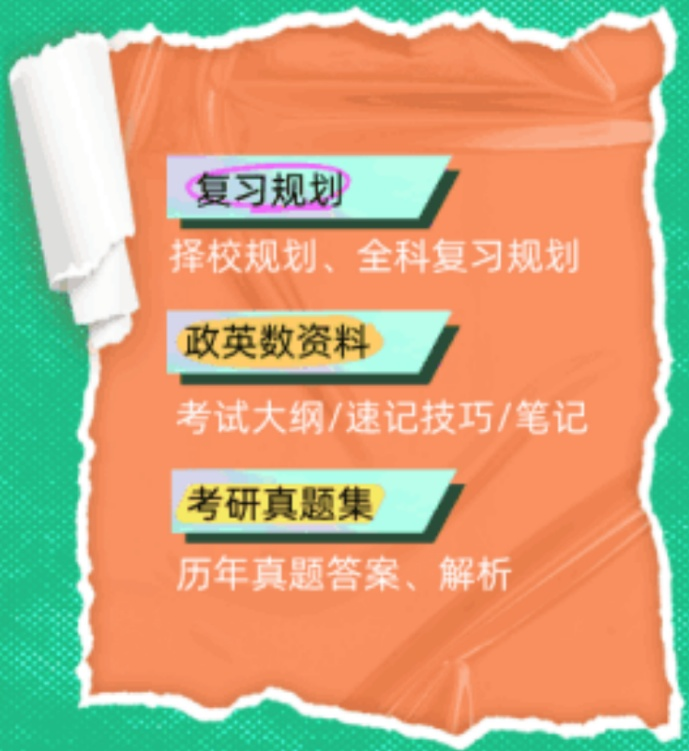
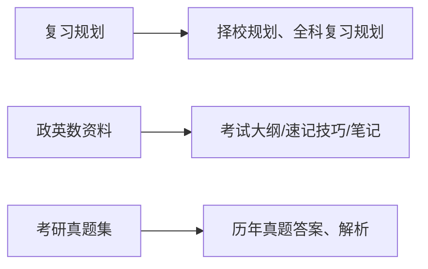

【择校】Ai智能择校 | 考研招简合集 | 历年分数线 | 报录比查询 | 计算机择校 | 法硕择校

【统考】历年真题合集 | 长难句备考 | 阅读精刷材料 | 考研新大纲 | 暑假复习必看 | 备考资料包

【热门】 计算机资料 | 计算机资料 | 法硕资料 | MBA | 推免生 | 保研攻略

【工具】 考研院校查询 | 英语能力测评 | 管综能力测评 | 政治能力测评 | 时政刷题 | 复试小程序

2026考研政治已经考完了，大家对今年的考研政治难度感觉怎么样呢？新东方考研老师们在制作《新东方版-2026考研政治真题及答案(文字版)》，希望能帮助到您。

## 《新东方版-2026考研政治真题及答案（文字版）》

考后第一时间获取，对答案，预估分，听解析

#

text_image

26考研
真题&答案解析详解
点击免费领取

【考后估分 抢先准备】

text_image

26考研
考后估分黄金12h
抢先备复试
✓方便
✓精准

《新东方版-2026考研政治真题及答案（文字版）》

## 1、【单项选择题】

[题干]

“十五五”时期在基本实现社会主义现代化进程中具有承前启后的重要地位，习近平总书记在《关于<中共中央关于制定国民经济和社会发展第十五个五年规划的建议>的说明》中指出，实现社会主义现代化是一个阶梯式递进、不断发展进步的历史过程，需要不懈努力、接续奋斗。“阶梯式递进、不断发展进步”的过程是一个

①前进性和曲折性相统一的过程
②规律性和能动性相统一的过程
③连续性和非连续性相统一的过程
④直线性和循环性相统一的过程

[选项]A.①②③

B.①②④

C.①③④

D.②③④

【答案】A

## 2、【单项选择题】

[题干]

一般认为，在重力的作用下，当树叶飘移枝头坠落地面时，密度大的叶片正面更容易朝下着地。科学研究表明，叶片的下落过程并非简单的直线下落，因为叶片形状并非完全对称，加之空气阻力差异、涡流和风等因素影响，叶片以翻滚和旋转的复杂运动形态下落。内部结构差异与外在形态变化，在一定程度上影响着叶落的飘落状态，旋转动能和空气阻力也是影响叶片在下降过程中朝向的因素。叶片下落过程表明，事物运动的规律

[选项]A.取决于外在因素作用的大小

B. 是纯粹偶然因素作用的结果
C. 取决于物质运动形态的结果
D. 是各种因素相互作用的结果

[答案]D

## 3、【单项选择题】

[题干]

孙子兵法将变化视为军事运行常态，认为“兵无常势，水无常形”，要将战争的主动权始终掌握在自己手中，根据不同的情况灵活应对，由此可知，“兵无常势，水无常形”，契合了

[选项]A.“原则是研究的出发点”的观点
B.“理性是衡量一切的唯一尺度”的观点
C.“意志自由只是借助于对事物的认识来做出决定”的观点
D.“思维的本质在于把意识的因素联合为一个统一体”的观点

[答案]C

## 4、【单项选择题】

[题干]

列宁在谈到对未来社会时写道:“我们可以绝对有把握地说，剥夺资本家一定会使人类社会的生产力蓬勃发展。但是，生产力将以什么样的速度向前发展，将以什么样的速度发展到打破分工、消灭脑力劳动和体力劳动的对立、把劳动变为生活的第一需要’，这都是我们所不知道而且也不可能知道的。”列宁的表述中可以看出，未来社会必然会发生的是

[选项]A.生产力发展的具体方式

B.生产力将有更大发展
C. 劳动成为生活的唯一需要
D. 实现人的无差别的全面发展

[答案]B

## 5、【单项选择题】

[题干]

毛泽东在谈到中国革命经验时指出，“党的领导机关，包括全国性的、省的和县的负责同志，也要亲自调查一两个农村，解剖一两只‘麻雀’，这就叫做‘解剖学’。”毛泽东在此强调，“解剖麻雀“的实际意义在于

[选项]A.理论只有彻底，才能说服人

B. 反对经验主义、尾巴主义和机会主义

C. 没有革命的理论，就不会有革命的实践

D. 全面深入了解本国实际，发现本国革命的规律

[答案]D

## 6、【单项选择题】

[题干]

1987年3月25日，邓小平在审阅《关于草拟十三大报告大纲的设想》时，对《设想》提出十三大报告全篇拟以社会主义初级阶段作为立论的根据作出批示:“这个设计好。”《设想》的设计思路好就好在，它首次

[选项]A.系统阐明了社会主义和共产主义的关系

B. 提出我们的社会主义制度还是处在社会主义初级阶段

C. 明确了社会主义初级阶段是制定路线方针政策的出发点和根本依据

D.明确了发展生产力是社会主义现代化的根本任务

[答案]C

## 7、【单项选择题】

[题干]

中国特色社会主义制度中具有统领地位的是

[选项]A.民族区域自治制度

B. 党的领导制度

C. 社会主义基本经济制度

D.全过程人民民主制度

[答案]B

## 8、【单项选择题】

[题干]

建立大安全大应急框架，完善公共安全体系，推动公共安全治理模式

[选项]A.从分散接管到单一接管的转变

B.从政府监管到市场监管的转变

C. 从事后监管到事前干预的转变

D.从危机疏导到危机干预的转变

[答案]C

## 9、【单项选择题】

[题干]

绿色发展是中国式现代化的鲜明底色。环保是企业的“加分项”,而今却是生存发展的“及格线”,无处堆放的工业废物，如今许多已成为可以生财的宝贝。消费的思维也发生了潜移默化的转变:外卖选择无需餐具，出行采用共享单车，买家电选一级能效……这些看得见摸得着的变化充分说明，生态环境问题系统解决的治本之策是

[选项]A.国土空间开发布局优化

B.经济发展方式和生活方式转变

C. 生态文明制度体系的完善
D. 山水林田湖草沙一体化的保护和系统治理

[答案]B

## 10、【单项选择题】

[题干]

1840年，英国发动鸦片战争，清政府最终以失败告终。此后，列强通过一系列不平等条约在中国攫取了大量特权，中国社会发生了重大转折。最主要的表现是

[选项]A.中国出现资本主义因素

B.中国社会性质发生变化
C. 地主阶级退出历史舞台
D. 清政府集团出现分化

[答案]B

## 11、【单项选择题】

[题干]

毛泽东在《中国共产党在民族战争中的地位》一文中指出:“遵义会议纠正了王明‘左’倾教条主义的严重错误，团结了中国共产党和红军，使党中央、红军胜利完成长征，转到抗日的前线阵地，执行了抗日民族统一战线的政策方针。”遵义会议实现了生死攸关的伟大转折，表现在

[选项]A.制定了抗日民族统一战线政策

B.确立了马克思主义建党建军原则
C. 开辟了农村包围城市，武装夺取政权的新道路
D. 开启了中国共产党独立自主解决中国革命实际问题的新阶段

[答案]D

## 12、【单项选择题】

[题干]

1948年秋，中国人民解放军先后发动三大战役即辽沈战役，淮海战役，平津战役。三大战役历时四个多月，取得决定性胜利，这表明

[选项]A.国民党主要军事力量基本上被摧毁

B.中国革命重心已经从农村转向城市
C.延续22年之久的反动统治已经覆灭
D.人民解放军立刻转入全国性反攻的形势已经成熟

[答案]A

## 13、【单项选择题】

[题干]

1992年邓小平南方谈话和十四大召开后，我国现代化建设事业进入从计划经济体制向社会主义市场经济体制转变的新阶段。这一新阶段，建立社会主义市场经济体制的中心环节是

[选项]A.价格体制改革

B. 财政制度改革
C. 国有企业改革
D. 流通体制改革

[答案]C

## 14、【单项选择题】

[题干]

习近平强调:“我为什么要对青年讲社会核心价值观的问题？是因为青年的价值观取向决定未来整个社会价值取向，而青年又处在价值观形成和确立的时期，抓好这一时期十分重要。这就像穿衣服扣扣子一样，如果第一粒扣子扣错了，剩余的扣子都会扣错。人生的扣子从一开始就要扣好。”从“人生的第一颗扣子就要扣好”强调

[选项]A.核心价值观是青年成长中的关键

B. 对青年的价值观教育需抓早抓实
C.青年健康成长需要价值观引领
D. 核心价值观教育是青年的立身之本

[答案]B

## 15、【单项选择题】

[题干]

2025年10月24日，十四届全国人大常委会第八次会议经表决通过了关于设立台湾光复纪念日的决定，下列与台湾光复纪念日相关的历史事件是1945年10月25日

[选项]A.中国战区台湾省受降仪式在台北举行

B. 中、美、英等国发表《开罗宣言》和《波茨坦公告》

C. 日本无条件投降仪式在密苏里号战舰上举行

D. 日本天皇发布终战诏书

[答案]A

## 16、【单项选择题】

[题干]

2025年6月16日，联合国大会表决一项决议，宣布每年12月4日为“反对单边强制措施国际日”，其目的在于

[选项]A.敦促各国不采取、不颁布、不实行任何单边经济、金融或贸易措施

B.促进国际社会联合起来反对美发动的单边关税战

C.彻底消除国际关系中的单边主义现象

D.重新确立指导国家间和平关系的规范和原则

[答案]A

text_image

新东方在线

## 别浪费时间找资料了 考研上岸 必备资料

## 免费领取

flowchart

## 【政治真题】资料这里有↑↑↑

上一篇:新东方版-2026考研政治真题答案（完整版）

下一篇:新东方版-2026考研政治真题及答案（完整版）

一、凡本网注明“稿件来源:新东方在线”的内容，版权均属北京新东方迅程网络科技股份有限公司所有，未经授权不得转载、链接、转贴或以其他方式复制发表。获授权使用者须注明来源，违者将依法追责。
二、本网未注明上述来源的转载内容，旨在传递更多信息，并不代表赞同其观点或证实其真实性。使用方须保留本网注明的来源，并自负法律责任。擅自篡改来源将依法追责。
三、若内容涉及版权等问题，请联系weisen@xdf.cn处理。